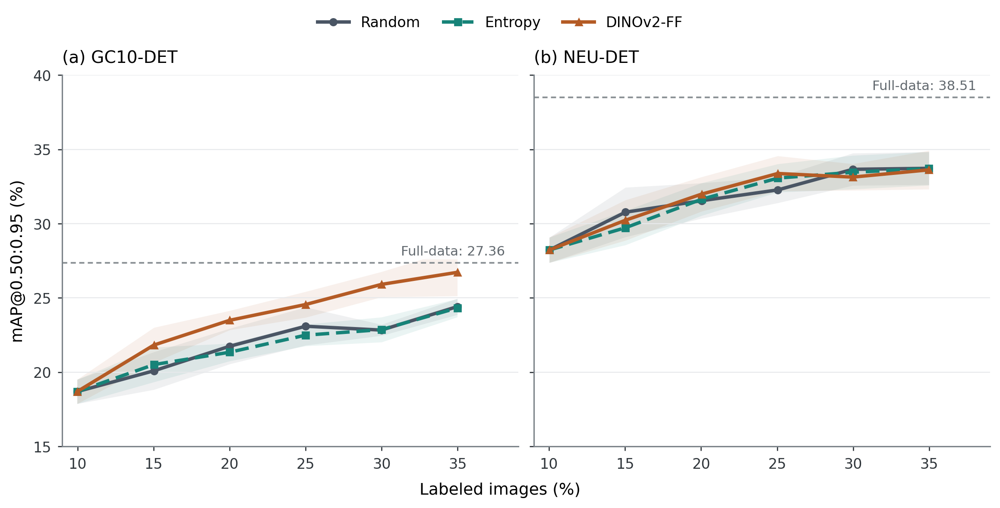
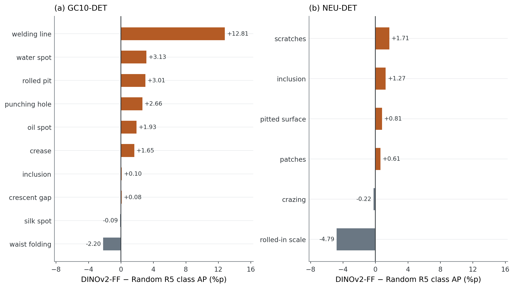
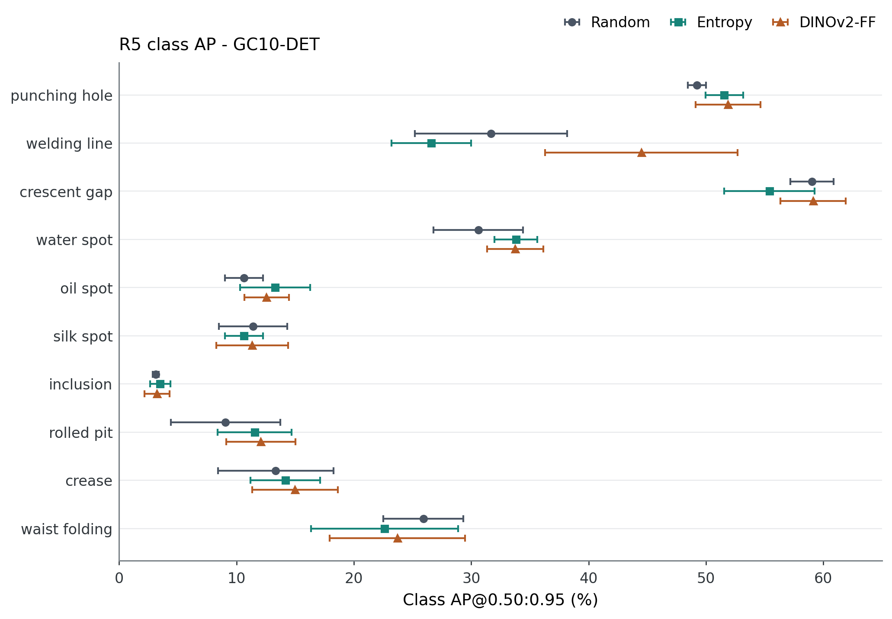
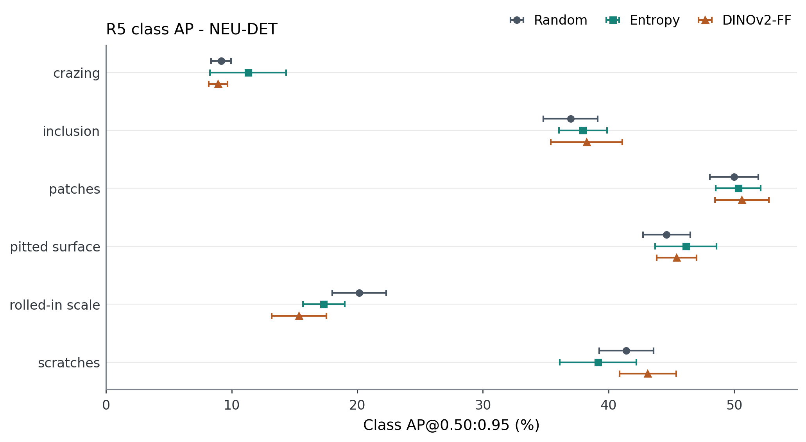

# 소량 라벨 환경의 금속 표면 결함 객체 탐지: clean split v2

**2026-09-22 · 최종 본실험 162/162 완료 · development 결과 · TEST NOT RELEASED**

라벨을 붙일 이미지가 제한되어 있을 때, 고정 DINOv2 특징으로 다양한 이미지를 선택하면 탐지 성능이 좋아지는가? GC10-DET와 NEU-DET에서 Random, DINOv2 특징 기반 farthest-first, detection-score Entropy를 동일한 YOLOv8n 학습 조건으로 비교했다. 이 브랜치는 clean split v2의 완료된 **개발셋 탐색 결과**와 논문용 그림을 공유한다. 사전 정의된 1차 평가 대상은 이후 별도로 공개·평가할 **test nAULC**이며, 여기에는 test 성능이 없다.

> GC10 development에서 DINOv2-FF의 곡선 평균 성능 이점이 반복적으로 관찰되었지만, NEU에서는 일관된 우위가 관찰되지 않았다. 클래스별 차이도 균일하지 않았다. 현재 결과는 통계적으로 유의한 우월성을 지지하지 않는다.

이전 original split·과거 n=10 결과는 아래 숫자에 포함하지 않았다. 이전 연구 설명은 [이전 README 보관본](docs/history/README_before_clean_split_v2_20260922.md)에 남겼다. 과거 연구 브랜치의 코드와 결과를 이번 실험의 동일 실행환경으로 간주하지 않는다.

## 빠르게 읽기

- **전체 성능:** 아래 그림 1과 nAULC 표.
- **클래스별 차이:** 그림 2와 펼칠 수 있는 전체 클래스 표.
- **숫자의 출처:** [seed별 원자료와 run ID](results/clean_split_v2_development_20260922/02_tables/RAW_SEED_METRICS.csv), [실제 봉인 metric JSON](results/clean_split_v2_development_20260922/08_source_evidence/runs).
- **검증과 해석:** [사전 점검](results/clean_split_v2_development_20260922/00_preflight/00_FINAL_ANALYSIS_PREFLIGHT.md), [통계 방법·결과](results/clean_split_v2_development_20260922/05_statistics/06_STATISTICAL_TESTS.md), [논문에서 가능한 주장](results/clean_split_v2_development_20260922/06_interpretation/09_ALLOWED_AND_DISALLOWED_CLAIMS.md).
- **그림 파일·캡션:** [개정 그림·캡션·디자인 비교](results/clean_split_v2_development_20260922/03_figures_main/redesign_v2/REDESIGN_COMPARISON.md).

## 1. 실험 설계

| 항목 | GC10-DET | NEU-DET |
|---|---:|---:|
| Canonical images | 2,291 | 1,798 |
| Train acquisition pool | 1,604 | 1,258 |
| Development | 343 | 270 |
| Withheld test | 344 | 270 |
| Classes | 10 | 6 |
| R0–R5 cumulative images | 160 / 241 / 321 / 401 / 481 / 561 | 126 / 189 / 252 / 315 / 377 / 440 |
| Acquisition seeds | 5 | 5 |
| Full-data reference | 1 run | 1 run |

Acquisition seeds는 `2026091901–2026091905`, learner seed는 `2026091900`으로 고정했다. 반복 단위는 acquisition seed이며, round나 개별 이미지를 독립 반복으로 세지 않는다. R0는 데이터셋·seed별로 세 방법이 공유한다. 총 162개 물리 모델은 **shared R0 10 + Random 50 + DINOv2-FF 50 + Entropy 50 + Full-data 2**다. 163번째 회수 checkpoint는 본실험이 아닌 NEU 기술 점검용이다.

| 방법 | 선택 원리 | 참고 |
|---|---|---|
| Random | 미선택 이미지에서 균등 비복원 추출 | 기준 방법 |
| DINOv2-FF | 고정 DINOv2-small 특징의 greedy farthest-first | 기존 run ID의 `DINO_F518`과 동일한 방법 |
| Entropy | post-NMS box의 정규화 class-score entropy를 이미지 안에서 평균 | `ENTROPY_NCS_MEAN_V2`, detection이 없으면 0 |
| Full-data | train acquisition pool 전체로 학습 | 데이터셋별 1회 참고값 |

DINOv2-FF는 full-frame 비율 유지 resize·padding의 **F518** 입력을 사용하며 crop을 하지 않는다. L2 정규화된 384차원 특징의 cosine distance에 기반한다. GT class나 class quota를 선택기에 넣지 않는다. F518은 특징 추출 입력 설정이며 detector의 640 입력과 구별한다. Entropy의 정규화 점수는 native softmax posterior가 아니고 모든 형태의 탐지 불확실성을 대표하지 않는다.

YOLOv8n은 모든 scientific cell에서 동일한 공개 pretrained weights로 cold start한다. 주요 통제 조건은 100 epochs, batch 8, image size 640, SGD, 고정 learner seed다. Training-time development fitness로 best checkpoint를 고르고, **봉인 evaluator의 `sealed_dev_metrics.json`**을 최종 개발셋 지표로 사용했다. 학습 중 best fitness와 봉인 평가값을 혼합하지 않았다. 전체 세부값은 [고정 protocol](results/clean_split_v2_development_20260922/08_source_evidence/config/protocol.json) 및 [설계 문서](results/clean_split_v2_development_20260922/08_source_evidence/reference/FINAL_MAIN_EXPERIMENT_PROTOCOL_v2_0_KO.md)에 있다. 설계 snapshot의 `DESIGN_ONLY`/`PENDING` 문구는 작성 당시 상태이며, 실제 완료 여부는 [최종 실행 gate](results/clean_split_v2_development_20260922/08_source_evidence/final_integrity.json)와 사전 점검 기록을 따른다.

## 2. 전체 능동학습 성능곡선



**그림 1.** 실제 train acquisition pool 대비 누적 라벨 이미지 비율과 development mAP@0.50:0.95. 선은 5 acquisition seed 평균, 음영은 표본 SD다. Full-data 점선은 데이터셋별 1회 참고값이다. 공통 y축은 15–40%이며 0에서 시작하지 않는다. 음영은 유의성 표시가 아니다. DINOv2-FF는 F518 특징 입력을 사용한다.

[PDF](results/clean_split_v2_development_20260922/03_figures_main/redesign_v2/MAIN_FIGURE_1_AL_CURVES_COMMON_15_40.pdf) · [SVG](results/clean_split_v2_development_20260922/03_figures_main/redesign_v2/MAIN_FIGURE_1_AL_CURVES_COMMON_15_40.svg) · [데이터셋별 축 대안](results/clean_split_v2_development_20260922/03_figures_main/redesign_v2/AL_CURVES_ALTERNATIVE_DATA_RANGE.png). 본문에는 공통 축을 권장한다. 기존 0–50% 그림도 패키지에 보존했다.

## 3. 전체 곡선 요약: nAULC

값은 평균 ± 표본 SD이며, nAULC는 % 단위, 차이는 %p 단위다.

| Dataset | Random (%) | DINOv2-FF (%) | Entropy (%) | Δ DINOv2-FF − Random (%p) |
|---|---:|---:|---:|---:|
| GC10-DET | 21.85 ± 0.44 | 23.69 ± 0.33 | 21.73 ± 0.41 | +1.83 |
| NEU-DET | 31.84 ± 0.81 | 31.92 ± 0.54 | 31.76 ± 0.75 | +0.09 |

GC10의 DINOv2-FF − Random paired nAULC 차이는 **+1.832%p**이고 5개 seed 모두 양수다. NEU는 **+0.086%p**이며 3개 양수·2개 음수였다. GC10에서는 R1–R5의 모든 예산에서 DINOv2-FF의 평균이 Random·Entropy보다 높았다. NEU에서는 방법 간 평균 차이가 작고 예산별 방향이 바뀌었다.

평균·SD·95% CI·중앙값·최소/최대는 [nAULC 상세표](results/clean_split_v2_development_20260922/02_tables/03_FINAL_NAULC_RESULTS.csv), 개별 30개 값은 [seed별 nAULC](results/clean_split_v2_development_20260922/02_tables/RAW_SEED_NAULC.csv)에 있다. 본문에는 이 표를 권장하며, [연결선 없는 point-range 대안](results/clean_split_v2_development_20260922/03_figures_main/redesign_v2/NAULC_POINT_RANGE_ALTERNATIVE.png)은 분포를 보여주는 부록 후보이다.

## 4. 마지막 예산(R5)과 Full-data

| Dataset | Random (%) | DINOv2-FF (%) | Entropy (%) | Full-data: 1 run (%) |
|---|---:|---:|---:|---:|
| GC10-DET | 24.41 ± 0.54 | 26.72 ± 1.60 | 24.32 ± 0.61 | 27.36 |
| NEU-DET | 33.72 ± 1.11 | 33.62 ± 1.30 | 33.71 ± 1.13 | 38.51 |

R5는 GC10 561/1,604장(34.9751%), NEU 440/1,258장(34.9762%)이다. GC10에서 DINOv2-FF의 R5 평균과 Full-data 참고값 사이의 절대 차이는 **0.65%p**다. NEU의 같은 차이는 **4.89%p**다. Full-data는 n=1이므로 동등성이나 통계적 비교를 주장하지 않는다. 이 예산은 이미지 수이며 실제 annotation 시간·인건비 절감률이 아니다.

<details>
<summary>R0–R5 전체 평균±SD와 실제 이미지 비율 보기</summary>

단위는 mAP@0.50:0.95 (%)이며, 세 방법의 R0는 같은 모델을 참조한다.

### GC10-DET

| Round | Images | Actual labeled images (%) | Random | DINOv2-FF | Entropy |
|---|---:|---:|---:|---:|---:|
| R0 | 160 | 9.9751 | 18.69 ± 0.82 | 18.69 ± 0.82 | 18.69 ± 0.82 |
| R1 | 241 | 15.0249 | 20.09 ± 1.27 | 21.82 ± 1.18 | 20.51 ± 1.17 |
| R2 | 321 | 20.0125 | 21.74 ± 1.20 | 23.49 ± 0.65 | 21.34 ± 0.59 |
| R3 | 401 | 25.0000 | 23.09 ± 1.28 | 24.55 ± 0.87 | 22.49 ± 0.73 |
| R4 | 481 | 29.9875 | 22.83 ± 0.37 | 25.91 ± 0.85 | 22.86 ± 0.84 |
| R5 | 561 | 34.9751 | 24.41 ± 0.54 | 26.72 ± 1.60 | 24.32 ± 0.61 |

### NEU-DET

| Round | Images | Actual labeled images (%) | Random | DINOv2-FF | Entropy |
|---|---:|---:|---:|---:|---:|
| R0 | 126 | 10.0159 | 28.22 ± 0.85 | 28.22 ± 0.85 | 28.22 ± 0.85 |
| R1 | 189 | 15.0238 | 30.77 ± 1.67 | 30.23 ± 1.36 | 29.72 ± 1.16 |
| R2 | 252 | 20.0318 | 31.54 ± 1.19 | 31.98 ± 1.16 | 31.64 ± 1.10 |
| R3 | 315 | 25.0397 | 32.27 ± 0.87 | 33.37 ± 1.18 | 33.06 ± 0.95 |
| R4 | 377 | 29.9682 | 33.65 ± 1.09 | 33.13 ± 0.89 | 33.45 ± 1.14 |
| R5 | 440 | 34.9762 | 33.72 ± 1.11 | 33.62 ± 1.30 | 33.71 ± 1.13 |

</details>

## 5. 통계적 해석

$$\mathrm{nAULC}=\frac{\sum_{r=1}^5 (n_r-n_{r-1})(AP_r+AP_{r-1})/2}{n_5-n_0}$$

실제 누적 이미지 수로 사다리꼴 면적을 구하고 예산 span으로 나눈다. Full-data AP로 나누지 않는다. AP를 0–1로 계산한 뒤 표시 단계에서 100배 한다.

| Dataset | Contrast | Δ nAULC (%p) | Wins/losses | Bootstrap 95% interval (%p) | Exact two-sided p | Holm p |
|---|---|---:|---:|---:|---:|---:|
| GC10-DET | DINOv2-FF - Random | +1.832 | 5/0 | [+1.480, +2.214] | 0.0625 | 0.25 |
| GC10-DET | DINOv2-FF - Entropy | +1.952 | 5/0 | [+1.721, +2.223] | 0.0625 | 0.25 |
| GC10-DET | Entropy - Random (secondary) | -0.120 | 2/3 | [-0.398, +0.093] | 0.5625 | — |
| NEU-DET | DINOv2-FF - Random | +0.086 | 3/2 | [-0.314, +0.486] | 0.7500 | 1.00 |
| NEU-DET | DINOv2-FF - Entropy | +0.159 | 4/1 | [-0.349, +0.561] | 0.5625 | 1.00 |
| NEU-DET | Entropy - Random (secondary) | -0.073 | 2/3 | [-0.517, +0.345] | 0.7500 | — |

사전 분석계획의 주요 대비는 두 데이터셋 각각 DINO−Random과 DINO−Entropy이며, 네 대비에 **하나의 Holm 보정**을 적용했다. Entropy−Random은 보조 비교다. 동일 seed의 차이를 대상으로 32개 부호 조합을 전부 확인한 양측 exact sign-flip을 썼다. n=5에서 가능한 최소 raw p는 **0.0625**이므로, GC10의 일관된 방향에도 불구하고 p<0.05의 유의성을 주장할 수 없다. 작은 표본의 paired bootstrap 구간이 0을 포함하지 않아도 이 결론을 바꾸지 않는다. 비유의는 동등성의 증거도 아니다.

이 통계는 **development에 대한 탐색적 적용**이다. 사전 정의된 confirmatory primary는 아직 평가하지 않은 test다. 데이터셋을 합쳐 n=10으로 검정하지 않았다. 방법과 bootstrap seed는 [통계 보고서](results/clean_split_v2_development_20260922/05_statistics/06_STATISTICAL_TESTS.md)에 기록했다.

## 6. 모든 클래스에서 같은 효과인가?



**그림 2.** R5의 DINOv2-FF − Random development class AP@0.50:0.95 평균 차이(%p). 전체 GC10 10개, NEU 6개 클래스를 표시했다. 0선의 오른쪽은 양수, 왼쪽은 음수이며 유의성 표시는 아니다. GC10 `welding_line` +12.81%p와 `waist_folding` −2.20%p, NEU `rolled-in_scale` −4.79%p를 함께 보여준다.

[PDF](results/clean_split_v2_development_20260922/03_figures_main/redesign_v2/MAIN_FIGURE_2_R5_CLASS_DELTA.pdf) · [SVG](results/clean_split_v2_development_20260922/03_figures_main/redesign_v2/MAIN_FIGURE_2_R5_CLASS_DELTA.svg) · [클래스별 전체 수치](results/clean_split_v2_development_20260922/02_tables/05_CLASSWISE_RESULTS.csv) · [seed별 paired class 차이](results/clean_split_v2_development_20260922/02_tables/R5_PAIRED_CLASS_DIFFERENCES.csv).

<details>
<summary>전체 클래스의 R5 절대 AP 평균±SD 보기</summary>

### GC10-DET

| Class | Random | DINOv2-FF | Entropy | Δ DINOv2-FF − Random (%p) |
|---|---:|---:|---:|---:|
| `punching_hole` | 49.23 ± 0.77 | 51.88 ± 2.77 | 51.57 ± 1.62 | +2.66 |
| `welding_line` | 31.69 ± 6.49 | 44.50 ± 8.20 | 26.59 ± 3.39 | +12.81 |
| `crescent_gap` | 59.04 ± 1.85 | 59.13 ± 2.78 | 55.41 ± 3.86 | +0.08 |
| `water_spot` | 30.62 ± 3.81 | 33.75 ± 2.41 | 33.81 ± 1.83 | +3.13 |
| `oil_spot` | 10.64 ± 1.63 | 12.56 ± 1.90 | 13.30 ± 2.98 | +1.93 |
| `silk_spot` | 11.42 ± 2.91 | 11.34 ± 3.05 | 10.65 ± 1.62 | -0.09 |
| `inclusion` | 3.13 ± 0.25 | 3.23 ± 1.08 | 3.51 ± 0.85 | +0.10 |
| `rolled_pit` | 9.07 ± 4.66 | 12.08 ± 2.95 | 11.55 ± 3.15 | +3.01 |
| `crease` | 13.35 ± 4.93 | 15.00 ± 3.65 | 14.17 ± 2.96 | +1.65 |
| `waist_folding` | 25.92 ± 3.41 | 23.72 ± 5.77 | 22.62 ± 6.28 | -2.20 |

### NEU-DET

| Class | Random | DINOv2-FF | Entropy | Δ DINOv2-FF − Random (%p) |
|---|---:|---:|---:|---:|
| `crazing` | 9.16 ± 0.79 | 8.93 ± 0.75 | 11.31 ± 3.03 | -0.22 |
| `inclusion` | 36.98 ± 2.16 | 38.25 ± 2.84 | 37.96 ± 1.91 | +1.27 |
| `patches` | 50.00 ± 1.93 | 50.61 ± 2.14 | 50.32 ± 1.80 | +0.61 |
| `pitted_surface` | 44.61 ± 1.88 | 45.42 ± 1.59 | 46.15 ± 2.44 | +0.81 |
| `rolled-in_scale` | 20.16 ± 2.15 | 15.36 ± 2.19 | 17.34 ± 1.67 | -4.79 |
| `scratches` | 41.42 ± 2.16 | 43.13 ± 2.26 | 39.17 ± 3.05 | +1.71 |





두 부록 그림은 x축 0부터 시작하며, 마커는 평균·가로 오차막대는 seed SD다. 모든 그림의 PNG 300 dpi, PDF, SVG가 함께 있다.

</details>

클래스 선택 구성도 보존했다. GC10 R5 `welding_line` 포함 이미지 수의 평균은 Random/DINO/Entropy 각각 122.4/205.4/90.6장, `waist_folding`은 36.4/17.0/12.0장이다. NEU `rolled-in_scale`은 74.4/32.8/76.6장이다. 선택량과 AP 차이의 연관은 관찰 사실이며 인과관계를 입증하지 않는다. [신규·누적 선택 구성](results/clean_split_v2_development_20260922/02_tables/SELECTION_COMPOSITION.csv)와 [R5 선택 구성 요약](results/clean_split_v2_development_20260922/02_tables/SELECTION_COMPOSITION_R5_SUMMARY.csv)에는 이미지 incidence와 bbox incidence를 나눠 기록했다.

## 7. 가능한 결론과 남은 한계

| 현재 증거로 말할 수 있는 것 | 현재 증거로 말할 수 없는 것 |
|---|---|
| GC10 development에서 DINOv2-FF의 평균 곡선 이점이 관찰됐다 | 두 데이터셋에서 통계적으로 유의하게 우월하다 |
| NEU에서는 방법별 평균이 근접하고 순위가 예산별로 달라졌다 | NEU에서 동등성을 입증했다 |
| 클래스별 이득과 손실이 함께 나타났다 | 모든 결함 클래스가 개선됐다 |
| F518 전처리 민감성은 후속 가설이 될 수 있다 | NEU 결과의 원인은 F518이다 |
| 35%는 train pool의 라벨 이미지 수 비율이다 | 라벨링 비용/시간을 65% 절감했다 |
| 현재 결과는 development에 조건부다 | test 일반화 성능 또는 primary 성공을 입증했다 |

반복은 acquisition seed 5개이며 split과 learner seed가 고정돼 있다. Full-data는 1회다. NEU의 F224/F518 동일 조건 ablation은 없다. 후속 test release·평가는 기존 checkpoint와 분석계획을 고정한 별도 단계이고, 이번 공유 작업에서 새 학습·추론·test 접근은 수행하지 않았다. [전체 해석](results/clean_split_v2_development_20260922/06_interpretation/08_FINAL_RESULT_INTERPRETATION.md)

## 8. 자료 무결성과 출처

- 최종 시도: `ANNOTATION_PATCH_v2_0_2`, scientific **162/162 COMPLETE**, final integrity **PASS**.
- 회수한 본실험 best checkpoint **162개**, 비가중치 산출물 **2,156개**의 SHA 일치 확인.
- 이전 부분 export와 겹치는 sealed metric 97개도 동일했다.
- 이 저장소에는 162개 모델의 sealed development metric과 best-selection 기록을 제공한다. checkpoint·원본 이미지·feature cache·논문 원문 PDF는 Git에 재배포하지 않는다.
- `sealed_dev_metrics.json`의 `overall["metrics/mAP50-95(B)"]`가 주 수치 출처다. `best_selection.json` fitness는 학습 중 선택 기록이다.
- 원래 train label tar hardlink를 일부만 읽으면 R0 라벨 286개가 빠지는 문제를 확인해, 선택 구성 분석은 최종 overlay train 라벨 **2,862개**의 SHA를 검증한 뒤 만들었다.

| 로컬 보관 원본 archive | SHA-256 |
|---|---|
| `FINAL_RESULTS_ONLY_20260922.tar.gz` | `b978fd30179ce0136cfac81b59399169de9b64daa889a1dddce8bddd0f06bd18` |
| `FINAL_BEST_WEIGHTS_20260922.tar.gz` | `79b7d9c75973b5bee4e2d37609cef9795dbe1dd535289daa3897b3c67d2ab021` |

위 archive는 이 브랜치에 업로드하지 않았으며 공개 다운로드 링크를 제공하지 않는다. 전체 실행 감사에는 해당 원본이 필요하다. Git에 포함한 공유 파일의 hash는 [SHARE_MANIFEST.csv](results/clean_split_v2_development_20260922/SHARE_MANIFEST.csv)로 확인한다.

## 9. 이 checkout에서 그림 재생성하기

별도 GPU나 원본 이미지 없이, 확정 CSV에서 개정 그림 6종과 nAULC 표만 다시 만든다. 통계 재계산 명령이 아니다.

```bash
python -m venv .venv
# Windows PowerShell: .venv\Scripts\Activate.ps1
# macOS/Linux: source .venv/bin/activate
python -m pip install -r results/clean_split_v2_development_20260922/requirements-figures.txt
python results/clean_split_v2_development_20260922/03_figures_main/redesign_v2/plot_redesign_v2.py
```

테스트한 plotting 환경은 Python 3.14.2, NumPy 2.4.1, Matplotlib 3.10.8, Pillow 12.1.0이다. PDF는 embedded TrueType text, SVG는 text element로 저장한다. 폰트·라이브러리 버전에 따라 출력 파일의 byte hash는 바뀔 수 있지만 입력 CSV는 바뀌지 않는다. 2-panel 그림은 논문 전체 폭 삽입을 권장하며, 1-column 삽입 시 글자가 작아지지 않도록 각 panel을 별도 배치할 수 있다.

`07_reproducibility/`의 원래 분석·preflight 코드는 감사용으로 함께 보존했다. 이 코드는 전체 로컬 evidence/annotation overlay/원본 archive 배치를 요구하므로 위의 그림 재생성 명령과 구별한다. 이 브랜치만으로 전체 162회 학습을 재현했다고 주장하지 않는다.

## 10. 파일 안내

| 위치 | 제공 자료 |
|---|---|
| `results/clean_split_v2_development_20260922/00_preflight/` | 실행·지표·split 점검, 분석계획 |
| `01_literature/` | AL 객체탐지 원문 5편의 축·단위·반복·참조선 근거 |
| `02_tables/` | round/seed/nAULC/class/worst-class/selection 구성 CSV |
| `03_figures_main/redesign_v2/` | 개정 그림 6종 × PNG/PDF/SVG, 본문용 표, 캡션, plotting script |
| `03_figures_main/`, `04_figures_appendix/` | 최초 디자인 원본과 paired 효과 그림 |
| `05_statistics/` | paired 원자료, exact/Bootstrap/Holm 결과, 계산 요약 |
| `06_interpretation/` | 결과 해석 및 가능한/불가능한 주장 |
| `07_reproducibility/` | 원래 계산·감사 코드와 실행 기록 |
| `08_source_evidence/` | scientific run 162개의 봉인 metric·best 선택 기록, protocol, final gate |

## 11. 그림 표기 근거와 관련 문헌

- [Aghdam et al., ICCV 2019](https://openaccess.thecvf.com/content_ICCV_2019/papers/Aghdam_Active_Learning_for_Deep_Detection_Neural_Networks_ICCV_2019_paper.pdf): image-centric labeling budget; Fig. 5 자체의 x축은 FPPI이므로 AP–budget 사례로 오인하지 않았다.
- [Pardo et al., BAOD, CVPRW 2021](https://openaccess.thecvf.com/content/CVPR2021W/LXCV/papers/Pardo_BAOD_Budget-Aware_Object_Detection_CVPRW_2021_paper.pdf): annotation 비용과 탐지 성능. 그 비용 축은 우리 이미지 비율과 동일하지 않다.
- [Lyu et al., CVPR 2023](https://openaccess.thecvf.com/content/CVPR2023/papers/Lyu_Box-Level_Active_Detection_CVPR_2023_paper.pdf): #images/#boxes의 구별, Random과 FullSup 참조.
- [Yang et al., PPAL, CVPR 2024](https://openaccess.thecvf.com/content/CVPR2024/papers/Yang_Plug_and_Play_Active_Learning_for_Object_Detection_CVPR_2024_paper.pdf): Training Data (%)–AP 곡선, Random·Entropy baseline과 예산별 표.
- [Yamani et al., WACV 2024](https://openaccess.thecvf.com/content/WACV2024/papers/Yamani_Active_Learning_for_Single-Stage_Object_Detection_in_UAV_Images_WACV_2024_paper.pdf): 라벨 이미지 수와 객체 수를 구분한 예산 축.

원문 figure/table 번호와 확인 범위는 [문헌 표기 조사](results/clean_split_v2_development_20260922/01_literature/01_LITERATURE_FIGURE_CONVENTIONS.md)에 있다. 이 연구의 공개 artifact는 위 논문 수치를 재현하거나 직접 성능 비교한 벤치마크가 아니다.
