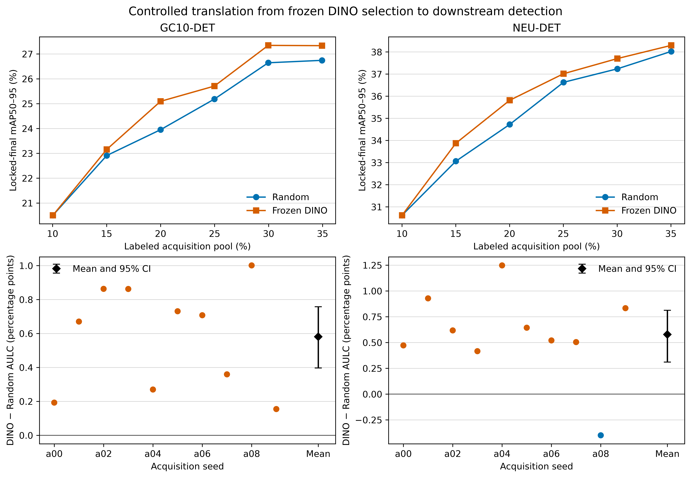

# Industrial Defect Active Learning: Selection Signals and Downstream Learning

This is the canonical collaboration branch for a master's-thesis study of **when a selection-stage signal in industrial defect active learning translates into downstream detector performance**. The repository preserves the path from exploratory vision-language-model (VLM) work to a prospectively frozen, Random-versus-Frozen-DINO controlled validation.

## Start here

A first-time collaborator should read these files in order:

1. [`README.md`](README.md) — the one-page map.
2. [`COLLABORATOR_BRIEF.md`](docs/collaboration/COLLABORATOR_BRIEF.md) — question, history, result, and boundaries.
3. [`DATASETS.md`](DATASETS.md) — exact project use, sources, and redistribution status.
4. [`CONTROLLED_440_PROTOCOL.md`](docs/collaboration/CONTROLLED_440_PROTOCOL.md) — the frozen design and why 440 jobs were required.
5. [`FINAL_RESULT_BRIEF.md`](final_analysis/FINAL_RESULT_BRIEF.md) — the advisor-length result.
6. [`CODE_INDEX.md`](docs/collaboration/CODE_INDEX.md) — which code is canonical, historical, supporting, deprecated, or scratch.
7. [`CLAIM_EVIDENCE_MATRIX.md`](docs/collaboration/CLAIM_EVIDENCE_MATRIX.md) — what the evidence does and does not permit us to say.

For a path-oriented index, use [`THESIS_FILE_INDEX.md`](THESIS_FILE_INDEX.md).

## What this project studies

Active learning chooses which unlabeled images to annotate next. An attractive selected set can look diverse, discover more rare cases, or score well under a VLM without necessarily producing a better detector. This thesis separates five evidence stages:

1. **candidate validity** — does a proposed VLM/representation signal measure what it claims?
2. **discovery** — does selection find unusual or target cases?
3. **composition** — how does the selected labeled set change?
4. **reproducibility** — does the difference persist across independent acquisition seeds and learner repeats?
5. **downstream learning** — does a detector trained on those sets improve across the label-budget curve?

The initial research tried to build a strong VLM-guided selector. Repeated audits showed that promising selection-stage numbers did not reliably beat Random downstream, and that overall and rare-class behavior could disagree. The thesis therefore changed from “invent a universally better selector” to the more defensible question above. The full history is in [`RESEARCH_HISTORY.md`](docs/collaboration/RESEARCH_HISTORY.md).

## Controlled validation

The final confirmatory comparison is deliberately narrow:

- datasets: **GC10-DET** and **NEU-DET**;
- strategies: uniform **Random-PCG64-v1** and GT-blind **FrozenDINO-FF-v1**;
- 10 independent acquisition seeds per dataset;
- 2 nested YOLO learner seeds for each acquisition trajectory;
- 6 cumulative budgets from about 10% to 35% of the fixed acquisition universe;
- cold-start YOLOv8n training for 100 epochs at every budget;
- development-selected `best.pt`, evaluated once on the locked final split;
- primary endpoint: normalized six-budget mAP50-95 area under the learning curve (AULC).

The 440 detector jobs are `40 shared Round0 + 200 Random post-Round0 + 200 DINO post-Round0`. They are **not 440 independent statistical samples**. The primary sampling unit is the acquisition seed (`n=10` per dataset); the two learner seeds are averaged within each acquisition/strategy before the paired contrast.

## Final controlled result

Locked-final evaluation and integrity checks completed at `440/440`, with no missing evaluation, development substitution, retraining, or post-final retuning.

| Dataset | Random AULC | Frozen DINO AULC | paired DINO − Random | 95% acquisition bootstrap CI | positive seeds | Holm p |
|---|---:|---:|---:|---:|---:|---:|
| GC10-DET | 0.244643 | 0.250454 | +0.005812 (+0.581 pp) | [+0.003970, +0.007576] | 10/10 | 0.003906 |
| NEU-DET | 0.351950 | 0.357731 | +0.005782 (+0.578 pp) | [+0.003100, +0.008119] | 9/10 | 0.003906 |

This is a **bounded positive primary result**, not universal DINO superiority. The effect was largest around early/middle budgets and was modest in magnitude. Crucially, NEU worst-class AULC decreased by `−0.014879` (`−1.488 pp`, 0/10 positive), and final worst-class AP decreased by `−3.118 pp`; overall improvement therefore did not establish class-level safety. See [`FINAL_CONTROLLED_ANALYSIS.md`](final_analysis/FINAL_CONTROLLED_ANALYSIS.md).

## Evidence layers

- **Historical evidence** includes VLM consistency/groundedness, discovery/composition studies, detector-aware and hybrid selectors, repeated acquisition audits, and stop/gate decisions on NEU, GC10, MPDD, VisA, KSDD2, and DeepPCB. It explains why the confirmatory question was necessary; it is not pooled with the controlled effect.
- **Controlled evidence** is the frozen Random–DINO protocol above. It answers a dataset- and protocol-bounded downstream question.
- **Raw-result preservation** means the public branch retains acquisition-level and learner-level result tables, not only means. Raw image data and trained weights are not redistributed.

## Repository map

| Location | Role |
|---|---|
| `confirmatory_v1/` | Base prospective split, seed, selector, and protocol freeze. |
| `confirmatory_v1_1/` | Final-evaluation lock, 440 runner, manifest seals, final analysis code, and canonical outputs. |
| `results/thesis_final/` | Small public-facing table and figure package. |
| `final_analysis/` | Human-readable final verdict, integrity statement, and result brief. |
| `docs/collaboration/` | Onboarding, code map, reproducibility, attribution, and claim boundaries. |
| `docs/`, `runs/`, `reports/`, `package/` | Historical evidence and thesis snapshots; consult `CODE_INDEX.md` before treating a file as authoritative. |

## Core code

- split/seed freeze: `confirmatory_v1/src/build_split_and_seed_freeze.py`
- selector definitions and GT-free boundary: `confirmatory_v1/src/confirmatory_v1/protocol_core.py`
- frozen DINO features and farthest-first selection: `confirmatory_v1/src/confirmatory_v1/frozen_dino_ff_v1.py`
- full registry and training: `confirmatory_v1_1/full_run/src/`
- locked-final evaluation and statistics: `confirmatory_v1_1/final_analysis/src/`

These are the final controlled-study implementations. The complete status map is [`CODE_INDEX.md`](docs/collaboration/CODE_INDEX.md).

## Reproduce

There are two distinct reproduction levels:

1. **Result audit without data or GPU:** install `requirements-thesis.txt`, then run `python scripts/verify_public_results.py`. This validates row counts, hashes, primary means, and the exact sign-flip/Holm results from the published tables.
2. **Full computational reproduction:** obtain datasets from their owners, reconstruct the sealed split/manifest inputs, obtain the recorded upstream checkpoints, and follow [`REPRODUCIBILITY.md`](docs/collaboration/REPRODUCIBILITY.md). This requires substantial GPU time. It is not required to verify the reported public tables.

Heavy training must not be rerun casually: the result-independent frozen protocol, manifests, seeds, and checkpoint hashes are part of the evidence.

## Limitations and claim boundary

The controlled result covers two public benchmark datasets, one detector family/configuration, image-count budgets around 10–35%, a global DINOv2 image representation, and two learner seeds nested within ten acquisition seeds. It does not prove monetary annotation savings, production deployment gains, all-class safety, superiority over state-of-the-art active-learning methods, or universal industrial generalization. The split was prospectively locked for this study but must not be called a historically untouched public test set.

## Data, models, and citation

No raw dataset, YOLO checkpoint, or DINO weight is newly distributed on this branch. Dataset origin, license confidence, restrictions, and exact project counts are recorded in [`DATASETS.md`](DATASETS.md) and [`DATASET_REDISTRIBUTION_AUDIT.md`](docs/collaboration/DATASET_REDISTRIBUTION_AUDIT.md). External model and library attribution is in [`MODEL_SOFTWARE_ATTRIBUTION.md`](docs/collaboration/MODEL_SOFTWARE_ATTRIBUTION.md). Cite the original dataset/model papers and respect their terms; `CITATIONS_DATASETS.bib` includes only citations verified sufficiently for this release.

## Collaboration notes

Before changing a controlled result or runner, identify its status in `CODE_INDEX.md` and compare against the protocol and manifest hashes. New experiments should be added as a new protocol/version rather than silently editing the frozen study. Historical null, negative, and mixed findings are evidence and must remain visible.
