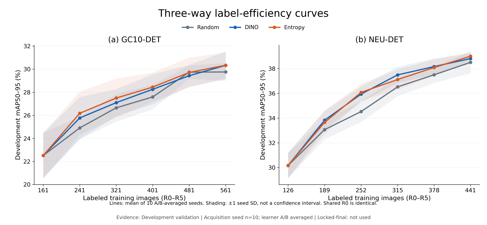
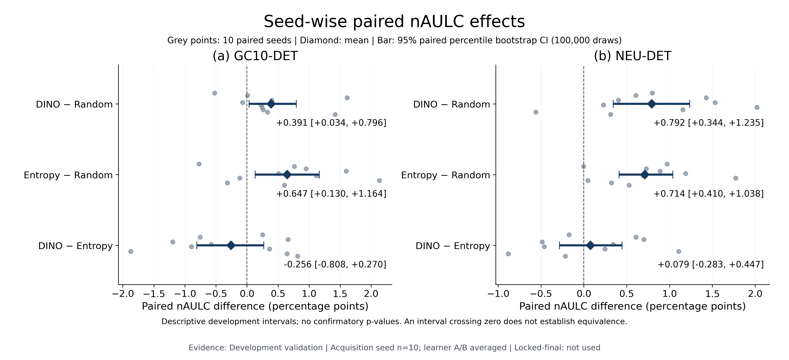
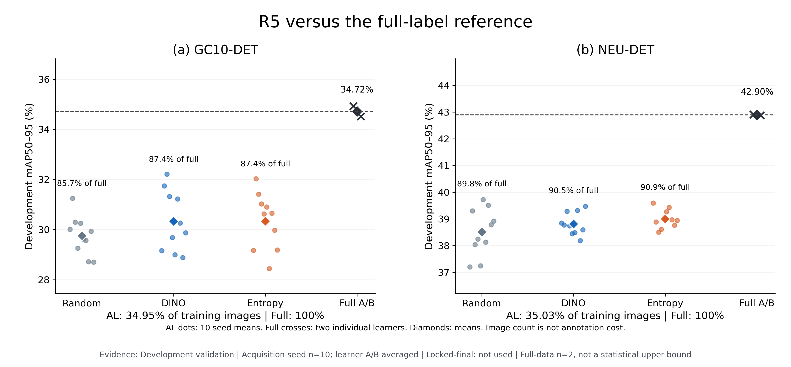
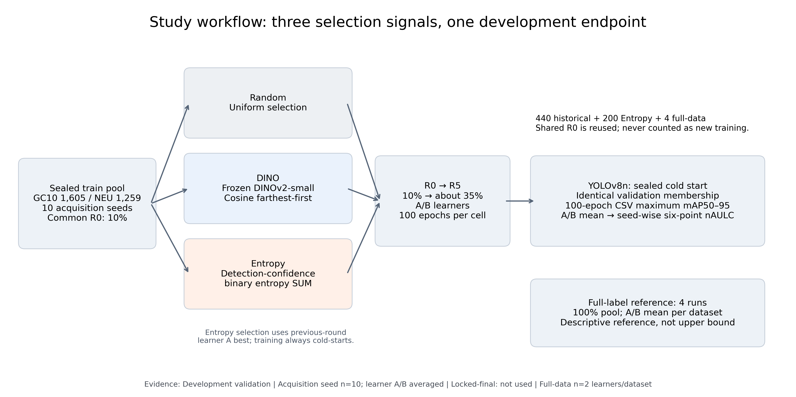
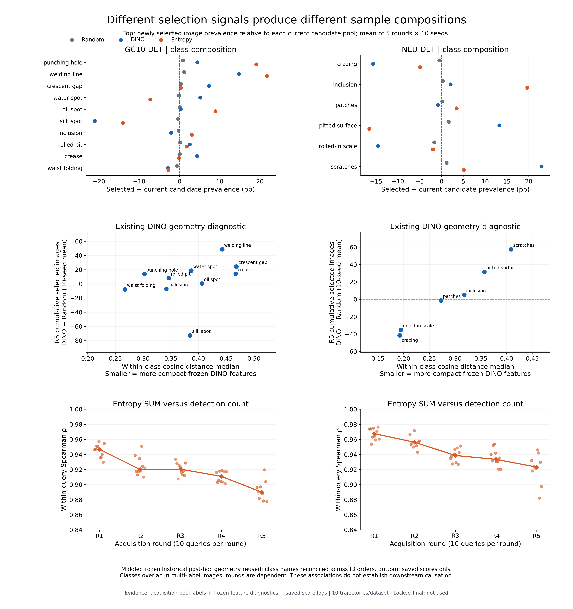

# 소량 라벨 환경에서 특징 기반 능동학습을 활용한 금속 표면 결함 객체 탐지

라벨을 붙일 수 있는 이미지 수가 제한될 때, 어떤 이미지를 고르면 금속 표면 결함을 더 잘 탐지할 수 있을까요? GC10-DET와 NEU-DET에서 표본 선택 신호를 달리하고 같은 YOLOv8n 학습 조건을 적용해, Random보다 label efficiency를 높일 수 있는지 확인합니다.

비교 방법은 **Random**, **Frozen DINOv2 feature + farthest-first**, **Detection-confidence Entropy**입니다. 전체 training pool을 쓴 **full-label reference**는 별도의 기준입니다. 이 저장소는 seed-level 원표 → budget 집계 → 선택 진단 → 그림 → 계산 코드까지 연결되는 연구 기록입니다.

## 현재 상태 — 2026-09-13

|실험|완료 상태|근거|
|---|---|---|
|Historical Random / Frozen DINO controlled experiment|440 physical training COMPLETE|기존 historical locked-final 유지|
|Entropy extension|200/200 training, 100/100 acquisition COMPLETE|Development validation|
|Full-label reference|4/4 COMPLETE: GC10 A/B, NEU A/B|Development validation, dataset별 learner 2개|
|전체 physical training index|644 = 440 + 200 + 4|공통 R0 재사용; 새 학습으로 중복 계산하지 않음|
|New locked-final extension|**NOT EXECUTED / PENDING SEPARATE FREEZE**|신규 204 checkpoint의 평가·통계계획·승인은 별도 단계|

**추가 AL training을 닫는 것과 최종평가가 완료된 것은 별개입니다.** 이번 공개는 이미 완료된 development 분석과 실험 기록입니다.

## 핵심 development 결과

> Evidence: Development validation  
> Statistical unit: acquisition seed, n=10  
> Learner A/B averaged within acquisition seed/round  
> Locked-final: not used

두 데이터셋 모두 DINO와 Entropy의 평균 development nAULC가 Random보다 높았습니다. DINO−Entropy의 직접 차이는 두 데이터셋 모두 95% interval이 0을 포함합니다. **Consistent superiority is not established.** 통계적 동등성도 확인하지 않았습니다.



전 라벨 예산의 곡선을 함께 보면 평균 이득과 budget별 역전을 구분할 수 있습니다. 선은 10개 seed의 A/B 평균을 다시 평균한 값이며 음영은 seed SD입니다. SD는 평균의 신뢰구간이 아닙니다.

|Dataset|Random nAULC (%)|DINO nAULC (%)|Entropy nAULC (%)|
|---|---:|---:|---:|
|GC10-DET|27.002|27.393|27.649|
|NEU-DET|35.189|35.981|35.902|



회색 점은 10개 paired seed effect, 마름모는 평균, 막대는 100,000회 paired bootstrap 구간입니다. DINO−Random은 GC10 +0.391pp, NEU +0.792pp이고 Entropy−Random은 +0.647pp, +0.714pp입니다. 직접 비교 DINO−Entropy는 −0.256pp/+0.079pp로 방향이 다르며, 구간이 0을 포함하는 것을 동등성으로 해석하지 않습니다.

전체 평균·중앙값·구간·승패 수: [paired nAULC](results/development_20260913/tables/paired_nAULC_comparison.md) · [seedwise nAULC CSV](results/development_20260913/tables/seedwise_nAULC.csv) · [budget별 paired 차이](results/development_20260913/tables/budget_paired_summary.md).

## 약 35%의 이미지 라벨과 full-label reference



GC10은 561/1605장(34.95%), NEU는 441/1259장(35.03%)을 사용한 R5입니다. DINO·Entropy는 full-label reference의 약 **87.4–90.9%** development 성능에 도달했습니다. Full 평균은 GC10 34.717%, NEU 42.8955%이며 learner A/B 두 개의 기술적 기준입니다. 이미지 수 비율은 annotation 비용 절감률을 의미하지 않습니다.

[Full A/B 원값](results/development_20260913/tables/full_data_reference_summary.md) · [절대 차이와 상대 비율](results/development_20260913/tables/r5_vs_full_data.md)

## 무엇을 고정해 비교했나



두 dataset의 동일 train pool·validation ID, a00–a09, A/B seed와 R0를 공유합니다. 매 cell은 sealed YOLOv8n에서 cold start해 100 epochs, imgsz 640, batch 8, SGD, resume false로 학습했습니다. Entropy acquisition은 직전 learner A best를 사용하고, NMS confidence binary entropy SUM(conf=.25, IoU=.70, max_det=300, empty=0)을 유지했습니다.

모든 cell에서 100-epoch CSV의 최대 validation mAP50–95를 같은 규칙으로 추출했습니다. A/B를 먼저 평균하고 기존 six-point normalized trapezoidal nAULC를 적용했습니다. R0–R5 가중치는 [0.1,0.2,0.2,0.2,0.2,0.1]이며 644회를 독립 표본 수로 쓰지 않습니다.

**자료구조 endpoint 정합성 A, 전체 비교는 조건부 B**입니다. GPU/OS 차이를 분리하지 못했고 일부 historical feasibility package field가 누락되어 있습니다. Validation은 checkpoint 및 Entropy 경로 선택에 관여하므로 독립 test를 대신하지 못합니다. 새 confirmatory family나 p-value 주장은 만들지 않았습니다.

## 선택 신호와 표본구성

> Evidence: Exploratory selection diagnostics. Frozen acquisition records only; 10 trajectories per dataset, 5 dependent rounds each. Locked-final not used.



DINO와 Entropy는 서로 다른 클래스 구성을 만듭니다. Entropy SUM과 retained detection count의 query 내부 Spearman 중앙값은 GC10 .918, NEU .945입니다. 이는 합산 점수와 검출 수의 강한 연관성을 보여주며 Entropy 정보의 무효성을 뜻하지 않습니다. DINO geometry는 기존 frozen post-hoc 진단을 재사용했고, 구성과 AP의 관계를 인과효과로 주장하지 않습니다.

[100-query 진단](results/development_20260913/tables/entropy_query_diagnostics.csv) · [선택 구성 원표](results/development_20260913/tables/selection_composition_per_query.csv) · [클래스명 연결 감사](results/development_20260913/tables/class_name_mapping_audit.md) · [그림 설명](results/development_20260913/FIGURE_CAPTIONS.md)

## Historical locked-final은 별도 근거

> **Evidence: Historical locked-final.** 아래 수치는 기존 평가이며 새 development 결과와 합쳐 final 3-way 비교를 만들지 않습니다.

기존 DINO−Random nAULC는 GC10 약 +0.581pp, NEU 약 +0.578pp입니다. 기존 확정 분석과 취약 클래스 결과는 그대로 보존합니다. Entropy/Full-data의 신규 locked-final은 실행하지 않았으며 기존 final 공개 후 추가한 확장임을 명시합니다.

[원래 locked-final 결과](results/thesis_final/README.md) · [기존 primary 표](results/thesis_final/tables/locked_final_primary.csv) · [기존 상세 보고서](confirmatory_v1_1/final_analysis/CONFIRMATORY_FINAL_ANALYSIS_REPORT.md)

## 연구 결과 읽는 순서

1. [실험 결과 기록](results/development_20260913/EXPERIMENT_RESULT_BRIEF.md)
2. [질문별 해석과 실험 종료 판단](results/development_20260913/FINAL_DEVELOPMENT_INTERPRETATION.md)
3. [전체 CSV·Markdown 표](results/development_20260913/tables/)와 [대표 그림 5종](results/development_20260913/figures/)
4. [분석 검증](results/development_20260913/ANALYSIS_VALIDATION_REPORT.md)과 [public release 감사](results/development_20260913/audit/PUBLIC_RELEASE_AUDIT.md)
5. [644-cell 원표](results/development_20260913/tables/complete_development_runs.csv), [완료 증거](results/development_20260913/evidence/README.md), [재현 코드](scripts/analysis/development_20260913/README.md)

## 공개 자료 검증

```sh
python scripts/verify_public_results.py
python scripts/verify_development_20260913.py
# NumPy가 있을 때 100,000회 paired bootstrap CI도 재검산
python scripts/verify_development_20260913.py --bootstrap
```

첫 verifier는 기존 historical locked-final 표를 확인합니다. 새 verifier는 공개 CSV의 행 수·seed·A/B 평균·nAULC·paired 차이·Full 산술·파일 hash·figure source mapping을 확인합니다. 모델이나 private checkpoint, raw dataset은 필요하지 않습니다. 그림 재생성 wrapper와 원래 실행 source는 별도로 표시했습니다.

## 기록과 범위

현재 좁은 연구질문에서는 추가 AL training을 종료하는 판단이 합리적입니다. 두 방법의 일관된 우월성·동등성, 모든 seed/budget/class에서의 향상, 구성 변화의 인과효과는 결론내리지 않습니다. 남은 단계는 신규 204 checkpoint에 대해 동일 locked-final endpoint와 통계계획을 별도 고정하고 승인된 평가를 수행하는 일입니다.

[전체 파일 안내](THESIS_FILE_INDEX.md) · [Controlled 440 protocol](docs/collaboration/CONTROLLED_440_PROTOCOL.md) · [Entropy protocol](entropy_extension_v1/official_release_v1/protocol.json) · [데이터/배포 범위](DATASETS.md) · [재현성 문서](docs/collaboration/REPRODUCIBILITY.md)

Historical 및 previous-stage 기록은 원래 날짜·범위대로 보존합니다. 기존 branch는 변경하지 않으며, 이번 branch는 development 결과와 실험 기록 공개입니다.
