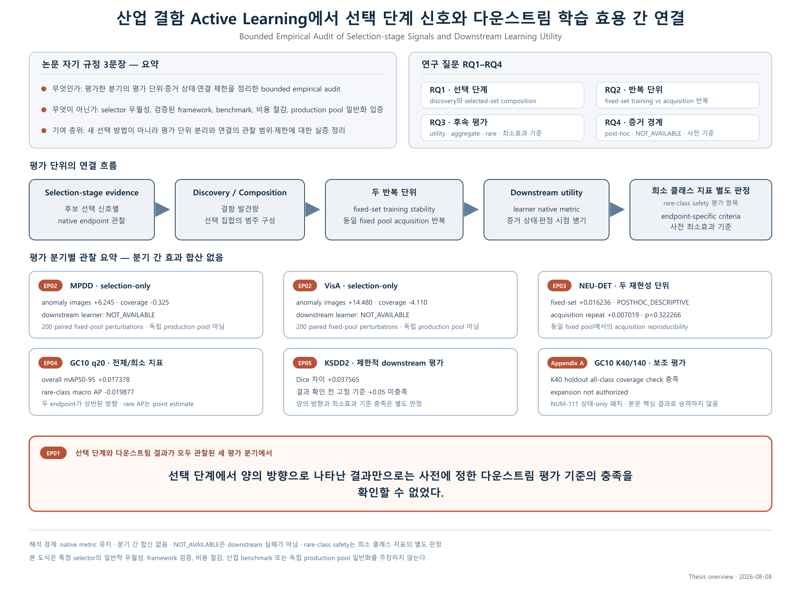

# 산업 결함 Active Learning에서 선택 단계 신호와 다운스트림 학습 효용 간 연결

> **Bounded Empirical Audit of Selection-stage Signals and Downstream Learning Utility**
> Thesis/Notion package snapshot: **2026-08-08** · NUM-111 safe patch applied



이 저장소는 산업 결함 Active Learning에서 선택 단계에 나타난 신호와 이후 학습 효용을 하나의 점수로 합치지 않고, 서로 다른 평가 단위와 증거 상태로 나누어 확인한 석사학위논문 프로젝트다. 현재 브랜치의 우선 진입점은 [`package/`](package/)이며, NUM-111 안전 패치가 반영된 Notion 재업로드용 원고·그림·검증 문서·ZIP을 포함한다.

## 논문 자기 규정

> 본 논문은 평가한 산업 결함 Active Learning 분기에서 selection-stage discovery, selected-set composition, fixed-set training stability, acquisition reproducibility, downstream learner utility, rare-class safety를 분리하고, 이들 사이의 연결이 어디까지 관찰되며 어디서 제한되는지를 정리한 bounded empirical audit이다.

> 본 논문은 특정 selector의 일반적 우월성, 선택–학습 연결을 예측하는 검증된 framework, 산업 benchmark, 실제 비용 절감 또는 독립 production pool 일반화를 입증하는 연구가 아니다.

> 본 논문의 기여는 새로운 선택 방법의 제안이 아니라, 평가한 분기 안에서 선택 단계와 후속 학습의 평가 단위 및 증거 상태를 분리하고 그 연결의 관찰 범위와 제한을 실증적으로 정리하는 데 있다.

여기서 `rare-class safety`는 희소 클래스 지표를 전체 성능과 별도로 확인하는 평가 항목이다. 실제 산업 안전 위험이나 rare-class harm의 인과적 입증을 뜻하지 않는다.

## 연구 질문

| ID | 질문 |
|---|---|
| RQ1 | 평가한 산업 결함 AL 분기에서 후보 선택 신호의 Random 대비 결과는 해당 지표가 관찰된 분기의 discovery 및 selected-set composition 지표에서 어떻게 나타나는가? |
| RQ2 | 고정 선택 집합의 training seed 반복 결과와 selector를 다시 실행하는 acquisition seed 반복 결과는 각각 어떤 변동성을 보여 주는가? |
| RQ3 | 선택 단계 결과와 downstream learner utility, aggregate 성능, 희소 클래스 지표 및 사전 최소효과 기준의 판정은 해당 결과가 관찰된 평가 분기에서 어떻게 함께 또는 다르게 나타나는가? |
| RQ4 | Post-hoc 결과, fixed-pool 반복, learner outcome의 `NOT_AVAILABLE`, 결과 확인 전에 고정한 기준을 구분할 때 현재 자료가 허용하는 선택–학습 연결 해석의 범위는 어디까지인가? |

## 평가 분기와 확정 증거 상태

분기별 task·metric·threshold·시간적 지위가 다르므로 아래 효과를 합산하거나 공통 실패율로 해석하지 않는다.

| 평가 분기 | 직접 관찰 | 증거 상태와 경계 |
|---|---|---|
| MPDD | anomaly images `+6.245`; coverage `-0.325` | selection-only; downstream learner `NOT_AVAILABLE`; 200 paired fixed-pool perturbations |
| VisA | anomaly images `+14.480`; coverage `-4.110` | selection-only; downstream learner `NOT_AVAILABLE`; 200 paired fixed-pool perturbations |
| NEU-DET | fixed-set `+0.016236`; acquisition repeat `+0.007019`, `p=0.322266` | favorable fixed set은 `POSTHOC_DESCRIPTIVE`; acquisition 반복은 동일 fixed pool 범위 |
| GC10 q20 | overall mAP50-95 `+0.017378`; rare-class macro AP `-0.019877` | 전체·희소 클래스 지표가 상반된 방향; rare AP는 해당 설정의 point estimate |
| KSDD2 | Dice 차이 `+0.037565` | 결과 확인 전 고정한 평균 Dice 차이 `+0.05` 기준 미충족 |
| Appendix A · GC10 K40/140 | K40 후보가 holdout all-class coverage 기준 충족 | NUM-111 상태-only 표현; `expansion not authorized`; 본문 핵심 결과로 승격하지 않음 |

### 통합 결론

> 선택 단계와 다운스트림 결과가 모두 관찰된 세 평가 분기에서, 선택 단계에서 양의 방향으로 나타난 결과만으로는 사전에 정한 다운스트림 평가 기준의 충족을 확인할 수 없었다.

이 문장은 평가한 세 분기의 제한된 통합 요약이며, selector의 일반적 실패율이나 보편 법칙을 뜻하지 않는다.

## 2026-08-08 Notion import package

### 바로 사용할 파일

1. **Notion import 기준 원고:** [`package/manuscript/thesis_notion_import_clean.md`](package/manuscript/thesis_notion_import_clean.md)
2. **업로드 순서:** [`package/docs/import_sequence.md`](package/docs/import_sequence.md)
3. **패키지 검증:** [`package/docs/package_verification.md`](package/docs/package_verification.md)
4. **대표 도식 캡션:** [`package/assets/overview_research_architecture_caption.md`](package/assets/overview_research_architecture_caption.md)
5. **완성 ZIP:** [`notion_import_package_20260808.zip`](notion_import_package_20260808.zip)

패키지는 다음 구조를 갖는다.

```text
package/
├─ manuscript/
│  ├─ thesis_notion_import_clean.md
│  ├─ thesis_full_clean.txt
│  └─ cleaning_log.md
├─ assets/
│  ├─ overview_research_architecture.svg
│  ├─ overview_research_architecture.png
│  ├─ overview_research_architecture_caption.md
│  ├─ figure04_gc10_endpoint_conflict.png
│  ├─ figure05_neu_two_reproducibilities.png
│  ├─ figure06_discovery_composition_contrast.png
│  ├─ figure08_ksdd2_positive_below_threshold.png
│  ├─ asset_manifest.csv
│  └─ asset_manifest.md
└─ docs/
   ├─ import_readme.md
   ├─ import_sequence.md
   ├─ package_verification.md
   └─ included_files_table.csv
```

Clean Markdown은 기존 그림 4개를 `../assets/` 상대경로로 참조한다. Notion importer가 상대경로를 자동 처리하지 못하면 [`import_sequence.md`](package/docs/import_sequence.md)의 순서대로 PNG를 수동 첨부한다. 대표 개요 이미지는 자동 삽입하지 않았으며, 제3장 3.1 말미 또는 별도 연구 개요 블록에 수동 배치하는 것을 권장한다.

## 제4장 결과 그림

- [MPDD·VisA discovery/composition 대비](package/assets/figure06_discovery_composition_contrast.png)
- [NEU-DET의 두 재현성 단위](package/assets/figure05_neu_two_reproducibilities.png)
- [GC10 q20 전체·희소 endpoint](package/assets/figure04_gc10_endpoint_conflict.png)
- [KSDD2 Dice 차이와 사전 최소효과 기준](package/assets/figure08_ksdd2_positive_below_threshold.png)

4.1 전용 외부 그림은 현재 장 경계를 만족하는 확정 자산이 없어 자동 대체하지 않았다. GC10 K40/140이나 STOP branch를 포함하는 기존 atlas 그림을 제4장에 유입하지 않는 원칙을 유지한다.

## 재현성과 해석 경계

- `fixed-set training stability`는 선택 집합을 고정한 조건의 training-seed 변동이다.
- `acquisition reproducibility`는 동일 물리적 pool에서 selector를 다시 실행해 선택 집합 변화까지 포함한 반복이다.
- `NOT_AVAILABLE`은 downstream 실패가 아니라 learner outcome이 관찰되지 않았다는 상태다.
- `POSTHOC_DESCRIPTIVE`는 결과 확인 후 선택된 기술적 분석이며 confirmatory 결과가 아니다.
- KSDD2 `+0.05`는 결과 확인 전에 고정한 분기별 기준이지만 외부 calibration 또는 산업적 최적성을 뜻하지 않는다.
- 이미지 예산은 선택 이미지 수를 뜻하며 annotation time, GPU-hour 또는 비용과 등가로 해석하지 않는다.

## 저장소 사용 시 주의

이 저장소에는 연구 진행 과정에서 생성된 과거 protocol, 초안, 실험 branch 및 보조 문서가 audit trail로 남아 있다. 현재 논문·Notion 재업로드 작업에서는 `package/`의 clean manuscript와 검증 문서를 우선하며, 과거 문서의 더 강한 표현을 현재 claim으로 되살리지 않는다.

데이터셋, 모델 가중치, 가상환경과 대규모 raw training output은 저장소 배포 범위에 포함하지 않을 수 있다. 결과를 인용하거나 재사용할 때는 분기별 native metric, 증거 상태, pool 범위와 판정 시점을 함께 유지해야 한다.
