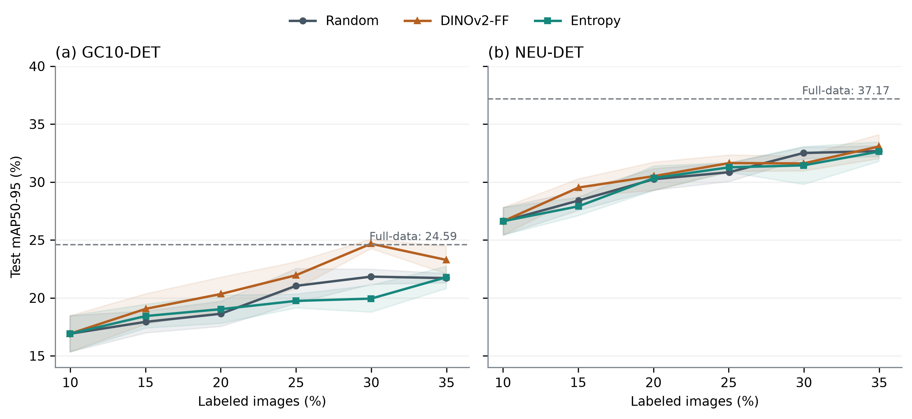
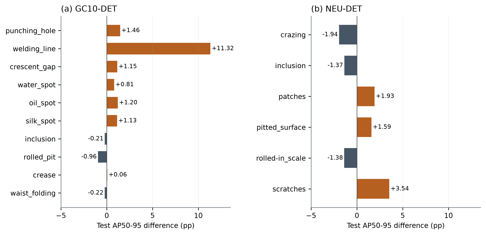

# 소량 라벨 환경의 금속 표면 결함 객체 탐지: 최종 test 결과

**최종 test 평가 2026-09-25 완료 · 162/162 scientific checkpoints · 논문 동기화 완료 · GitHub 보존 2026-09-26**

GC10-DET와 NEU-DET에서 Random, DINOv2 특징 기반 farthest-first(DINOv2-FF), Entropy를 고정 YOLOv8n 조건으로 비교했다. dev는 checkpoint 선택에 사용했으며, 아래 최종 성능은 별도 held-out test에서 측정했다. 같은 학습 모델의 별도 평가이며 독립적인 재학습 실험은 아니다.

> GC10-DET에서는 DINOv2-FF의 평균적 이점이 test에서도 유지되었다. NEU-DET에서는 Random 대비 평균 차이가 작고 시드별 방향이 달랐으며, Entropy 대비 양의 차이는 다섯 선택 시드에서 모두 관찰되었다. 네 주 비교 모두 Holm 보정 후 통계적 유의성은 확인되지 않았다. 평균 성능의 이점은 모든 결함 클래스와 최저 클래스의 향상으로 이어지지 않았다.

## 최종 산출물

- [논문 DOCX](docs/thesis_final_test_20260925/심사용논문_최종test반영본_20260925.docx) · [논문 PDF](docs/thesis_final_test_20260925/심사용논문_최종test반영본_20260925.pdf)
- [최종 평가 보고서](results/final_test_20260925/FINAL_TEST_REPORT_20260925.md)
- [모델별 raw CSV](results/final_test_20260925/raw/results.csv) · [raw JSON](results/final_test_20260925/raw/results.json) · [클래스 AP 원장](results/final_test_20260925/raw/class_ap.csv)
- [통계 원장](results/final_test_20260925/statistics) · [모델별 결과·설정·로그](results/final_test_20260925/raw/runs)
- [고정 프로토콜 및 사전 점검](results/final_test_20260925/preflight) · [SHA-256 보존 목록](results/final_test_20260925/publication_manifest.json)

## 네 주 비교: paired nAULC 차이

차이와 구간은 %p. 반복 단위는 acquisition seed 5개다. paired percentile bootstrap 100,000회, exact two-sided sign-flip 32개 부호 조합, 네 주 비교에 Holm 보정을 적용했다. bootstrap 구간과 exact 검정은 서로 다른 절차이며, 양의 bootstrap 구간을 통계적 유의성 주장으로 바꾸지 않는다.

| Dataset | 비교 | 평균 차이 (%p) | Bootstrap 95% CI | 양의 seed | Exact p | Holm p |
|---|---|---:|---:|---:|---:|---:|
| GC10-DET | DINOv2-FF - Random | +1.472 | +0.941–+1.953 | 5/5 | 0.0625 | 0.2500 |
| GC10-DET | DINOv2-FF - Entropy | +1.923 | +1.437–+2.317 | 5/5 | 0.0625 | 0.2500 |
| NEU-DET | DINOv2-FF - Random | +0.295 | -0.338–+0.967 | 3/5 | 0.5625 | 0.5625 |
| NEU-DET | DINOv2-FF - Entropy | +0.508 | +0.189–+0.841 | 5/5 | 0.0625 | 0.2500 |

## 학습 곡선과 클래스별 차이

## 고정 평가 조건과 검증 범위

| 항목 | 내용 |
|---|---|
| GC10-DET train / dev / test | 1604 / 343 / 344 |
| NEU-DET train / dev / test | 1258 / 270 / 270 |
| Scientific checkpoints | 81개 × 2 datasets = 162개; SHA 검증 완료 |
| R0 | dataset·seed별 공유 모델 한 번 평가 |
| Detector / imgsz / batch | YOLOv8n / 640 / 8 |
| Evaluation conf / NMS IoU / max_det | 0.001 / 0.70 / 300 |
| GPU | RTX 3070 8GB |
| Python / torch / torchvision / ultralytics | 3.11.9 / 2.12.1+cu126 / 0.27.1+cu126 / 8.4.90 |

test 개봉 전 dev dry-run은 GC10 DINOv2-FF R5 모델 한 개에서 기존 전체 mAP 및 클래스 AP와 오차 0이었다. 모든 모델·환경의 동등성을 뜻하지 않는다. TECHNICAL_NEU-DET checkpoint는 scientific 평가에서 제외했다. Entropy acquisition의 conf=0.25와 성능 평가의 conf=0.001은 별개다.

## 보존 및 이전 자료

CSV/JSON이 논문 숫자의 원장이며 Markdown과 DOCX/PDF는 보고 산출물이다. 평가 원장, 통계, 설정, 로그, 실행 당시 스크립트는 원본 바이트 그대로 복사하고 SHA-256을 기록했다. 논문은 기존 1·2장과 연구 설계를 유지했다. 이번 업로드에서 추가 추론·학습·통계 재실행은 하지 않았다.

데이터 이미지·annotation 복제본과 checkpoint 바이너리는 포함하지 않는다. checkpoint hash와 split inventory는 보존한다. 스크립트와 로그의 로컬 절대경로는 당시 실행 기록이므로 그대로 남겼으며, 이 패키지 자체를 즉시 실행 가능한 환경으로 간주하지 않는다.

- [이전 development README](docs/history/README_before_final_test_20260926.md): 당시 상태 기록으로, test 미평가 문구는 과거 시점의 설명이다.
- [기존 development 결과](results/clean_split_v2_development_20260922)
- [논문 수치 대조·시각 검수 기록](docs/thesis_final_test_20260925/audit)
