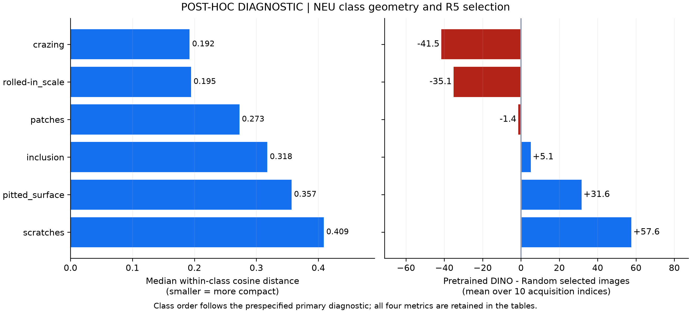

# 제한된 라벨 환경의 산업 결함 객체 탐지: 사전학습 DINOv2와 Entropy 비교

**최근 업데이트: 2026-09-09 · 연구 결과 및 보완 사항 공유용**

이 연구는 GC10-DET와 NEU-DET에서 제한된 라벨 예산으로 탐지기를 학습할 때, 표본 선택 방법의 평균 학습 효용과 취약 클래스 성능을 함께 평가합니다. **사전학습 DINOv2(Pretrained DINOv2)는 이미지 특징 추출에 사용하고, 실제 선택은 farthest-first가 수행합니다.** 본 실험에서 DINOv2 가중치를 추가 학습하지 않았습니다.

최근에는 **탐지기 uncertainty 기반 Entropy 비교군**, **실제 클래스 분포를 반영한 1-NN chance baseline**, **클래스 특징 공간의 compactness와 선택 편차를 연결하는 사후 진단**을 추가했습니다. Entropy 공식 실험은 200개 학습 셀 중 20개 완료 상태입니다.

## 무엇이 달라졌나

| 항목 | 기존 상태 | 현재 보완 |
|---|---|---|
| 선택 방법 비교 | Random / 사전학습 DINOv2 + farthest-first | **Basic Detection Entropy 추가**. 구현·단위검증·GPU integration 완료, official a00 실행 완료 |
| DINOv2 표현 타당성 | 전체 및 클래스별 kNN 보존율 | 전체 label set을 보존한 **10,000회 permutation chance baseline** 추가 |
| 선택 구성의 설명 | NEU 클래스별 선택 수와 AP 변화의 대응 | **compactness 4개 지표 × R1–R5 선택 편차**를 두 데이터셋에서 분석 |
| 연구 해석 | 평균 성능과 클래스별 결과 | NEU에서 geometry와 선택 편차의 일관된 연관성, GC10에서 예외까지 함께 보고 |
| 전체 라벨 기준선 | 없음 | **100% labeled-data reference 4-run 계획 준비**. 아직 실행 전이며 selector가 아닌 reference |
| 공개 설명 용어 | 이전 기록의 명칭 사용 | 설명과 신규 figure에 **사전학습 DINOv2 / Pretrained DINOv2** 사용 |

기존 protocol의 식별자·파일명·결과 표는 provenance와 hash 보존을 위해 그대로 둡니다. 표현 변경은 모델이나 선택 규칙의 변경이 아닙니다.

## 현재 비교 방법과 완료 상태

| 방법 | 선택 신호 | 학습 상태 | 해석 범위 |
|---|---|---|---|
| Random | 고정 seed의 무작위 선택 | 기존 공식 실험 완료 | 역사적 440-cell 결과에 포함 |
| 사전학습 DINOv2 + farthest-first | 사전학습 특징 공간에서 기존 선택 집합과의 거리 | 기존 공식 실험 완료 | 역사적 440-cell 결과에 포함 |
| Basic Detection Entropy | 탐지기의 post-NMS box confidence에 대한 binary entropy 합 | **20/200 cells**, 10/100 acquisition jobs 완료 | **INTERIM DESCRIPTIVE ONLY — NOT FINAL, 1/10 acquisition trajectories per dataset** |
| 100% labeled-data reference | 표본 선택 없이 acquisition pool 전부 사용 | **0/4 runs**, 계획 준비 | 추후 별도 성능 기준선 |

사전학습 DINOv2 + farthest-first는 **탐지 모델의 예측을 선택 점수에 사용하지 않음**. Entropy는 탐지기의 예측을 사용하는 다른 계열의 비교군입니다. 새로운 희소 클래스 보호 selector나 추가 VLM 실험을 실행한 상태는 아닙니다.

## 새로 확인한 결과: 클래스 geometry 사후 진단

**POST-HOC DIAGNOSTIC · CPU-only · 추가 모델 학습 없음**

### 1-NN의 우연 수준

기존 graph를 고정하고 이미지별 전체 annotation label set을 통째로 permutation했습니다. 클래스 빈도와 multi-label co-occurrence를 보존하며, 두 이미지의 라벨이 하나라도 겹치면 match입니다.

| Dataset | 기존 observed 1-NN | Permutation mean | Null 2.5–97.5 percentile | Observed − chance |
|---|---:|---:|---:|---:|
| GC10-DET | 81.25% | 21.07% | [18.82%, 23.30%] | +60.17 pp |
| NEU-DET | 99.21% | 18.96% | [16.44%, 21.53%] | +80.25 pp |

구간은 **null distribution 범위**이며 관측값의 신뢰구간이 아닙니다. 전체 일치율의 높음을 클래스 빈도와 동시 출현만으로 설명하기 어렵다는 결과입니다.

### 왜 어떤 클래스는 덜 선택됐는가

Primary 지표는 **클래스 내 서로 다른 이미지 쌍의 cosine distance 중앙값**입니다. 작을수록 compact합니다. 선택 편차는 R5에서 사전학습 DINOv2 + farthest-first와 historical Random의 클래스별 평균 선택 이미지 수 차이입니다.

| Dataset | R5 primary Spearman | 관찰 및 한계 |
|---|---:|---|
| NEU-DET, 6 classes | **1.000** | compact한 crazing / rolled-in_scale은 덜, spread가 큰 pitted_surface / scratches는 더 선택됨 |
| GC10-DET, 10 classes | **0.661** | 같은 방향의 연관성이 있으나 punching_hole, rolled_pit, silk_spot 등의 예외 존재 |

전체 판정은 **PARTIAL SUPPORT**입니다. NEU의 primary 관계는 매우 일관되지만, GC10의 예외와 secondary metric 차이가 있어 compactness가 모든 선택 차이를 설명한다고 단정하지 않습니다. 인과 분석이 아니며 p-value는 제시하지 않습니다.

숫자를 먼저 제시한 뒤 결과를 시각화했습니다. 이 그림은 **선택에는 사용하지 않은 사후 확인용**입니다. 클래스별 전체 수치·R1–R5 상관·예외·source/output hash는 [geometry 감사 보고서](docs/reviews/dino_class_geometry_posthoc_20260909/README.md)에 있습니다.

## Entropy에서 구현하고 검증한 것

- 정책 learner는 모든 trajectory에서 **A**로 고정. A의 validation-best checkpoint만 다음 acquisition에 사용합니다.
- 선택된 누적 manifest는 A/B가 공유하고, 두 learner 모두 사전 지정 seed와 sealed YOLOv8n pretrained weight에서 cold-start합니다.
- 점수는 post-NMS `boxes.conf`의 `−p ln(p) − (1−p) ln(1−p)`를 이미지의 box 전체에 **SUM**한 값입니다.
- no-detection = 0, conf=0.25, iou=0.70, max_det=300, canonical ID tie-break를 고정했습니다.
- 100 epochs, batch 8, imgsz 640, SGD 등 기존 학습 설정을 유지했습니다.
- integration 2셀은 official 결과로 재사용하지 않았습니다.
- 독립 Windows runner가 cell·acquisition·round gate를 기록하며 dependency 실패 시 중단합니다.

a00 post-run 결과는 **20/20 cells COMPLETE, 10/10 acquisitions COMPLETE, 10/10 gates PASS**, A/B 동일 manifest, B policy edge 0입니다. 현재 registry에서도 남은 180 training cells와 90 acquisition jobs는 미실행 상태입니다. Entropy class-wise/worst-class 비교는 아직 완료되지 않았습니다. smoke에서 관측한 entropy–detection-count 높은 상관(GC10 0.9466, NEU 0.9738)은 limitation으로 보존했으며 threshold나 aggregation을 조정하지 않았습니다.

[공식 protocol](entropy_extension_v1/official_release_v1/protocol.json) · [공식 freeze](entropy_extension_v1/official_release_v1/freeze.json) · [a00 post-run 보고서](reports/entropy_postrun_a00_20260908/POST_RUN_REPORT.md) · [중간 곡선 원자료](reports/entropy_postrun_a00_20260908/interim_descriptive_results.json)

## 기존 공식 440-cell 결과와의 관계

기존 결과는 **40 shared R0 + Random R1–R5 200 + 사전학습 DINOv2 R1–R5 200**입니다. 통계 단위는 데이터셋별 acquisition index 10개이며, A/B learner는 각 trajectory 안에서 평균합니다. 440개 셀이 독립 표본 440개라는 뜻은 아닙니다.

기존 약 10–35% 라벨 예산의 mAP50–95 nAULC에서 사전학습 DINOv2 방식의 Random 대비 차이는 GC10 **+0.581 pp**, NEU **+0.578 pp**였습니다. 동시에 NEU worst-class nAULC는 **−1.488 pp**, R5 worst-class AP는 **−3.118 pp**였습니다. 평균 성능과 취약 클래스 성능이 함께 좋아진다는 보장은 없다는 것이 논문의 핵심 경계입니다.

위 수치는 과거 승인·완료된 최종 분석의 기록입니다. 이번 geometry 분석에 test metric을 입력하지 않았고, 새로운 locked-test 접근·평가도 하지 않았습니다. Entropy의 a00 development 결과를 이 historical final 결과와 합쳐 순위를 내리지 않습니다.

[기존 최종 보고서](confirmatory_v1_1/final_analysis/CONFIRMATORY_FINAL_ANALYSIS_REPORT.md) · [기존 primary 결과 표](results/thesis_final/tables/locked_final_primary.csv)

## 멘토·협업자를 위한 읽는 순서

1. **이 README** — 최근 도입·보완과 완료/미완료 상태.
2. **[Geometry 사후 진단](docs/reviews/dino_class_geometry_posthoc_20260909/README.md)** — 이번에 새로 계산한 chance, compactness, selection 관계.
3. **[Entropy a00 post-run](reports/entropy_postrun_a00_20260908/POST_RUN_REPORT.md)** — 통합 실행 후 공식 20셀의 검증과 development 참고 곡선.
4. **[다음 세션 handoff](docs/reviews/END_OF_DAY_HANDOFF_20260909.md)** — 남은 작업과 고정 protocol.
5. **[기존 DINOv2 kNN 감사](docs/reviews/dinov2_representation_validity_audit_20260907.md)** — 기존 전체·클래스별 수치의 출처. 당시 보고서 명칭은 보존.
6. **[기존 440-cell 최종 분석](confirmatory_v1_1/final_analysis/CONFIRMATORY_FINAL_ANALYSIS_REPORT.md)** — 완료된 역사적 결과.

9월 8일 [멘토 의견 교차 감사](docs/reviews/mentor_repository_audit_20260908.md)는 **이번 geometry 계산 전의 상태 기록**입니다. 그 문서에서 미완료로 적었던 chance baseline·geometry 사후 진단은 이번 업데이트에서 보완됐습니다.

## 코드와 재현 자료

| 위치 | 역할 |
|---|---|
| [Entropy scorer](src/defect_al/entropy.py) | binary entropy, SUM, tie-break |
| [Official orchestration](src/defect_al/entropy_official.py) | policy A, manifest 공유, round dependency |
| [Detached runner](scripts/entropy_extension/detached_tranche.py) | 독립 Windows 실행과 상태 기록 |
| [사전학습 DINOv2 구현](confirmatory_v1/src/confirmatory_v1/frozen_dino_ff_v1.py) | 기존 hash로 고정된 특징 추출 구현 |
| [Geometry 분석 코드](docs/reviews/dino_class_geometry_posthoc_20260909/analyze.py) | CPU 분석, source hash 검증, 기존 파일 overwrite 차단 |
| [Geometry config](docs/reviews/dino_class_geometry_posthoc_20260909/analysis_config.json) | 결과 전 고정한 지표 순서·정의·permutation seed |
| [Geometry 출력 hash](docs/reviews/dino_class_geometry_posthoc_20260909/OUTPUT_SHA256.json) | 새 결과·그림·report 무결성 |
| [100% reference 계획](docs/design/full_data_reference_runplan_20260908.md) | GC10 A/B, NEU A/B의 별도 4-run 계획 |

Entropy 코드의 기존 unit/contract 검증은 **115 passed**, 이번 geometry 계산의 수치·경계 단위검증은 **7 passed**입니다. 신규 figure는 PNG/SVG로 제공하며 PPT나 대표 이미지 패널은 만들지 않았습니다.

공개 자료의 범위·배포 조건은 [DATASETS.md](DATASETS.md), 전체 재현 절차는 [REPRODUCIBILITY.md](docs/collaboration/REPRODUCIBILITY.md), 기존 코드 분류는 [CODE_INDEX.md](docs/collaboration/CODE_INDEX.md)를 확인하세요. 원본 이미지·라벨·특징 cache·가중치·실행 SQLite는 로컬에서 보호합니다. source manifest에 원래 절대경로와 SHA-256이 남아 있어, 새 clone만으로 공식 학습을 재개할 수 있는 패키지는 아닙니다.

## 다음 단계와 주장 범위

다음 순서는 고정 protocol을 유지한 Entropy 잔여 공식 실행, 완료 후 integrity audit, 별도 평가 승인에 따른 class-wise/worst-class 분석, 그리고 별도 full-data reference입니다. **오늘 업데이트에서 새 GPU 실행을 시작하지 않았습니다.**

현재 결과만으로 새로운 selector의 효능, 모든 클래스 보호, 인과 메커니즘, annotation 시간·비용 절감, 산업 현장 일반화, Entropy 최종 우위를 주장하지 않습니다. 사전학습 DINOv2를 사용하는 연구 방향은 유지하며, 이번 결과는 방법별 평균 효용과 클래스별 한계를 더 구체적으로 설명합니다.
