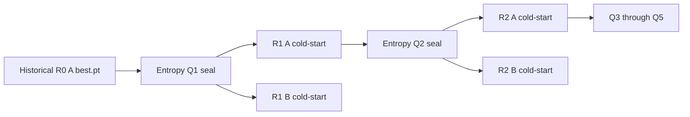

# Entropy B1 B2 resolution and integration handoff

## 현재 판정

**B1 RESOLVED. B2 구현 및 테스트 완료. 실제 R1 A/B 학습을 시작하기 직전에 정지했다.** 공식 200-cell training은 시작하지 않았다. 신규 locked-test 접근도 없다. 기존 pre-flight 보고서와 manifest는 당시 감사 결과로 보존했으며, 새로운 규칙과 상태는 entropy_extension_v1/protocol.json을 따른다.

## 1 B1 resolution

모든 dataset × acquisition index에서 policy learner는 A다. A가 선택한 cumulative manifest를 A/B가 공유하고, 두 learner는 각각 기존 seed와 sealed pretrained yolov8n.pt로 cold-start한다. B checkpoint/성능은 acquisition에 들어가지 않는다. 이 구조는 기존 Random/DINO의 shared trajectory 및 acquisition별 pairing을 유지한다.

A/B 역할은 비대칭이다. A는 선택 정책에 관여하므로 두 learner를 교환가능한 독립 평가 반복으로 해석하지 않는다. 데이터셋별 acquisition index n=10을 유지하고 A/B 6점 AULC의 평균이라는 기존 reduction을 보존한다. 20개는 실행 dependency상 독립 경로 수이며, 두 데이터셋을 합친 n=20 iid 표본 수가 아니다. 상세 근거와 논문 정의문은 entropy_b1_resolution_20260908.md에 기록했다.

## 2 B2 architecture

| 구성 | 경로 / 동작 |
|---|---|
| Protocol | entropy_extension_v1/protocol.json: policy A, shared A/B, cold-start, seed/budget, runtime pin |
| 신규 학습 plan | entropy_extension_v1/planned_cells.json: Entropy R1–R5 200개만 포함 |
| Acquisition plan | entropy_extension_v1/planned_acquisitions.json: 100개 query dependency |
| R0 reference | entropy_extension_v1/historical_r0.json: historical A/B 40개 best.pt·manifest·args hash, read-only |
| Freeze | entropy_extension_v1/freeze.json: protocol/plan/환경입력 index/scorer/runner/source 해시 고정 |
| 별도 final lock | entropy_extension_v1/final_lock.json: 항상 LOCKED, historical authorization 재사용 불가 |
| 상태 저장 | runtime/official/registry.sqlite 및 runtime/integration/registry.sqlite를 분리 |
| 선택 결과 | acquisitions/{namespace}/{query node}/attempt_NN/: score, query IDs, shared manifest, policy checkpoint hash |
| 학습 입력 | training_inputs/{namespace}/{query node}/: 공통 dataset.yaml, train/validation lists, A/B specs |
| 학습 결과 | outcomes_private/{namespace}/{cell}/attempt_NN/: best.pt, last.pt, args.yaml, hash가 담긴 cell_result.json |
| 실행 | scripts/entropy_extension/run.py: prepare-integration, integration, acquire, train-cell, run-trajectory, run-official |

Acquisition이 COMPLETE로 seal되어야 해당 A/B cells가 BLOCKED_MANIFEST에서 READY가 된다. 이전 A가 COMPLETE이고 checkpoint 및 manifest seal이 맞아야 다음 query가 가능하다. SQLite transaction으로 같은 job의 중복 실행을 막는다. FAILED 재시도는 명시적 retry-failed 명령만 허용하고 최대 3회, 같은 seed/config/manifest로 cold-start한다. RUNNING을 자동 reset하지 않으며 비정상 프로세스 종료 시 별도 운영 복구가 필요하다.

현재 제공한 실행기는 단일 GPU에서 각 acquisition/training을 별도 프로세스로 순차 실행한다. 따라서 inference의 RNG/precision 상태가 training에 이어지지 않는다. 20개 dependency graph는 서로 분리되지만 분산 scheduler나 다중 GPU 동시 실행을 검증했다는 뜻은 아니다.

학습 label cache가 historical adapter에 써지는 일을 피하기 위해 **query를 seal한 다음**, 선택된 train 이미지/라벨과 fixed validation 이미지/라벨을 extension 안에 독립 copy한다. hardlink를 쓰지 않는다. Label 내용을 score로 해석하거나 class distribution을 계산하지 않았다. 원본 전체 train/validation byte hashes와 image canonical pixel IDs를 확인했다. index는 GC10 1605+229, NEU 1259+180만 포함하며 locked-test 이미지는 0개다.

학습은 기존 실제 args와 같은 100 epochs, batch 8, imgsz 640, SGD, lr0/lrf .01, AMP, augmentation으로 고정한다. dataset.yaml에는 train/val만 있고 test 항목이 없다. validation이 best.pt를 선택하고 last.pt는 audit artifact다. 학습 후 best.pt의 fixed validation 확인도 기존 lifecycle대로 수행하며 값은 private 로그에만 남긴다. 공개 상태 기록에는 AP가 없다.

## 3 Planned registry cell count

- GC10: 10 acquisition indices × 5 rounds × 2 learners = **100 new cells**.
- NEU: 같은 구조로 **100 new cells**.
- 합계 **200 new training cells**, **100 acquisition jobs**, **20 independent dependency trajectories**.
- Historical R0 **40 checkpoint references**는 신규 cells로 등록하지 않는다.
- Integration namespace는 GC10 a00 Q1/A1/B1 3개 job만 가진다. 현재 Q1 COMPLETE, A1/B1 READY다.
- Official namespace는 200 training cells 모두 BLOCKED_MANIFEST, 100 query jobs 모두 PENDING이며 모든 attempt=0이다.

Integration의 두 학습은 official registry와 별도 namespace다. 성공하더라도 자동으로 official 완료 처리하지 않는다. 이후 공식 freeze 시 hash가 모두 일치하는 결과를 재사용할지 별도로 명시해야 한다.

## 4 Dependency graph



각 query에는 이전 A checkpoint에 대한 edge만 있다. B는 다음 query의 parent가 아니다. 제공한 sequential scheduler는 편의상 round의 A/B를 순서대로 마친 뒤 다음 round로 이동하지만 policy resolver는 B를 읽거나 B 성능에 의존하지 않는다. 전체 300개 노드와 300개 dependency edges는 reports/entropy_b1_b2_20260908/dependency_graph.json에 저장했다.

## 5 Historical 440 integrity

작업 전 보관한 historical 파일 **1348개**의 hash가 모두 동일하다. 현재 **440 best.pt / 440 last.pt / 440 labeled manifests**를 다시 검증했으며 archived CELL_REGISTRY와 일치한다. 기존 registry, SQLite, protocol, runner, final lock/authorization을 수정하지 않았다. 역사적 결과/AP 파일을 읽거나 비교하지 않았다. 같은 repo의 기존 사용자 변경도 보존했다.

## 6 End-to-end test command

이번에 새 extension runner가 실제 GC10 a00 R0 A best.pt로 U0 1444장을 다시 추론하여 **query 80개, R1 공통 labeled 241개**를 만들었다. score/ranking/selected-ID hash는 이전 pre-flight smoke와 일치한다. A seed=1356694077, B seed=850898698이다. 두 spec의 manifest 및 dataset.yaml hash도 동일하다. R2는 실제 R1 A가 아직 없으므로 차단되는 것을 확인했다.

- Shared manifest SHA-256: `30985e4b95050f4ab28223d7a67af0444a0503aca21894488e3b522090dd9097`
- Shared dataset YAML SHA-256: `c8b6bf192f9614a8946e35069c50066d0014de15537c826d95ac6dd27f27142e`
- Freeze SHA-256: `0d3deb6656b9b22ddbb8d63f17ef6721adac4f3120560528c44954f8713d00fb`

**예상 GPU 시간: 약 16–22분.** 같은 RTX 3070에서 수행한 historical GC10 R1 40개 셀(241장, 100 epochs)의 train+validation 운영 기록을 근거로 한다. 두 셀 기준 median 15.75분, 관측 min/max를 두 배 한 범위 14.98–18.48분이며 디스크·warmup 여유를 포함했다. Entropy 이미지별 box 수/augmentation 작업량에 따라 실제 시간은 달라질 수 있다. 새로운 학습으로 시간을 측정하지 않았다.

**아래 명령은 작성만 했고 실행하지 않았다.** 실행하면 integration scope의 R1 A/B 두 학습에 대한 명시적 opt-in을 기록하고, 학습·validation-best 생성·해시 검증 후 다음 policy resolver가 R1 A를 읽는지 확인한다. R2 query나 학습은 실행하지 않는다.

```powershell
& "C:/Users/user/Desktop/vlm/Defect_VLM_Project/.python311/python.exe" "C:/Users/user/Desktop/vlm/confirmatory_random_dino_v1/scripts/entropy_extension/run.py" integration --mode integration --execute-training --approve-gc10-a00-r1 --freeze-sha256 0d3deb6656b9b22ddbb8d63f17ef6721adac4f3120560528c44954f8713d00fb
```

동일 명령은 docs/design/run_gc10_a00_r1_integration_20260908.ps1에도 저장했다. 현재 authorization 파일은 발급하지 않았다. --execute-training, --approve-gc10-a00-r1, 정확한 freeze hash가 빠지면 학습 시작 전 거부한다.

## 7 Official run 전 남은 blocker

1. **실제 GC10 a00 R1 A/B integration은 아직 미실행**이다. 이번 요청에 따라 여기서 중지했다. 학습/validation-best/다음 policy 참조 확인이 실제 GPU에서 PASS해야 한다.
2. 그 PASS 후 official training용 새 authorization을 정확히 200-cell plan과 freeze에 묶어 발급해야 한다. 기존 historical authorization은 사용하지 않는다. 현재 official authorization은 없다.
3. Integration 결과의 official 재사용 여부를 명시하고 최종 실행 freeze를 확인해야 한다. 현 candidate는 기존 결과와 완전히 별도 namespace이며 자동 승격하지 않는다.

B1의 과학적 연결 문제와 B2의 구현 부재는 해결했다. 높은 entropy–detection-count 상관과 no-detection=0은 기존 method limitation으로 유지했으며 threshold/aggregation은 변경하지 않았다. 향후 성능 평가용 contrast/multiplicity 계획은 평가 전에 별도로 고정한다. 이 구현에는 locked-test 평가 endpoint가 없고 최종 평가 기능 추가는 이번 범위 밖이다.

## 검증과 Git 상태

**115 tests passed**: 신규 extension 21개 + 기존 94개. 모든 20개 trajectory의 5 rounds를 synthetic checkpoint로 이어 dependency를 검증했고, 실제 YOLO 학습은 mock으로만 lifecycle 테스트했다. 실제 detector를 사용한 작업은 이번 GC10 R0→Q1 inference까지다. 실제 R1 GPU end-to-end PASS라고 표현하지 않는다.

Branch: exp/entropy-baseline-preflight-20260908. Commit/push 없음. 신규 코드·문서·extension 파일은 uncommitted이며 기존 Random/DINO 및 pre-flight 파일을 수정하지 않았다.

## AMP runtime cache 준비

설치 Ultralytics의 check_amp는 yolo26n.pt를 별도 수치 점검 모델로 사용한다. 기존 repo의 동일 파일을 extension subprocess 작업 폴더에 복사하고 SHA-256 동일성을 확인해 첫 학습 시 다운로드가 필요 없도록 준비했다. 이번에는 이 모델을 실행하지 않았다. 학습 detector 초기화는 계속 sealed yolov8n.pt다. helper provenance는 reports/entropy_b1_b2_20260908/amp_helper_provenance.json에 저장했다.
