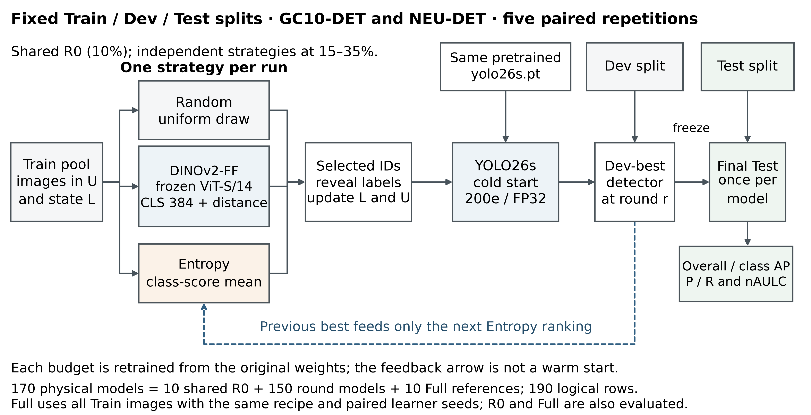
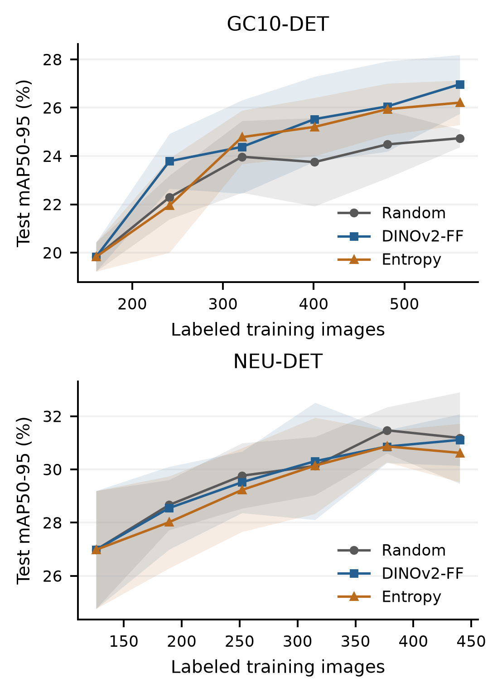
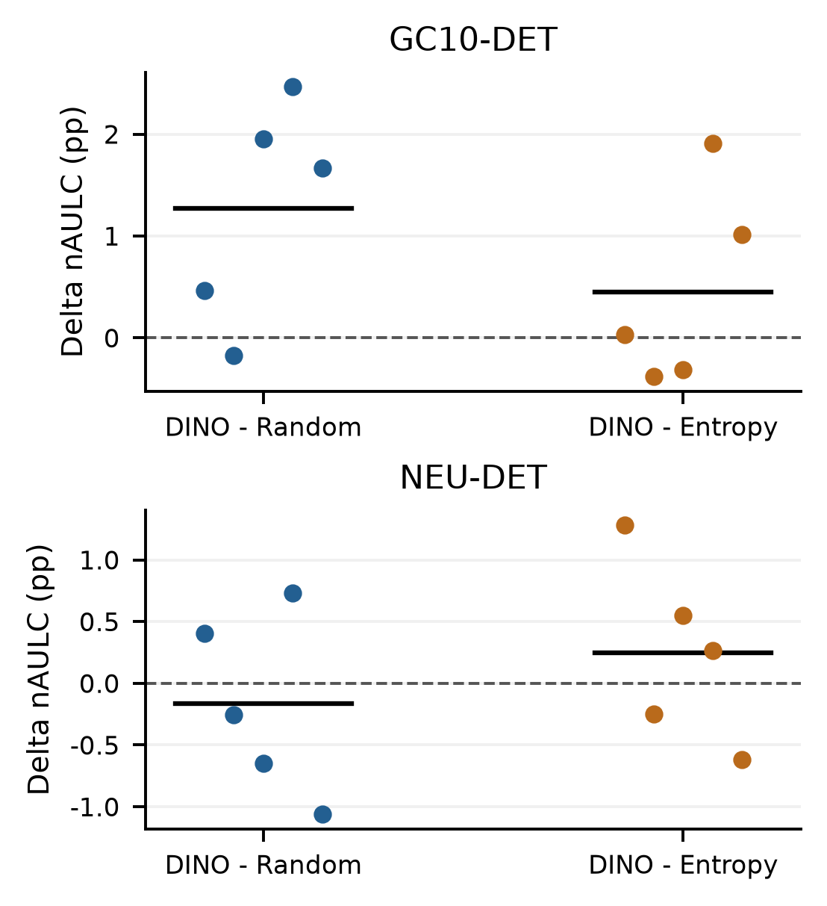
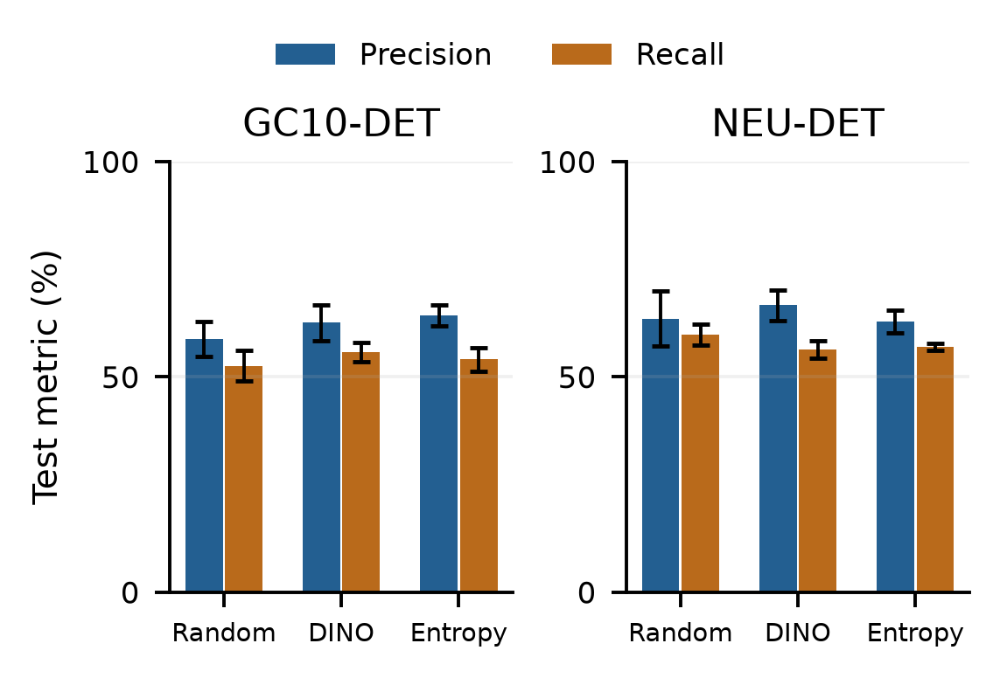
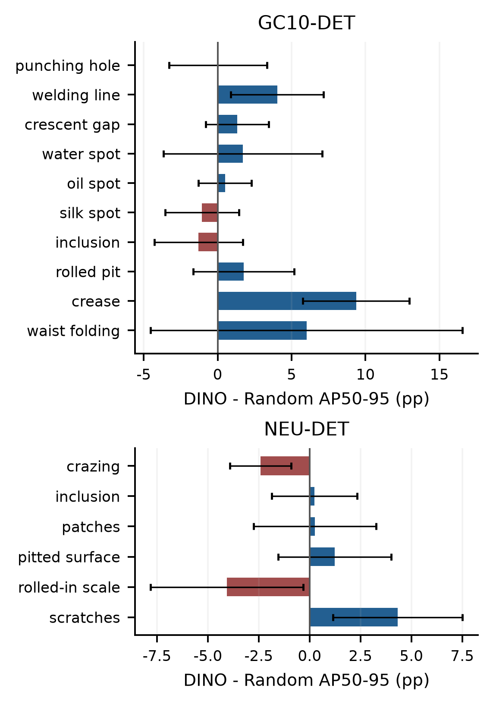
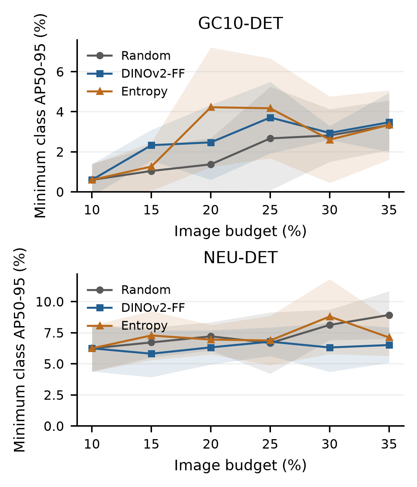

# 금속 표면 결함 객체탐지에서 DINOv2 기반 표본 선택의 라벨 효율과 클래스별 성능 분석

Label Efficiency and Class Specific Performance of DINOv2 Based Sample Selection for Metallic Surface Defect Detection

요    약

본 논문은 금속 표면 결함 탐지에서 고정 DINOv2 특징의 표본 선택이 라벨 효율과 클래스별 성능에 미치는 영향을 분석한다. GC10-DET와 NEU-DET에서 Random, DINOv2 farthest-first, Entropy를 동일 YOLO26s·200epoch·획득/학습 시드 5쌍으로 비교하고 170개 모델을 고정 Test로 평가하였다. DINOv2와 Random의 평균 nAULC 차이는 +1.27%p와 −0.17%p였고 Holm 보정 p값은 0.50과 1.00이었다. 두 자료 모두 DINOv2의 전체 nAULC는 Entropy보다 높았으나 최저 클래스 nAULC는 낮았다. 클래스별 분해에서 GC10의 평균 이득은 일부 결함에 집중되었고 NEU의 작은 평균 차이는 상반된 증감이 상쇄된 결과였다. 이는 같은 표본 선택법의 효과가 자료와 평가 목표에 따라 달라짐을 보여준다. 평균 학습곡선, 대응 반복과 클래스별 결과를 함께 해석하되 통계적 우위나 실제 주석 비용 절감을 확립한 결과로 일반화하지 않는다.

ABSTRACT

This study examines how sample selection with frozen DINOv2 features affects label efficiency and class-specific performance in metallic surface defect detection. Random, DINOv2 farthest-first, and entropy sampling are compared on GC10-DET and NEU-DET using YOLO26s, 200 epochs, and five paired acquisition and learner seeds. All 170 physical models are evaluated on fixed test splits. DINOv2 minus random mean normalized areas under the learning curve are +1.27 and -0.17 percentage points, with Holm-adjusted p-values of 0.50 and 1.00. On both datasets, DINOv2 yields higher overall normalized area than entropy but lower minimum-class normalized area. The results show that overall gains can be concentrated in a few classes or offset by losses in others. Label efficiency should therefore be interpreted jointly with paired learning curves and class-level outcomes within the limits of the five-pair, fixed-split design.

키워드: 능동학습, 결함 객체탐지, DINOv2, 표본 선택, 라벨 효율

Key Words: Active learning, Defect detection, DINOv2, Sample selection, Label efficiency

## Ⅰ. 서론

금속 표면 결함의 객체탐지에서는 결함의 종류뿐 아니라 경계 상자의 위치도 학습해야 한다. 같은 이미지 수라도 포함된 결함의 종류·상자 수·크기와 배경이 다르면 검출기가 얻는 정보가 달라진다. 공개 자료인 GC10-DET[1]와 NEU-DET[2]는 제한된 이미지 예산에서 이 차이를 분석할 수 있는 사례다. 따라서 라벨 효율을 평가하려면 이미지 수에 따른 평균 탐지 성능과 그 평균을 구성하는 개별 클래스의 변화를 함께 확인해야 한다.

풀 기반 능동학습(active learning)은 현재 라벨 집합으로 학습한 뒤 미선택 이미지 일부를 추가하는 절차다. 대표성을 이용한 선택은 특징 공간에서 떨어진 표본을 확보하고, 불확실성 선택은 현재 모델이 판단하기 어려운 표본을 우선한다. 그러나 범용 이미지 표현의 거리와 검출기의 분류·위치 오차는 서로 다른 기준이다. 학습 이미지 수와 탐지 성능의 관계[3]를 고려하면, 선택법의 효과는 한 예산의 최고 점수보다 여러 누적 예산의 곡선과 반복별 대응 차이로 비교하는 편이 적절하다.

본 연구는 고정 DINOv2 특징의 farthest-first 선택(DINOv2-FF)을 Random 및 Entropy와 비교한다. YOLO26s[9]와 학습 규칙을 공통으로 두고, 획득 시드와 학습 시드를 묶은 다섯 대응 반복에서 초기 라벨 집합과 공개 초기 가중치를 공유한다. 같은 누적 이미지 수에서 표본 선택에 따른 차이를 관찰하고, 전체 성능·최저 클래스 성능·선택 이미지 구성의 관계를 분석한다.

연구 질문은 두 가지다. 첫째, 동일한 검출기와 이미지 예산에서 DINOv2-FF의 학습곡선과 대응 효과는 Random 및 Entropy와 어떻게 다른가. 둘째, 전체 평균에서 관측한 이득이 개별 클래스와 최저 클래스 성능에서도 유지되는가. 본 연구의 기여는 170개 모델의 통제된 비교를 바탕으로 이 두 질문을 연결하고, 평균 점수의 변화가 어느 클래스에서 발생했는지와 평가 지표에 따라 전략의 순서가 달라지는 지점을 제시하는 데 있다.

분석은 선택 표현의 차이를 동일한 학습·평가 경로로 연결하도록 구성하였다. 공유 R0, 예산별 cold start와 대응 Full 참조는 반복의 비교 기준을 맞추고, 클래스별 AP의 분해와 최저 클래스 곡선은 평균 이득이 어디에서 발생했는지 보여준다. 새로운 선택 알고리즘의 우위보다 이러한 관측과 적용 범위를 명확히 하는 것이 본 연구의 실증적 기여다.

## Ⅱ. 관련 연구

### 2.1 산업 영상과 학습 데이터의 구성

학습 이미지 수는 객체탐지 성능의 기본 조건이지만, 같은 개수에서 어떤 이미지를 포함하는지도 중요하다. Lee와 Kang[3]은 안티드론 탐지에서 학습 이미지 수에 따른 성능을 분석하였다. 금속 결함에서는 한 이미지에 여러 상자와 클래스가 공존할 수 있으므로, 이미지 예산의 증가와 개별 결함에 대한 학습 기회의 증가를 동일하게 볼 수 없다. 본 연구는 이미지 수를 공통 예산으로 두되 클래스별 AP와 선택된 이미지 구성을 추가로 분석한다.

Lv 등[4]은 표면 결함 탐지에서 불확실성 기반 후보 선택과 Average Margin을 이용한 클래스별 표본 규모 조절을 결합하였다. 이는 선택 점수와 클래스별 할당이 서로 다른 설계 요소임을 보여준다. 본 연구는 클래스별 할당을 추가하지 않은 DINOv2-FF가 두 결함 자료에서 만드는 결과를 평가한다. 따라서 관측한 클래스 구성의 차이를 명시적 클래스 균형화 알고리즘의 효과로 해석하지 않는다.

### 2.2 특징 기반 선택과 능동학습 평가

Sener와 Savarese[5]의 core-set 관점은 특징 공간의 기하를 이용해 라벨 집합이 풀을 대표하도록 표본을 선택한다. 본 연구의 farthest-first도 라벨 집합에서 가장 먼 후보를 순차적으로 추가한다. 다만 선택 표현은 검출기에서 학습한 특징이 아니라 사전학습된 DINOv2[6]의 고정 CLS 벡터다. 범용 표현을 그대로 활용할 수 있는 대신, 그 거리가 결함별 탐지 난도를 직접 나타내는지는 실험에서 확인해야 한다.

Munjal 등[7]은 학습 무작위성과 실험 조건이 능동학습과 Random의 상대 결과에 영향을 줄 수 있음을 보였다. Probst 등[8]은 객체탐지에서 박스별 불확실성을 이미지 점수로 집계하는 방식의 중요성을 분석하였다. 이에 본 연구는 초기 집합·학습 초기화·박스 점수 집계를 고정하고, 획득과 학습 무작위성을 묶은 반복 단위에서 세 방법을 비교한다. 이 설계의 목적은 선택법의 관측 효과를 해석할 수 있는 공통 기준을 만드는 것이다.

### 2.3 본 연구의 비교 범위

본 비교에서는 고정된 범용 표현의 기하학적 선택과 직전 검출기에 의존하는 불확실성 선택을 같은 조건에 놓는다. DINOv2-FF의 선택 특징은 검출기를 학습해도 변하지 않지만 Entropy의 점수는 라운드 모델에 따라 바뀐다. 이 차이를 유지한 채 전체·클래스별 결과를 함께 보는 설계로, 표현 공간에서의 대표성이 탐지 효용으로 이어지는 범위를 평가한다.

## Ⅲ. 연구 방법

### 3.1 전체 연구 구성

그림 1은 입력 분할, 표본 선택, 검출기 학습과 최종평가의 정보 흐름이다. 각 데이터셋·시드 쌍에서 공통 R0를 만든 후 세 전략을 독립적으로 반복한다. 선택된 이미지의 주석을 누적하고 매 예산에서 공개 가중치로 새로 학습하며, Dev로 best를 선택한다. 직전 모델은 Entropy의 다음 순위 계산에만 사용한다. 고정 Test는 선택이나 학습 초기화로 되돌아가지 않고 완료된 모델의 성능 평가에 사용한다.

그림 1. 표본 선택과 검출기 학습 및 평가의 연구 구성도

Fig. 1. Experimental architecture. Dashed feedback supplies the previous detector only to Entropy ranking; every budget is trained from the same pretrained weights.

### 3.2 데이터 분할과 라벨 예산

분석에는 GC10-DET의 10개 클래스와 NEU-DET의 6개 클래스를 사용하였다. 원 아카이브에서 이미지·주석 대응과 RGB 내용, 중복 주석을 감사하여 정제한 후, 중복 위험 관계의 연결성분이 분할을 넘지 않도록 약 70:15:15의 Train·Dev·Test를 고정하였다. 연결성분은 실제 생산 lot을 뜻하지 않는다. 정제 후 이미지는 각각 2,291장과 1,798장이며 실제 입력 수는 표 1과 같다. 분할 시드는 GC10 2026102306, NEU 2026102307이다.

표 1. 고정 데이터 분할

Table 1. Fixed dataset splits

| Dataset | Classes | Train | Dev | Test |
| --- | --- | --- | --- | --- |
| GC10-DET | 10 | 1,604 | 344 | 343 |
| NEU-DET | 6 | 1,258 | 270 | 270 |

학습 풀은 Train으로 한정하였다. 이미지 한 장을 선택하면 그 이미지에 포함된 모든 결함 주석을 학습에 사용한다. 누적 라벨 예산은 학습 풀의 약 10%, 15%, 20%, 25%, 30%, 35%로 두었다. 실제 누적 수는 GC10에서 160, 241, 321, 401, 481, 561장, NEU에서 126, 189, 252, 315, 377, 440장이다. 초기 10%를 R0, 이후 다섯 단계를 R1~R5로 구분하며 이미 선택한 이미지는 계속 유지한다.

획득 시드 2026102401~2026102405와 학습 시드 2026102501~2026102505를 일대일로 묶은 다섯 반복을 사용하였다. 같은 쌍에서는 세 방법이 R0와 학습 시드를 공유하며, 예산이 바뀌어도 같은 공개 가중치에서 새로 학습한다. 반복은 획득과 학습 무작위성의 결합 단위다. 두 요인의 분산을 따로 추정하는 교차 설계가 아니며, 결과에 따라 시드나 초기 집합을 다시 고르지 않았다.

### 3.3 표본 선택 방법

Random은 정렬된 미선택 이미지 목록에서 필요한 수를 동일 확률로 비복원 추출한다. 데이터셋·획득 시드·라운드·목적을 구분한 PCG64 규칙을 고정하였다. DINOv2-FF는 facebook/dinov2-small의 고정 revision(ed25f3a31f01632728cabb09d1542f84ab7b0056)에서 마지막 CLS 토큰을 추출한 384차원 단위 벡터를 사용한다. 입력의 긴 변을 518로 맞추고 비율을 유지한 채 RGB(124,116,104)로 중앙 패딩하며 자르지 않는다. 특징 추출기는 갱신하지 않는다.

학습 풀을 U, 현재 라벨 집합을 L, 정규화 특징을 z(x)라 하자. 후보와 L의 거리는 δ(x,L)=min{1−z(x)ᵀz(l): l∈L}로 계산한다. 식 (1)로 하나의 후보를 추가한 뒤 남은 후보의 최근접 거리를 갱신한다. 단위 벡터에서 이 거리는 L2 거리와 같은 순서를 주지만, 실제 비교값과 동점 규칙은 1−내적에 맞춰 고정하였다. float32 저장 특징을 float64로 비교하고 거리 차이가 10⁻¹² 이내이면 이미지 식별자 순서를 사용한다.

$$
x^*=\arg\max_{x\in U\setminus L}\delta(x,L)
$$

Entropy는 직전 라운드의 해당 반복 모델로 미선택 이미지를 추론한다. YOLO26s의 one-to-one 헤드에서 최종 top-k 이전의 8,400개 후보와 C차원 sigmoid 클래스 점수 벡터를 보존한다. 최대 클래스 점수가 0.25를 넘는 후보에 CPU 클래스별 NMS(IoU 0.70, 최대 300개)를 적용하고, 남은 원래 점수 벡터를 성분의 합으로 나누어 q를 구한다. 식 (2)의 정규화 엔트로피를 박스별로 계산한 뒤 이미지 안에서 산술평균한다. 검출이 없으면 0, 정확한 동점이면 이미지 식별자 순서를 사용한다.

$$
h(b)=-\frac{\sum_{c=1}^C q_{bc}\log q_{bc}}{\log C}
$$

이 Entropy는 sigmoid 점수의 상대적인 분산을 이용하는 대리값이며 위치 오차나 보정된 확률 자체는 아니다. 같은 이미지에서 검출된 박스 수가 달라도 산술평균으로 집계하므로 박스 수와 이미지 점수의 합을 동일하게 취급하지 않는다. 획득용 클래스별 NMS와 최종 one-to-one 헤드의 NMS 없는 평가는 구분한다. 직전 모델은 다음 표본의 순위 계산에만 사용하며 다음 예산 모델의 초기 가중치로 이어받지 않는다.

### 3.4 검출기 학습과 최종평가

주실험은 Ultralytics 8.4.90의 YOLO26s[9]를 사용하였다. 모든 방법과 예산은 동일한 yolo26s.pt에서 시작하며 이전 라운드 가중치를 이어받지 않는다. 학습은 200epoch로 고정하고 AMP와 TF32를 끈 FP32, SGD와 cosine schedule을 사용하였다. Dev mAP50-95가 최대인 best checkpoint를 선택하며 동률이면 마지막 해당 epoch를 사용한다. 최종 Test 점수로 모델이나 설정을 선택하지 않았다. 주요 조건은 표 2와 같다.

표 2. 주실험의 학습 및 평가 조건

Table 2. Training and evaluation settings of the main experiment

| Item | Setting |
| --- | --- |
| Detector / initialization | YOLO26s / same pretrained weights; cold start |
| Epochs / patience | 200 / 200 |
| Image / train batch | 640 × 640 / 32 |
| Optimizer | SGD; lr0=0.01; lrf=0.01 |
| Momentum / decay | 0.937 / 0.0005 |
| Schedule / warmup | Cosine / 3 epochs |
| Nominal batch / mosaic | 64 / close in last 10 epochs |
| Precision / TF32 | FP32; AMP off / TF32 off |
| Training device | RTX PRO 4500 Blackwell (32 GB) |
| Training software | Python 3.11.9; Torch 2.12.1+cu129 |
| Validation batch | 64 during training; 8 for final Test |
| Evaluation device | RTX3070; Torch 2.12.1+cu126 |
| Test settings | 640; FP32; rect=False; conf=0.001; max_det=300 |
| Detection head | one-to-one; end2end=True; NMS-free Test |
| Acquisition NMS | conf>0.25; class-wise IoU 0.70; max300 |
| Ultralytics | 8.4.90 in both stages |

공통 R0는 반복마다 한 번만 학습하였다. 데이터셋당 R0 5개, 각 방법의 R1~R5 모델 25개씩과 Full 5개로 85개, 두 자료를 합쳐 170개 모델이다. Full은 같은 학습 시드의 전체 Train 참조다. 200epoch와 best/last 파일 해시를 확인한 후 고정 Test로 각 best 모델을 한 번씩 평가하였다. 공통 R0를 세 방법에 연결하면 논리 결과는 190행이다. 서버 학습과 로컬 평가의 GPU·CUDA 환경은 달라 비트 단위 동일성을 주장하지 않는다.

### 3.5 지표와 통계 분석

주 검출 지표는 IoU 0.50~0.95를 0.05 간격으로 바꾸어 계산한 클래스별 AP의 평균인 mAP50-95다. mAP50, 정밀도(precision, P)와 재현율(recall, R)을 보조 지표로 제시한다. 식 (3)에서 TP, FP와 FN은 각각 정탐, 오탐과 미검출을 뜻한다.

$$
P=\frac{TP}{TP+FP},\qquad R=\frac{TP}{TP+FN}
$$

저장된 P/R는 IoU 0.50에서 평활한 클래스 평균 F1이 최대인 confidence의 클래스 평균값이다. 평가 입력 conf=0.001은 후보 하한이며 P/R를 보고한 공통 운영 임계값이 아니다. 모델별 요약 평가점이 다를 수 있으므로 이 값만으로 같은 운영 조건의 오탐·누락 위험을 비교하지 않는다. 평균과 표본 SD(ddof=1)는 다섯 획득·학습 시드 쌍으로 계산한다.

각 반복의 누적 이미지 수를 n₀,…,n₅, 해당 mAP50-95를 A₀,…,A₅라 하면 정규화 학습곡선 아래 면적(nAULC)을 식 (4)로 계산한다. 실제 이미지 수 간격을 사용해 사다리꼴 적분하고 관측 예산 구간으로 나눈다. Full 참조는 적분에 포함하지 않는다.

$$
\mathrm{nAULC}=\frac{\sum_{r=0}^4(n_{r+1}-n_r)(A_{r+1}+A_r)}{2(n_5-n_0)}
$$

반복별 nAULC를 먼저 계산한 뒤 같은 시드 쌍의 대응 차이를 구하였다. 두 데이터셋의 DINOv2-FF−Random과 DINOv2-FF−Entropy, 총 네 사전 지정 비교에 대응 차이의 부호 교환 가능성을 가정한 평균 차이 통계량의 양측 exact sign-flip과 Holm 보정[10]을 적용하였다. 5개 차이의 32개 부호 조합을 모두 열거하므로 최소 양측 p값은 0.0625이며 보정 전에도 0.05 미만에 도달할 수 없다. 효과량·표본 SD·개별 대응 값을 함께 보고하고 여러 예산점을 독립 반복으로 세지 않는다. 클래스별·구성별 분석은 탐색적으로 해석한다.

## Ⅳ. 실험 결과 및 분석

### 4.1 라벨 예산에 따른 성능 변화

표 3과 그림 2은 동일한 학습 규칙에서 얻은 Test mAP50-95 곡선이다. GC10에서 DINOv2-FF는 15~35%의 모든 후속 예산에서 Random보다 평균 AP가 높았다. 예를 들어 25% 예산의 25.53%는 Random 35%의 24.74%보다 높았고, 사용 이미지는 401장과 561장이었다. 이는 관측된 평균 곡선에서 더 작은 이미지 집합으로 높은 AP를 얻은 사례다. 반복별 변동이 있으므로 이 교차 예산 비교를 동일 성능이나 실제 주석 비용 절감의 보장으로 바꾸지는 않는다.

표 3. 예산별 Test mAP50-95

Table 3. Test mAP50-95 (%) across label budgets

| Data / budget | N | Random | DINOv2-FF | Entropy |
| --- | --- | --- | --- | --- |
| GC10 10% | 160 | 19.83±0.60 | 19.83±0.60 | 19.83±0.60 |
| GC10 15% | 241 | 22.29±0.91 | 23.79±1.14 | 21.95±1.95 |
| GC10 20% | 321 | 23.97±1.49 | 24.38±1.93 | 24.78±1.11 |
| GC10 25% | 401 | 23.75±1.83 | 25.53±1.76 | 25.21±1.21 |
| GC10 30% | 481 | 24.48±1.39 | 26.05±1.87 | 25.94±1.07 |
| GC10 35% | 561 | 24.74±0.37 | 26.97±1.22 | 26.21±0.92 |
| NEU 10% | 126 | 26.98±2.22 | 26.98±2.22 | 26.98±2.22 |
| NEU 15% | 189 | 28.66±0.94 | 28.55±1.56 | 28.01±1.73 |
| NEU 20% | 252 | 29.76±1.23 | 29.52±1.15 | 29.23±1.57 |
| NEU 25% | 315 | 30.13±1.09 | 30.31±2.20 | 30.14±1.80 |
| NEU 30% | 377 | 31.47±0.87 | 30.86±0.62 | 30.87±0.59 |
| NEU 35% | 440 | 31.18±1.72 | 31.11±0.97 | 30.62±1.10 |

Mean±sample SD over five paired acquisition and learner seeds. R0 is shared.

그림 2. 라벨 이미지 수에 따른 Test 성능곡선

Fig. 2. Test learning curves with sample SD over five paired repetitions

NEU에서는 이 양상이 유지되지 않았다. DINOv2-FF는 25%에서만 Random보다 소폭 높고 15%, 20%, 30%, 35%에서는 낮았다. DINOv2-FF 35%의 31.11%는 Random 30%의 31.47%보다도 낮았다. 따라서 GC10에서 관측한 라벨 효율의 이득을 동일한 특징 선택법의 보편적 성질로 볼 수 없다. 표 3의 일부 평균은 예산이 늘 때 감소하는데, 각 예산에서 새로 학습하고 Dev best를 고르는 설계에서는 Test AP의 단조 증가를 보장하지 않는다.

### 4.2 학습곡선의 요약과 반복별 효과

표 4는 전체 nAULC와 함께 예산별 최저 클래스 AP를 적분한 탐색적 nAULC를 제시한다. 전체 nAULC에서 DINOv2-FF−Random은 GC10 +1.27%p, NEU −0.17%p였다. DINOv2-FF−Entropy는 각각 +0.45%p와 +0.25%p다. 반면 최저 클래스 nAULC에서는 DINOv2-FF가 Entropy보다 각각 0.15%p와 0.99%p 낮았다. 평균 성능으로 정한 전략의 순서와 하위 클래스 요약으로 정한 순서가 두 자료에서 달랐다.

표 4. 전체 및 최저 클래스 nAULC와 35% 예산 성능

Table 4. Overall and minimum-class nAULC and AP at R5

| Data | Method | Overall nAULC | Min-class nAULC | AP35 |
| --- | --- | --- | --- | --- |
| GC10 | Random | 23.35±0.58 | 1.97±0.34 | 24.74±0.37 |
| GC10 | DINOv2-FF | 24.62±0.78 | 2.69±0.58 | 26.97±1.22 |
| GC10 | Entropy | 24.17±0.89 | 2.84±1.62 | 26.21±0.92 |
| NEU | Random | 29.82±0.82 | 7.26±0.73 | 31.18±1.72 |
| NEU | DINOv2-FF | 29.65±1.19 | 6.32±1.41 | 31.11±0.97 |
| NEU | Entropy | 29.41±1.18 | 7.31±1.71 | 30.62±1.10 |

Mean±sample SD, n=5. Min nAULC integrates each repetition's minimum class AP at each budget; AP35 is overall mAP50-95 at R5.

표 5와 그림 3에서 DINOv2-FF−Random의 반복별 nAULC 차이는 GC10에서 4개가 양수, 1개가 음수였고 NEU에서는 2개가 양수, 3개가 음수였다. Entropy 대비 차이도 두 자료 모두 3개만 양수였다. 따라서 평균의 크기와 개별 반복의 방향을 함께 살펴보아야 한다.

표 5. 대응 nAULC 차이와 정확 검정

Table 5. Paired nAULC differences and exact tests

| Data | Pair | Delta±SD (pp) | Exact p | Holm p |
| --- | --- | --- | --- | --- |
| GC10 | D−R | +1.27±1.09 | 0.1250 | 0.5000 |
| GC10 | D−E | +0.45±0.99 | 0.4375 | 1.0000 |
| NEU | D−R | -0.17±0.74 | 0.6875 | 1.0000 |
| NEU | D−E | +0.25±0.74 | 0.5625 | 1.0000 |

Delta: mean±sample SD (pp), n=5. D: DINOv2-FF; R: Random; E: Entropy. Holm family: four comparisons.

그림 3. 반복별 대응 nAULC 차이

Fig. 3. Five paired nAULC differences for each comparison; black marks show means

GC10의 DINOv2-FF−Random은 양측 p=0.125, Holm p=0.50이었고, 나머지 세 비교의 Holm p값은 모두 1.00이었다. 이 값은 지정한 검정에서 우위가 확립되지 않았음을 뜻한다. n=5의 정확 검정은 가능한 p값이 거칠기 때문에, 평균 효과와 반복별 부호를 검정 결과와 함께 보고해야 한다. 비유의 결과는 효과 부재나 동등성의 증거로 사용하지 않는다.

Full의 Test mAP50-95는 GC10 28.56±0.80%, NEU 34.72±1.16%였다. 데이터셋당 같은 학습 시드의 다섯 모델을 사용하였다. 예산별 성능과 대응 Full 비율은 별개 지표이며, Full을 학습곡선의 적분 구간에 포함하지 않는다.

### 4.3 정밀도와 재현율의 차이

표 6과 그림 4은 같은 R5 checkpoint에서 구한 전체 지표다. GC10에서 DINOv2-FF는 Random보다 mAP50-95가 2.23%p, 정밀도가 3.87%p, 재현율이 3.16%p 높았다. AP와 P/R가 함께 높아진 이 결과를 클래스별 분석의 출발점으로 삼는다.

표 6. 35% 예산의 Test 전체 지표

Table 6. Overall test metrics (%) at the 35% budget

| Metric | Random | DINOv2-FF | Entropy |
| --- | --- | --- | --- |
| GC10-DET (n=5) | GC10-DET (n=5) | GC10-DET (n=5) | GC10-DET (n=5) |
| mAP50 | 51.34±1.96 | 56.17±2.02 | 54.98±1.53 |
| mAP50-95 | 24.74±0.37 | 26.97±1.22 | 26.21±0.92 |
| Precision | 58.75±4.08 | 62.61±4.13 | 64.28±2.39 |
| Recall | 52.60±3.51 | 55.76±2.25 | 54.09±2.78 |
| NEU-DET (n=5) | NEU-DET (n=5) | NEU-DET (n=5) | NEU-DET (n=5) |
| mAP50 | 60.64±3.06 | 59.78±1.40 | 58.93±1.79 |
| mAP50-95 | 31.18±1.72 | 31.11±0.97 | 30.62±1.10 |
| Precision | 63.56±6.43 | 66.65±3.53 | 62.90±2.63 |
| Recall | 59.78±2.45 | 56.34±2.00 | 56.96±0.87 |

Mean±sample SD, n=5 paired repetitions. P/R use each model's smoothed mean-F1 operating point at IoU 0.50.

그림 4. 35% 예산의 Test 정밀도와 재현율

Fig. 4. Precision and recall at R5 with sample SD; DINO denotes DINOv2-FF

NEU에서 DINOv2-FF의 정밀도는 Random보다 3.09%p 높았지만 재현율은 3.44%p 낮았다. mAP50-95와 mAP50는 각각 0.07%p와 0.86%p 낮았다. 정밀도의 상승과 전체 AP의 개선은 별개였으며, 모델별 F1 요약점이라는 조건 아래 P/R의 다른 방향을 관찰한 결과다.

### 4.4 클래스별 성능과 최저 클래스

그림 5와 표 7은 R5의 모든 클래스에 대한 결과다. GC10의 전체 mAP50-95 증가는 2.23%p였지만, 클래스 AP 변화의 산술평균으로 분해하면 crease와 waist folding의 증가가 그중 1.54%p를 차지한다. 두 클래스의 AP 차이는 +9.37%p와 +6.01%p였고, inclusion과 silk spot은 −1.30%p와 −1.07%p였다. 전체 이득이 모든 결함에 균등하게 분포한 결과는 아니었다.

그림 5. 35% 예산에서 클래스별 Test AP50-95 차이

Fig. 5. Class-wise DINOv2-FF minus Random AP50-95 differences at R5 with paired sample SD

표 7. 전체 클래스의 R5 Test AP50-95와 대응 차이

Table 7. R5 test AP50-95 and paired differences for all classes

| Data / class | Random AP50-95 | DINOv2-FF AP50-95 | Paired D−R (pp) |
| --- | --- | --- | --- |
| GC10 / punching hole | 50.72±3.09 | 50.74±0.95 | +0.02±3.31 |
| GC10 / welding line | 44.37±2.76 | 48.39±2.16 | +4.02±3.15 |
| GC10 / crescent gap | 53.49±1.69 | 54.82±1.96 | +1.32±2.12 |
| GC10 / water spot | 26.25±3.12 | 27.95±5.25 | +1.70±5.38 |
| GC10 / oil spot | 13.54±2.11 | 14.04±2.70 | +0.50±1.79 |
| GC10 / silk spot | 11.35±3.58 | 10.28±3.21 | -1.07±2.49 |
| GC10 / inclusion | 4.77±3.20 | 3.47±1.48 | -1.30±2.99 |
| GC10 / rolled pit | 6.34±2.73 | 8.11±1.15 | +1.76±3.41 |
| GC10 / crease | 7.06±3.01 | 16.42±4.44 | +9.37±3.60 |
| GC10 / waist folding | 29.46±7.94 | 35.47±3.77 | +6.01±10.55 |
| NEU / crazing | 8.93±1.91 | 6.51±1.42 | -2.42±1.50 |
| NEU / inclusion | 30.80±1.84 | 31.03±1.53 | +0.23±2.10 |
| NEU / patches | 54.48±1.94 | 54.72±1.53 | +0.25±3.01 |
| NEU / pitted surface | 35.90±4.36 | 37.12±1.90 | +1.23±2.78 |
| NEU / rolled-in scale | 19.62±5.07 | 15.55±2.74 | -4.07±3.75 |
| NEU / scratches | 37.37±1.45 | 41.70±2.25 | +4.33±3.18 |

Mean±sample SD (%); paired delta in pp, n=5. D: DINOv2-FF; R: Random. Class-wise analysis is descriptive.

NEU에서는 scratches의 AP 증가가 전체 mAP에 +0.72%p를 기여했지만, rolled-in scale과 crazing의 감소분은 합계 −1.08%p였다. 나머지 클래스의 증가가 더해져 전체 차이는 −0.07%p가 되었다. 평균 차이가 거의 0이라는 사실은 클래스별 결과도 서로 비슷하다는 뜻이 아니다. 표 7의 대응 SD는 같은 반복끼리 뺀 값의 변동이며 두 방법 SD의 단순 차이가 아니다.

그림 6. 예산별 최저 클래스 Test AP50-95

Fig. 6. Minimum-class AP50-95 per budget and repetition; bands show sample SD

그림 6의 최저 클래스 곡선에서도 이 차이가 드러난다. GC10에서 최저 클래스 nAULC는 Random 1.97%, DINOv2-FF 2.69%, Entropy 2.84%였다. NEU에서는 7.26%, 6.32%, 7.31%였고, DINOv2-FF의 Random 대비 차이는 −0.94%p였다. 최저 클래스는 예산과 반복에 따라 달라질 수 있으므로 하나의 결함만 추적한 곡선과 구분한다. 이 지표는 전체 평균에서 가려질 수 있는 낮은 클래스 성능을 기술하는 사후 요약이다.

### 4.5 선택 이미지 구성과 성능의 관계

표 8은 선택 이미지 구성과 AP 변화가 함께 나타난 사례와 그에 맞지 않는 사례를 비교한다. GC10 inclusion은 Random 48.2장, DINOv2-FF 27.0장으로 줄고 AP도 1.30%p 낮았다. 그러나 waist folding은 35.2장에서 20.6장으로 줄었는데 AP는 6.01%p 높았다. NEU에서는 6개 클래스 모두 두 방법의 평균 선택 이미지 수 차이와 AP 차이의 부호가 같았다. 이 일치는 구성의 관련성을 살펴볼 단서이며 개수만으로 성능이 결정됨을 뜻하지 않는다.

표 8. 선택 이미지 구성과 클래스 AP 변화

Table 8. Selected-image composition and class-wise AP differences at R5

| Data / class | Random images | DINO images | Delta AP (pp) |
| --- | --- | --- | --- |
| GC10 / inclusion | 48.2 | 27.0 | -1.30 |
| GC10 / waist folding | 35.2 | 20.6 | +6.01 |
| GC10 / crease | 14.4 | 27.4 | +9.37 |
| NEU / crazing | 75.6 | 34.2 | -2.42 |
| NEU / rolled-in scale | 74.2 | 29.4 | -4.07 |
| NEU / scratches | 71.0 | 121.0 | +4.33 |

Image counts: means over five repetitions; classes may coexist in one image. Delta: DINOv2-FF minus Random AP50-95 (pp).

이 비교에서 개수는 해당 클래스가 포함된 이미지 수이며 상자 수가 아니다. 한 이미지 안의 다른 결함, 크기와 배경이 함께 선택되므로 구성과 AP 사이의 관계에 여러 요인이 섞인다. 특히 waist folding의 반대 방향 사례는 단순한 과소 선택 설명의 한계를 보여준다. 전체 클래스 AP를 먼저 제시한 후 이러한 사례를 해석하여, 평균을 지지하는 일부 클래스만으로 결론을 만들지 않는다.

### 4.6 대응 Full 참조와 라벨 예산

표 9는 같은 시드의 35% AP를 Full AP로 나눈 도달률이다. 다섯 비율의 평균·표본 SD와 관측 범위, 95% 이상인 반복 수를 함께 제시한다. 95%는 사후 기술을 위한 참조선이며 사전 최소효과 기준이나 유의성 검정의 임계값이 아니다. Full 자체도 같은 200epoch 규칙의 경험적 참조여서, 비율이 100%를 넘는 반복이 가능하다.

표 9. 35% 예산의 대응 Full 도달률

Table 9. Paired Full attainment at the 35% budget

| Data | Method | Attainment (%) | Observed range (%) | ≥95% (n/5) |
| --- | --- | --- | --- | --- |
| GC10 | Random | 86.66±2.71 | 85.32–91.49 | 0/5 |
| GC10 | DINOv2-FF | 94.58±7.02 | 89.61–105.52 | 2/5 |
| GC10 | Entropy | 91.78±2.75 | 87.74–94.79 | 0/5 |
| NEU | Random | 89.88±5.38 | 81.29–95.52 | 1/5 |
| NEU | DINOv2-FF | 89.65±3.26 | 86.02–94.03 | 0/5 |
| NEU | Entropy | 88.30±4.96 | 83.35–94.90 | 0/5 |

Attainment=100×AP35/paired Full, mean±sample SD. Range=min–max over 5 pairs; 95% counts are post-hoc descriptive.

DINOv2-FF의 평균 도달률은 GC10 94.58±7.02%, NEU 89.65±3.26%였다. GC10의 실제 범위는 89.61~105.52%이며 95% 이상은 2/5쌍이었다. NEU는 86.02~94.03%로 95% 이상인 반복이 없었다. 따라서 GC10의 평균을 약 95%라고 요약하는 것과 대부분의 반복이 그 수준에 도달했다고 말하는 것은 구분해야 한다.

Full은 더 많은 이미지에 대해 200epoch를 학습하므로 업데이트 수도 더 많다. 본 비교는 동일한 학습 규칙 아래 이미지 예산에 따른 결과이며 동일 계산량 비교가 아니다. 이미지 수에는 상자 수, 주석 난도, DINOv2 특징 추출과 추론 비용이 포함되지 않아, Full 도달률을 실제 작업 시간이나 비용 절감률로 환산하지 않는다.

## Ⅴ. 논의

### 5.1 자료와 평가 목표에 따른 선택 효과

첫 번째 연구 질문에서 DINOv2-FF의 Random 대비 nAULC 효과는 GC10 +1.27%p와 NEU −0.17%p로 달랐다. GC10에서는 더 작은 예산의 DINOv2-FF 평균 AP가 더 큰 예산의 Random보다 높은 구간이 있었으나 NEU에서는 반대 사례가 나타났다. 이 결과는 범용 특징을 사용한다는 사실만으로 자료별 라벨 효율을 예측하기 어렵다는 관측이다. 비교한 두 자료·한 분할의 범위를 넘어 실패율이나 보편 법칙으로 일반화하지 않는다.

두 번째 질문에서는 평균과 하위 클래스 평가가 서로 다른 정보를 주었다. GC10의 평균 AP 증가는 crease와 waist folding에 집중되었고 일부 클래스는 감소했다. NEU의 작은 평균 차이는 scratches의 이득과 rolled-in scale·crazing의 손실이 상쇄된 결과였다. 또한 DINOv2-FF는 두 자료 모두 Entropy보다 전체 nAULC가 높고 최저 클래스 nAULC가 낮았다. 따라서 어느 전략이 더 낫다는 판단에는 전체 AP와 낮은 클래스 성능 중 무엇을 목표로 삼는지 명시해야 한다.

### 5.2 표현 공간과 탐지 학습의 연결

가능한 해석은 이미지 표현과 탐지 학습의 단위가 다르다는 점이다. 고정 CLS 벡터의 farthest-first는 이미지 수준의 거리를 사용하지만, 검출기는 클래스 분류와 상자 위치를 함께 학습한다. 클래스별 표본 수나 작은 결함을 직접 할당하지 않는 선택에서 배경·질감·공존 결함의 차이가 영향을 줄 수 있다. 이는 관측한 구성과 AP를 설명할 후보 가설이며, 본 실험에서 배경이나 결함 크기를 독립적으로 조작해 확인한 기전은 아니다.

### 5.3 설계의 한계와 후속 검증

한계는 두 부분으로 나뉜다. 다섯 반복은 획득·학습 시드를 함께 바꾼 단위이고, 단일 분할·검출기와 과거 노출 이력이 있는 공개 자료를 사용했다. 통계적으로도 n=5 양측 exact 검정은 p<0.05에 도달할 수 없어 효과량과 불확실성을 중심으로 해석했다. 운영 측면에서는 P/R의 confidence가 모델별 F1 요약점이고 학습·평가 장치도 달라, 공통 운영점의 누락·오탐 위험이나 비트 단위 재현성을 입증한 결과는 아니다.

## Ⅵ. 결론

본 연구는 고정 DINOv2 특징의 표본 선택을 Random 및 Entropy와 동일 YOLO26s·200epoch·획득/학습 시드 5쌍으로 비교하였다. 170개 모델의 최종 Test에서 DINOv2-FF−Random의 전체 nAULC는 GC10 +1.27%p, NEU −0.17%p였고 지정한 네 비교에서 Holm 보정 후 통계적 우위는 확립되지 않았다.

주요 관측은 평균 AP의 이득과 모든 결함 클래스의 개선이 같은 결론이 아니라는 점이다. GC10의 이득은 일부 클래스에 집중되었고 NEU의 작은 평균 차이는 상반된 클래스 변화의 합이었다. DINOv2-FF와 Entropy의 전체·최저 클래스 nAULC 순서도 일치하지 않았다. 따라서 라벨 효율은 예산별 곡선, 대응 반복의 차이, 클래스별 결과를 함께 제시해 평가할 필요가 있다. 후속 검증은 독립 분할, 획득·학습 시드의 교차 설계와 공통 운영점의 오류 분석으로 관측 범위를 확장하는 방향이 적절하다.

## References

[1] X. Lv, F. Duan, J.-J. Jiang, X. Fu, and L. Gan, “Deep metallic surface defect detection: The new benchmark and detection network,” Sensors, vol. 20, no. 6, article 1562, Mar. 2020.
https://doi.org/10.3390/s20061562

[2] K. Song and Y. Yan, “A noise robust method based on completed local binary patterns for hot-rolled steel strip surface defects,” Applied Surface Science, vol. 285, pp. 858–864, Nov. 2013.
https://doi.org/10.1016/j.apsusc.2013.09.002

[3] Y. Lee and J. Kang, “Performance analysis by the number of learning images on anti-drone object detection system with YOLO,” J. Korean Inst. Commun. Inf. Sci., vol. 49, no. 3, pp. 356–360, Mar. 2024.
https://doi.org/10.7840/kics.2024.49.3.356

[4] X. Lv, F. Duan, J.-J. Jiang, X. Fu, and L. Gan, “Deep active learning for surface defect detection,” Sensors, vol. 20, no. 6, article 1650, Mar. 2020.
https://doi.org/10.3390/s20061650

[5] O. Sener and S. Savarese, “Active learning for convolutional neural networks: A core-set approach,” in Proc. ICLR, Vancouver, Canada, 2018.
https://arxiv.org/abs/1708.00489

[6] M. Oquab et al., “DINOv2: Learning robust visual features without supervision,” Transactions on Machine Learning Research, 2024.
https://arxiv.org/abs/2304.07193

[7] P. Munjal, N. Hayat, M. Hayat, J. Sourati, and S. Khan, “Towards robust and reproducible active learning using neural networks,” in Proc. IEEE/CVF CVPR, pp. 223–232, Jun. 2022.
https://doi.org/10.1109/CVPR52688.2022.00032

[8] D. Probst, H. Raza, and E. Rodner, “Evaluating zero-cost active learning for object detection,” arXiv:2212.04211, 2022.
https://doi.org/10.48550/arXiv.2212.04211

[9] Ultralytics, “Ultralytics YOLO26,” accessed Oct. 27, 2026.
https://docs.ultralytics.com/models/yolo26/

[10] S. Holm, “A simple sequentially rejective multiple test procedure,” Scandinavian Journal of Statistics, vol. 6, no. 2, pp. 65–70, 1979.
https://www.jstor.org/stable/4615733
