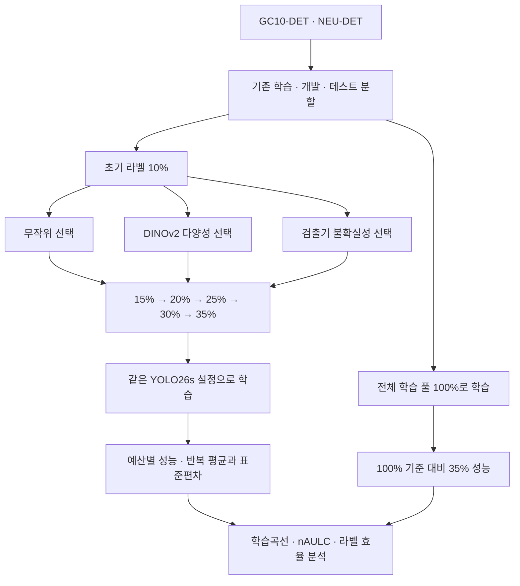

# 교수님 보고·학위논문·학회 원고 작업 계획 — 2026.10.21

> 실행 업데이트: 후속 사용자 지시에 따라10/21 20:57 KST에 정규 실행을 시작했다. [원고 내용 초안](20261021_paper_draft.md)과 [보고용 연구 흐름도](figures/20261021_research_flow.svg)를 병행 작성했다. 아래 일정은 최초 계획이며 실제 진행·ETA는 [실행 현황](../research_extensions/final_label_efficiency_20261021_01/campaign/STATUS_KO.md)에 기록한다.

## 교수님 피드백의 확정 요지

연구의 중심은 제한된 라벨에서 표본 선택이 학습 효율에 미치는 영향이다. 라벨 예산은 10~35% 여섯 지점을 유지하고, 동일 검출기의 100% 전체 train 기준과 비교한다. 새 selector·모델 구조·패치·추가 예산·취약 클래스 개선 연구는 진행하지 않는다. 반복 평균±SD, 예산별 mAP50-95/nAULC, 35%의 Full 대비 도달률을 주 결과에 포함한다. 실험과 글쓰기는 병행하며 교수님께 10월 27~28일 그림·초안을 전달한다.

## 현재 재사용할 자료와 수정할 자료

| 논문 부분 | 유지할 내용 | 이번 수정·추가 작업 | 완료 기준 |
|---|---|---|---|
| 서론 | 산업 결함 검출·라벨 비용·표본 선택 문제 | 같은 예산의 성능과 Full 대비 도달률이라는 두 질문을 명확히 연결 | 결과 수치를 예상하지 않은 서론 초안 |
| 관련 연구 | 기존 VLM/시각 표현·다양성·불확실성 연구 | 확인한 10월 공개 benchmark를 데이터·코드 공개로 정확히 표기; 외부 분할·mAP 정의 차이 설명 | 비교 조건 표와 실제 링크·서지 |
| 연구 이력 | 초기 VLM 탐색, C224 및 F518 증거 | 440회/162회/최근 dev/새YOLO26을 구분 | 실험 버전 표와 원자료 경로 일치 |
| 데이터 | F518 고정 train/dev/test와 기존 관계 처리 | 1,605와1,604 혼동 수정, NEU 정정 overlay 명시 | 모든 본문·표·그림의 최근 분할 수 일치 |
| 방법 | Frozen DINOv2-FF, Random, NCS Entropy | 26s·cosine·seed 대응·one2one adapter·cold-start·best 규칙 반영 | protocol.json과 방법절 대조 |
| 실험 결과 | 기존 v8 확정 결과 | 새26 결과는 별도 표·그림. 동일 설정 Full, 3반복 평균±SD, nAULC·도달률 추가 | 기술smoke·개발AP·testAP 혼입 0 |
| 논의 | 선택의 효과와 데이터셋 차이 | n=3·개발선정·과거test노출·고정epoch 한계, 개선/무차이/역전 모두 설명 | 유의성·독립 재현·상한 표현 점검 |
| 결론 | 확인된 연구 질문과 결과 | 완료 결과 범위 안에서만 정량화 | 근거 없는 성능·비용절감 주장 0 |

기존 학위논문 원본은 수정하지 않았다. `심사용논문_최종test반영본_20260925.docx`의 본문346문단과 `심사용논문_초안_20260927_내용정돈.docx`의 본문330문단을 텍스트로 확인했다. 두 문서 모두3.5절이 YOLOv8n 학습 조건이며 YOLO26 서술은 없다. 최근 고정 분할1,604/343/344는 이미 반영되어 있고,4.5절과 표4-4에는 전체 학습자료 참조 비교가 존재한다. 따라서 Full 설명을 새로 중복 삽입하기보다 기존4.5절을 확장하여35% 도달률·Full 반복SD·새26 결과를 구분한다. 과거test노출은 확인한 본문에 명시되어 있지 않아 한계절에 추가해야 한다.

문장 정돈본을 편집용 작업사본의 우선 후보로 하고,9월25일본의 최종평가 근거·표를 대조하여 유지한다. 실제 편집 전 표·수식·각주와 결과 수치의 전체 대조는 별도로 수행한다. 이번 확인은 DOCX 본문 텍스트를 읽은 것으로 서식·레이아웃 검증이나 DOCX 수정 완료를 뜻하지 않는다. 추출 근거는 실행 준비물의 `evidence/manuscript_read_check.json`에 남겼다.

## 필요한 표와 그림

| 산출물 | 포함 내용 | 현재 상태 |
|---|---|---|
| 표1: 데이터·분할·예산 | GC10/NEU train/dev/test, 실제 라벨 수, seed, 정정 이력 | 즉시 작성 가능 |
| 표2: 공통 학습·평가 설정 | YOLO26s, optimizer/schedule, 초기화, head, 패키지와 수치 소스 | 준비 완료 |
| 표3: 100% 성능 | 두 데이터셋 3 learner의 mAP50-95·mAP50·P/R 평균±SD | GC10 1회 학습 재사용, 나머지5회 필요; test 미평가 |
| 표4: 35% 효율 | 3방법의 AP, Full 대비 평균비 도달률, 대응비 평균±SD와 절대 gap | 틀 준비; 새26 결과 대기 |
| 표5: nAULC | 방법별 평균±SD와 DINO 대비 대응차이·Holm 정의 | 집계기 준비; 결과 대기 |
| 그림1: 연구 흐름 | 두 dataset→고정 train/dev/test→세 선택방법→10~35% 학습→100% 참조→효율 분석 | 아래 한국어 흐름 틀 |
| 그림2: 학습곡선 | dataset별 3방법 평균±SD, x는10~35%; Full은 별도 수평 참조선/범위 | 결과 대기. 35→100을 이어 그리지 않음 |
| 그림3: 반복별 대응차이 | 각 반복의 DINO−Random·DINO−Entropy nAULC | 결과 대기 |
| 보조표·그림 | 전체 클래스 AP, 기존 inclusion/crazing 사례, 외부 조건 비교 | 기존 자료 재사용; 새 진단실험 없음 |

결과 틀은 빈칸/TBD로 두며 가상 수치나 기술 smoke AP를 채우지 않는다. 평균±SD의 띠는 신뢰구간과 구별해 범례에 표시한다. 과거 v8의 GC10 DINO 94.69%·NEU88.96% Full 도달률은 별도 기존 결과군에서만 인용한다.

## 수정 연구 흐름도

그림에는 R0~R5·복잡한 수식·당연한 통제 조건 문구를 넣지 않는다. 전체 pool의100%이며 원본 전체 데이터나 test를 포함하지 않는다는 설명은 캡션에 쓴다. 논문 최종 그림은 본문 용어와 맞춰 출력하고 실제 결과값은 완료 후 반영한다.

## 학회 논문 초안 구성과 지금 쓸 수 있는 문장

학회 양식·분량·서지 스타일은 아직 확인되지 않았으므로 아래는 내용 초안 구조다. 최종 제출 형식으로 확정하지 않는다.

1. 서론: 산업 결함 annotation 비용과 같은 예산에서의 표본 선택 비교 필요성.
2. 관련 연구: 객체 탐지 AL, 불확실성 선택, frozen 시각 특징 기반 다양성, 외부 benchmark의 평가 조건.
3. 방법: 데이터·고정 분할, 세 선택방법, 여섯 예산, YOLO26s와 Full, 3개 대응 반복 및 분석.
4. 결과: Full→학습곡선→nAULC와 대응차이→35% 도달률→클래스 보조표 순서.
5. 논의·결론: 관측 결과, 기존 v8과의 조건 차이, 적용 범위와 한계.

방법절 초안:

> 본 연구는 GC10-DET와 NEU-DET에서 학습 풀의 약10~35%에 해당하는 여섯 라벨 예산을 고정하고, 무작위 선택, Frozen DINOv2 특징 기반 farthest-first 선택 및 검출기 class-score entropy 기반 선택을 비교한다. 각 방법은 대응된 초기 라벨 집합과 검출기 학습 조건을 공유한다. 별도로 전체 학습 풀을 사용한 동일 검출기를 참조 모델로 학습하며, 개발·테스트 데이터는 학습 풀에 포함하지 않는다. 예산별 mAP50-95와 nAULC, 35% 예산의 전체 학습 기준 대비 도달률을 분석한다. 결과는 세 개의 대응 획득·학습 seed 설정에서 평균과 표본 표준편차로 제시한다.

한계절 초안:

> 최근 검출기 설정은 개발 분할에서 검토되었으며, 사용한 고정 테스트 분할은 이전 연구 단계에서 평가된 이력이 있다. 따라서 본 비교를 연구 전 과정에서 미관찰인 신규 테스트에 대한 확증으로 해석하지 않는다. 세 개의 대응 반복은 획득 및 학습 무작위성의 결합 변동을 관측하며 두 요인의 효과를 분리 추정하지 않는다. 단일 데이터 분할, 고정 학습 epoch 및 공개 결함 데이터 범위의 제한을 함께 고려한다.

초록·결과·결론의 최종 수치 문장은 새26 결과 확보 뒤 작성한다. DINO 우위를 가정한 문장이나 성능 동등성 주장을 미리 넣지 않는다.

## 10월27~28일 전달 일정

| 날짜(KST) | 실험 작업 | 글·그림 작업 | 전달 가능한 증거 |
|---|---|---|---|
| 10/21 | 기존 감사·Full 재사용·입력 봉인·소규모 점검 | 교수님 추가지침·범위·예산 확정 기록 | 이번3문서, 통합표,102셀 행렬, 준비 판정 |
| 10/22 | 정규 실행 시작 시 공유10%·NEU Full 우선; 첫 실측시간으로 ETA 갱신 | 기존 학위논문 작업사본 선택, 데이터·방법절 수정 | 초기화·head·Full 설정 대조 |
| 10/23~25 | 모든 세전략·예산·대응 반복, 남은Full 확보 | 서론·관련연구·방법 초안, 표·그림 틀 | 완료/미완료 원장, 가중치·source SHA |
| 10/26 | 전체 완료 점검 후 고정test 평가·집계. 미완료면 완료 부분과 남은 비용 명시 | 학습곡선·도달률·클래스표 반영, 기존v8 결과와 구분 | 원시행↔집계 대조와 통계단위 검증 |
| 10/27 | 수치·도표·서술 일치 검토 | 교수 보고용 그림과 학회 내용 초안 정리 | 초안, 그림, 변경표, 한계·미완료 목록 |
| 10/28 | 필요시 누락 실행 상태 갱신 | 교수님 의견 반영 준비 | 실제 확보분 기준 전달 패키지 |

위10/22 이후 일정은 최초 실행 계획이다. 후속 지시로10/21에 착수했으며 임대·원격 전환은 하지 않았다. 준비 당시 약44시간의 중앙 추정은 평가/획득 비용을 제외하므로 날짜를 완료 보장으로 사용하지 않는다. 이후 원장에서는 실제 완료 셀·진행 epoch·획득 시간을 반영하여 갱신한다. 시간이 부족하면 결과에 유리한 예산·반복을 골라 제거하지 않고, 현재 완료 범위와 최종 완료 예상 시각을 보고한다.

## 우선순위와 완료 기준

- P0: 입력·설정·반복·재사용 판정 일치, 세전략 Entropy 경로 검증, 과거test노출 고지.
- P1: 동일 설정 Full과 전체AL 행렬 완료, 평균±SD·곡선·nAULC·도달률 확보, 표·그림 채움.
- P2: 기존 오류 사례·클래스 AP를 이용한 해석, 학위논문 변경 부분·학회 내용 원고 연결.

최종 인계에는 코드·환경·데이터 SHA, 정규 셀 성공/실패/미완료 원장, 같은 조건의 Full 결과, 평균±SD와 반복별 원자료, 교수 보고 그림, 학회 초안, 학위논문 수정 목록을 함께 넣는다. 확인되지 않은 실행이나 결과는 미실행·확인 불가로 남긴다.
