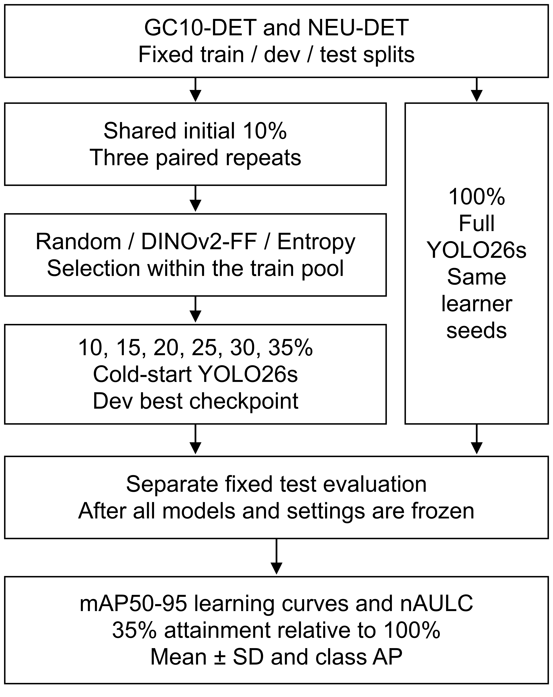

# Frozen DINOv2 기반 표본 선택의 금속 표면 결함 검출 라벨 효율 분석

Label Efficiency of Frozen DINOv2 Sample Selection for Metallic Surface Defect Detection

금속 표면 결함 검출의 위치 주석 비용을 줄이기 위해서는 같은 라벨 예산에서 학습 표본의 선택 효과를 비교할 필요가 있다. 본 연구는 고정된 DINOv2 특징 공간의 farthest-first 선택을 Random 및 검출기 Entropy 선택과 비교하는 실험을 설계한다. GC10-DET와 NEU-DET의 고정 분할에서 학습 풀의 10~35%를 사용하며, 동일한 YOLO26s를 100%로 학습한 지도학습 참조 모델을 포함한다. 세 개의 대응된 획득·학습 seed 설정에서 mAP50-95 학습곡선, nAULC, 35% 도달률과 평균±표준편차를 분석한다. 선택 원장과 예측 없음·동점 진단을 통해 획득 단계의 재현성을 점검한다. [최종 평가 후 정량 결과와 결론 보완]

Reducing bounding-box annotation demand requires examining which images are selected under a fixed label budget. This study compares farthest-first selection in a frozen DINOv2 feature space with random sampling and detector-based entropy sampling. Fixed splits of GC10-DET and NEU-DET are used with six cumulative training-pool budgets from 10% to 35%. Every detector is initialized from the same pretrained YOLO26s weights, and a fully supervised reference is trained on the complete training pool. Three paired acquisition and learner seed configurations are used. Label efficiency is assessed through mAP50-95 learning curves, normalized area under the learning curve, and 35%-budget attainment relative to the 100% reference. Means and sample standard deviations are reported, and acquisition logs track empty predictions, exact ties, and identifier-based cutoff decisions. Historical test exposure and the limited number of paired repetitions constrain interpretation. [Quantitative findings and the final conclusion will be added after the fixed evaluation.]

## Ⅰ. 서  론

금속 표면의 결함 검사는 제품 품질과 공정 상태를 확인하는 작업이다. 영상 기반 객체 검출기는 결함의 종류와 위치를 함께 예측할 수 있지만, 학습에 사용할 이미지마다 경계 상자와 클래스 주석이 필요하다. GC10-DET[1]와 NEU 표면 결함 데이터[2]는 서로 다른 결함 유형을 포함한 공개 자료로서, 제한된 라벨에서 검출기를 학습하는 방법을 비교할 수 있는 기반을 제공한다.

공개된 전체 주석을 학습에 사용하는 조건과 달리, 실제 라벨 예산이 제한된 상황에서는 어떤 이미지를 먼저 주석할 것인지가 문제가 된다. 풀 기반 능동학습은 초기 라벨 집합에서 학습한 모델 또는 영상 표현을 이용해 미선택 후보를 순차적으로 추가한다. 이때 같은 수의 이미지를 사용하더라도 표본의 구성에 따라 검출 성능이 달라질 수 있다. 따라서 선택 전략의 효과는 한 예산의 단일 점수보다 여러 예산의 학습곡선과 반복 간 변동을 통해 평가할 필요가 있다.

본 연구는 고정된 DINOv2 영상 표현에서 farthest-first로 표본을 선택하는 방법이 금속 표면 결함 검출의 라벨 효율에 어떤 영향을 주는지 검토한다. 비교 대상은 Random과 검출기의 클래스 점수 Entropy이며, 두 데이터셋에서 10%, 15%, 20%, 25%, 30%, 35%의 누적 이미지 예산을 사용한다. 별도로 전체 학습 풀의 100%를 사용하는 Fully Supervised 모델을 학습하여, 35% 라벨에서 참조 성능의 어느 정도에 도달하는지 분석한다.

연구 질문은 두 가지다. 첫째, 같은 예산과 검출기에서 Frozen DINOv2 선택의 성능곡선과 nAULC가 다른 전략과 어떻게 다른가. 둘째, 제한된 라벨로 확보한 성능이 100% 지도학습 참조와 얼마나 차이가 나는가. 이를 위해 선택 전략 이외의 학습·평가 조건을 고정하고 세 개의 대응 반복을 사용한다. 본 연구의 기여는 새로운 선택 알고리즘이나 검출기 구조의 제안이 아니라, 두 결함 데이터에서 선택 전략과 전체 학습 참조를 함께 비교하는 데 있다.

## Ⅱ. 관련 연구 및 연구 방법

### 2.1 산업 영상의 이상 탐지와 객체 검출

J-KICS에 게재된 Lee 등의 연구[3]는 정상 영상만으로 학습한 계단식 U-Net을 이용해 산업용 USB 영상의 이상 영역을 찾는다. Kim과 Park의 MG-AD[4]는 마스크를 이용한 student–teacher 학습으로 산업 영상의 이상 탐지를 다룬다. 두 연구는 결함 자료 확보의 어려움을 고려하지만, 정상 중심 이상 탐지와 경계 상자 지도학습의 문제 설정은 다르다. 본 연구는 이미 주석된 공개 자료에서 일부 이미지만 선택하는 객체 검출 실험이며, 해당 연구들의 AUROC 또는 AUPRO 수치를 mAP와 직접 비교하지 않는다.

Lim 등의 YOLO 응용 연구[5]는 검출 모델의 클래스별 정밀도, 학습 결과 및 구현 환경을 구분하여 제시한다. 본 연구에서도 데이터 분할·검출기 설정·클래스별 검출 결과를 분리하여 설명한다. 외부 논문의 성능은 데이터, 모델 크기, 분할 및 지표가 일치하지 않으므로 선택 전략의 우열을 판단하는 비교값으로 사용하지 않는다.

### 2.2 고정 특징 공간의 표본 선택

Sener와 Savarese[6]는 능동학습을 특징 공간의 core-set 선택 관점에서 다루었다. 본 연구는 이러한 기하학적 관점을 참고하여, 현재 라벨 집합과의 최근접 거리가 가장 큰 후보를 반복적으로 추가하는 greedy farthest-first를 사용한다. 원 연구의 최적화 절차나 이론적 보장이 본 비교의 검출기에 그대로 성립한다고 가정하지 않는다.

DINOv2[7]는 자기지도 학습으로 얻은 범용 시각 특징을 제공한다. 본 연구에서는 고정 revision의 facebook/dinov2-small을 갱신하지 않고 사용한다. 이미지의 긴 변을 518로 맞추고 고정 RGB값으로 패딩한 뒤, 마지막 CLS 표현을 384차원 L2 정규화 특징으로 저장한다. DINOv2는 선택을 위한 영상 표현이며, 별도 학습하는 YOLO26s의 backbone을 대체하거나 텍스트 정보를 입력하지 않는다.

학습 풀을 U, 현재 라벨 집합을 L, 정규화 특징을 z로 두면 다음 후보는 식 (1)로 선택한다. d(x,L)은 특징 z(x)와 라벨 집합의 각 z(l) 사이 L2 거리의 최솟값이다. 후보를 하나 추가할 때마다 각 미선택 표본의 최근접 거리를 갱신한다. 저장된 float32 특징을 float64 비교에 사용하며, 거리 동률의 허용범위와 ID 처리 규칙은 기존 선택 구현을 유지한다. 검출기에 의존하지 않는 Random과 DINOv2 선택 목록은 입력 해시와 집합 포함 관계를 검증하여 재사용한다.

x* = arg maxₓ∈U∖L minₗ∈L ‖zₓ − zₗ‖₂  (1)

### 2.3 Random과 Entropy 선택

Random은 기존 PCG64/SeedSequence 생성 규칙에 따라 미선택 학습 풀에서 표본을 추가한다. 같은 반복의 세 전략은 동일한 초기 10% 집합과 learner seed를 공유한다. 각 획득은 이미 선택된 표본을 제외하며, 누적 예산의 정수 이미지 수를 정확히 맞춘다.

Entropy는 직전 예산에서 학습한 해당 반복의 best checkpoint로 미선택 이미지를 추론하여 점수를 계산한다. YOLO26s의 one2one branch에서 top-k 이전의 전체 클래스 sigmoid 점수를 얻고, 설치 구현의 XYXY 박스를 기존 집계 함수가 요구하는 XYWH로 변환한다. 최대 클래스 점수가 0.25를 넘는 후보에 클래스별 stable NMS(IoU 0.7)를 적용하고 최대 300개를 남긴다. 이 처리는 획득 점수를 집계하기 위한 것이며 최종 검출 평가 경로와 구분한다.

박스 j의 클래스 점수 sⱼ꜀를 클래스 합으로 나누어 qⱼ꜀를 만들고, 클래스 수 C의 로그로 정규화한 Shannon entropy hⱼ를 계산한다. 이미지의 획득 점수는 남은 박스의 hⱼ 평균이다. 이는 보정된 사후확률 또는 인식적 불확실성의 직접 추정으로 해석하지 않는다.

hⱼ = −Σ꜀ qⱼ꜀ log(qⱼ꜀) / log C  (2)

유효 박스가 없으면 이미지 점수를 0으로 둔다. 이미지 점수가 정확히 같으면 opaque ID의 오름차순으로 선택한다. 예측 없음 비율, 정확 동점 비율, cutoff 동점에서 ID로 결정된 선택 수 및 ID 순위 10분위 분포를 획득 원장에 기록한다. 일부 입력의 반복 추론 일치와 선택 목록의 크기·유일성·미선택 풀 포함 여부를 확인한다. 진단은 고정 규칙의 작동을 확인하기 위한 것으로, 결과를 본 뒤 새로운 선택 규칙으로 바꾸지 않는다.

### 2.4 데이터 분할과 라벨 예산

두 데이터셋은 기존에 고정한 canonical 표본과 component 분할을 사용한다. GC10-DET의 분석 대상은 2,291장, NEU-DET는 1,798장이다. RGB identity, 주석 정합성, 알려진 중복·부분 영상 관계 및 보수적으로 묶은 위험 관계를 고려한 component가 분할을 가로지르지 않도록 확인한다. 이 component는 실제 제품 또는 생산 lot의 정답 그룹을 뜻하지 않는다. 분할별 이미지 수와 seed는 표 1과 같다.

표 1. 고정 데이터 분할

Table 1. Fixed dataset splits

| Dataset | Class count | Train | Dev | Test |
| --- | --- | --- | --- | --- |
| GC10-DET | 10 | 1,604 | 343 | 344 |
| NEU-DET | 6 | 1,258 | 270 | 270 |

GC10과 NEU의 분할 seed는 각각 2026091906과 2026091907이다. NEU 실행 라벨은 기존 주석 패치에 따라 같은 클래스·같은 좌표의 정확 중복 상자 3행을 제거한 버전을 사용한다. 원본 자료를 새로 교체하거나 추가 정제하지 않는다. 학습·개발 이미지와 라벨 6,950개 파일의 SHA-256 및 분할 ID를 실행 전에 확인한다. 고정 테스트에는 과거 연구의 평가 및 이전 분할에서의 자료 사용 이력이 있으며, 연구 전 과정에서 미관찰인 신규 테스트로 기술하지 않는다.

예산의 분모는 학습 풀의 이미지 수이며, 개발·테스트 이미지는 포함하지 않는다. 10% 초기 집합에서 다섯 차례 획득하여 35%까지 증가시키고, 정수 반올림으로 얻은 실제 누적 수를 표 2에 제시한다. 비교에는 표시 백분율뿐 아니라 이 실제 수를 사용한다.

표 2. 예산별 누적 라벨 이미지 수

Table 2. Cumulative labeled image counts

| Budget | GC10-DET | NEU-DET |
| --- | --- | --- |
| 10% | 160 | 126 |
| 15% | 241 | 189 |
| 20% | 321 | 252 |
| 25% | 401 | 315 |
| 30% | 481 | 377 |
| 35% | 561 | 440 |

### 2.5 대응 반복과 공통 검출기

그림 1은 제한된 라벨의 표본 선택과 100% 지도학습 참조를 비교하는 전체 흐름이다.

그림 1. 표본 선택과 전체 학습 참조의 비교 흐름

Fig. 1. Sample selection and the fully supervised reference

표 3의 획득 seed와 learner seed를 하나의 대응 반복으로 사용한다. 같은 반복의 Random, DINOv2-FF, Entropy는 초기 집합과 학습 seed를 공유하며, 동일한 learner seed의 100% 참조를 둔다. 획득과 학습 무작위성을 분리 추정하는 3×3 설계가 아니라 세 개의 결합 반복이다. 공유 10% 모델은 전략별로 중복 학습하지 않는다.

표 3. 대응된 획득 및 학습 seed

Table 3. Paired acquisition and learner seeds

| Pair | Acquisition seed | Learner seed |
| --- | --- | --- |
| 1 | 2026091901 | 2026091900 |
| 2 | 2026091902 | 2026091908 |
| 3 | 2026091903 | 2026091909 |

공통 검출기는 Ultralytics YOLO26s[8]이며, 모든 예산을 동일한 공식 사전학습 가중치에서 새로 초기화한다. 이전 예산의 검출기 학습을 이어받지 않는다. Entropy 획득에 직전 checkpoint를 사용하는 것과 다음 예산 모델의 초기화 정책을 구분한다.

학습 설정은 표 4와 같다. 공통 100 epoch, 입력 640, batch 8, nbs 64, SGD 및 cosine schedule을 사용하며 마지막 10 epoch에서 mosaic을 닫는다. 기존 개발 분할의 설정 검토를 거쳐 고정한 조건을 두 데이터셋과 모든 선택 방법에 공통 적용한다. 방법별 결과를 보고 학습률·증강·optimizer를 다시 선택하지 않는다. 나머지 손실·증강 설정도 봉인한 공통 인자를 따른다.

표 4. 공통 학습 및 평가 설정

Table 4. Common training and evaluation settings

| Item | Setting |
| --- | --- |
| Detector | YOLO26s; common pretrained weights |
| Initialization | Cold start at every budget |
| Epochs / input | 100 / 640 × 640 |
| Batch / nominal batch | 8 / 64 |
| Optimizer | SGD; lr0 0.01; lrf 0.01 |
| Momentum / decay | 0.937 / 0.0005 |
| Schedule / warmup | Cosine / 3 epochs |
| Close mosaic | Last 10 epochs |
| Train precision | AMP enabled |
| Checkpoint choice | Maximum dev mAP50-95; latest tie |
| Dev selection loader | Batch 16; rect=True |
| Report evaluation | FP32; batch 8; rect=False |
| Report thresholds | conf 0.001; IoU 0.7; max_det 300 |
| Detection head | Installed one2one / end2end path |
| Software | Python 3.11.9; Ultralytics 8.4.90 |
| Torch / torchvision | 2.12.1+cu126 / 0.27.1+cu126 |
| GPU | NVIDIA RTX 3070 |

best checkpoint는 학습 중 개발 mAP50-95가 최대인 epoch이며, 동률이면 마지막 epoch를 선택한다. checkpoint 선정 loader는 batch 16·rect=True이고, 최종 보고 평가는 FP32·batch 8·rect=False를 사용한다. 따라서 학습 로그의 개발 점수를 최종 테스트 수치로 대체하지 않는다. YOLO26s 출력은 설치 버전 8.4.90의 실제 one2one 경로를 사용하며 다른 버전의 기본값을 소급 적용하지 않는다.

100% 참조는 같은 학습 풀 전체를 사용하고 나머지 정책을 공유한다. GC10의 learner seed 2026091900 참조는 분할·가중치·학습 설정·실행 환경·100 epoch 완료를 검증하여 재사용한다. 전체 설계는 데이터셋별 51개, 합계 102개의 물리적 학습 모델로 구성되며 신규 학습은 101개다. 기술 점검용 실행은 과학적 반복에 포함하지 않는다. 동일 epoch의 100% 참조는 더 많은 업데이트를 포함하므로 동일 계산량의 비교 또는 성능의 절대 상한을 의미하지 않는다.

### 2.6 평가지표와 분석 방법

주 검출 지표는 mAP50-95이며, mAP50, Precision, Recall 및 클래스별 AP50·AP50-95를 보조로 제시한다. AP는 원자료의 0~1 값을 본문에서 백분율로 표시하고 방법 간 차이는 %p로 표기한다. P/R는 설치 validator가 smoothed mean F1 최대점에서 반환하는 요약값이며, 고정 confidence 운영점의 값과 구분한다. 세 반복의 평균과 표본 표준편차(ddof=1)를 보고한다.

한 반복의 실제 누적 라벨 수를 N₁,…,N₆, 해당 mAP50-95를 A₁,…,A₆, 구간 간격을 ΔNᵢ=Nᵢ₊₁−Nᵢ라 하면 nAULC는 식 (3)과 같다. 학습곡선을 사다리꼴 적분한 뒤 N₆−N₁로 나누며, 100% 참조는 이 적분에 포함하지 않는다. 반복별 nAULC를 먼저 계산한 뒤 평균과 표준편차를 구한다. 표시 단위는 AP와 같은 백분율이다.

nAULC = Σᵢ₌₁⁵ ΔNᵢ(Aᵢ₊₁ + Aᵢ) / [2(N₆ − N₁)]  (3)

실제 이미지 수를 이용하므로 예산 구간별 반올림에 따른 간격 차이를 반영한다.

35% 도달률의 주 요약은 식 (4)의 평균비이며, 동일 learner seed에 대응하는 세 개별 비율의 평균±SD도 별도로 제시한다. 분모가 0이면 비율은 정의하지 않는다. 각 방법의 35% 성능과 Full 성능, 대응 절대 gap도 함께 제시하여 비율만으로 차이를 판단하지 않는다.

R₃₅ = 100 × mean(A₃₅) / mean(AFull)  (4)

DINOv2−Random과 DINOv2−Entropy의 반복별 nAULC 차이를 대응 비교한다. 두 데이터셋과 두 비교로 구성된 네 primary family에 Holm 정의를 적용한다. 다만 세 대응 반복의 양측 exact sign-flip 검정에서 가능한 최소 p는 0.25이므로 p<0.05의 우위를 확인할 수 없다. 따라서 효과의 크기·방향, 표준편차와 반복별 값을 중심으로 해석하며, 여섯 예산을 독립 반복으로 세지 않는다.

입력·선택 목록·설치 수치 소스·학습 인자·checkpoint의 해시와 셀별 실행 시간을 보존한다. 전체 모델과 설정 확정 후 별도 단계에서 고정 테스트를 평가한다. 테스트 결과를 보고 주 지표, 선택 전략 또는 예산을 바꾸지 않는다. 예산은 이미지 수의 비율이며 경계 상자 수 또는 실제 주석 시간의 절감률을 직접 나타내지 않는다.

## Ⅲ. 실험 및 결과

### 3.1 예산별 성능곡선

표 5와 표 6은 각 데이터셋의 예산별 mAP50-95를 정리할 자리다. 모든 수치는 별도 고정 평가 후 세 대응 반복의 평균±SD로 채운다. 표의 대시(—)는 평가 대기이며 0점 또는 검출 실패를 뜻하지 않는다. 학습 중 개발 점수와 과거 검출기 실험의 테스트 결과는 이 표에 혼합하지 않는다.

표 5. GC10-DET의 예산별 mAP50-95

Table 5. GC10-DET mAP50-95 (%) by label budget

| Label (%) | N | Random | DINOv2- FF | Entropy |
| --- | --- | --- | --- | --- |
| 10% | 160 | — | — | — |
| 15% | 241 | — | — | — |
| 20% | 321 | — | — | — |
| 25% | 401 | — | — | — |
| 30% | 481 | — | — | — |
| 35% | 561 | — | — | — |

표 6. NEU-DET의 예산별 mAP50-95

Table 6. NEU-DET mAP50-95 (%) by label budget

| Label (%) | N | Random | DINOv2- FF | Entropy |
| --- | --- | --- | --- | --- |
| 10% | 126 | — | — | — |
| 15% | 189 | — | — | — |
| 20% | 252 | — | — | — |
| 25% | 315 | — | — | — |
| 30% | 377 | — | — | — |
| 35% | 440 | — | — | — |

10% 값은 같은 반복 안에서 공유되므로 세 방법에 같은 결과를 기입한다. 학습곡선은 실제 라벨 이미지 수를 x축, mAP50-95를 y축으로 하고 평균과 SD를 표시한다. 동일 데이터셋의 100% 참조 평균과 변동을 별도로 나타낸다. 학습곡선은 실제 평가값이 확보된 후 작성하며, 특정 방법의 우위를 전제하여 형태를 채우지 않는다.

### 3.2 nAULC와 100% 참조 대비 도달률

표 7에는 10~35% 구간의 nAULC와 35% 성능, Full 대비 주 도달률을 함께 정리한다. 같은 데이터셋의 Full 참조는 방법별로 새로 학습한 값이 아니라 세 learner seed가 공유하는 기준이다. 반복별 대응 차이와 개별 도달률의 평균±SD 및 절대 gap은 표 8에 구분한다. Full을 상회하는 값이 관측되어도 이를 오류나 새로운 상한의 증거로 단정하지 않는다.

표 7. 라벨 효율과 전체 학습 참조

Table 7. Label efficiency and the fully supervised reference

| Data | Method | nAULC (%) | AP35 (%) | R35 (%) |
| --- | --- | --- | --- | --- |
| GC10 | Random | — | — | — |
| GC10 | DINOv2-FF | — | — | — |
| GC10 | Entropy | — | — | — |
| NEU | Random | — | — | — |
| NEU | DINOv2-FF | — | — | — |
| NEU | Entropy | — | — | — |

표 7의 nAULC와 AP35는 평균±SD, R35는 100×mean(AP35)/mean(APFull)이다. GC10 Full mAP50-95: —; NEU Full mAP50-95: — (각각 평균±SD, %).

표 8. 대응 반복의 차이와 개별 도달률

Table 8. Paired differences and individual attainment ratios

| Data | Comparison / method | Summary |
| --- | --- | --- |
| GC10 | DINOv2 − Random: ΔnAULC | — |
| GC10 | DINOv2 − Entropy: ΔnAULC | — |
| GC10 | Random: paired R35 / gap | — |
| GC10 | DINOv2-FF: paired R35 / gap | — |
| GC10 | Entropy: paired R35 / gap | — |
| NEU | DINOv2 − Random: ΔnAULC | — |
| NEU | DINOv2 − Entropy: ΔnAULC | — |
| NEU | Random: paired R35 / gap | — |
| NEU | DINOv2-FF: paired R35 / gap | — |
| NEU | Entropy: paired R35 / gap | — |

### 3.3 클래스별 결과와 획득 진단

평균 성능만으로 특정 결함의 저하가 가려지는지 확인하기 위해 35%와 Full의 클래스별 AP50-95를 표 9에 정리한다. 클래스 이름은 실행 라벨의 정의를 따르며 GC와 NEU에서 같은 이름이 나타나도 서로 다른 데이터셋의 클래스로 취급한다. AP50 및 전체 P/R는 보조 결과로 함께 집계한다. 비교를 위한 새로운 데이터 분할이나 선택 알고리즘은 추가하지 않는다.

표 9. 35%와 전체 학습의 클래스별 AP50-95

Table 9. Class AP50-95 (%) at 35% and 100% budgets

| Data / class | Rnd 35% | DINO 35% | Ent 35% | Full 100% |
| --- | --- | --- | --- | --- |
| GC / punching hole | — | — | — | — |
| GC / welding line | — | — | — | — |
| GC / crescent gap | — | — | — | — |
| GC / water spot | — | — | — | — |
| GC / oil spot | — | — | — | — |
| GC / silk spot | — | — | — | — |
| GC / inclusion | — | — | — | — |
| GC / rolled pit | — | — | — | — |
| GC / crease | — | — | — | — |
| GC / waist folding | — | — | — | — |
| NEU / crazing | — | — | — | — |
| NEU / inclusion | — | — | — | — |
| NEU / patches | — | — | — | — |
| NEU / pitted surface | — | — | — | — |
| NEU / rolled-in scale | — | — | — | — |
| NEU / scratches | — | — | — | — |

Entropy 획득별로 전체 미선택 후보 수, 예측 없음 수와 비율, 정확 동점 집합의 크기, cutoff ID 결정 수 및 ID 순위 분포를 확인한다. 예측이 없는 표본의 0점과 유효 예측을 가진 동점은 구분한다. cutoff 동점이 선택 목록에 미치는 영향은 비율의 분모와 함께 기록하고, ID 순위가 한쪽에 집중되는지를 해석한다. 이 진단은 예측과 선택의 구현이 정상인지 평가하는 근거이며 검출 AP를 대체하지 않는다. [획득 완료 후 진단 요약 입력]

### 3.4 해석 범위와 한계

본 비교는 두 공개 결함 데이터의 하나의 고정 분할과 지정된 YOLO26s 설정에 한정된다. 개발 분할은 설정 검토와 checkpoint 선정에 사용되었으며, 고정 테스트에는 과거 평가와 이전 분할의 학습 노출 이력이 있다. 따라서 본 결과를 연구 전 과정에서 독립적인 외부 검증 또는 새로운 생산 환경에 대한 일반화의 확증으로 주장하지 않는다.

세 반복은 획득과 학습 seed의 결합 변동을 관측한다. 표본 수가 작아 유의성 판정보다 반복별 방향과 효과량의 일관성을 우선 해석한다. 또한 100% 모델은 동일 epoch에서 더 많은 학습 업데이트를 포함하고, 이미지 기준 예산은 객체 수와 주석 난이도의 차이를 포함하지 않는다. 도달률은 이 고정 조건의 상대 성능이며 실제 작업 시간이나 비용의 절감률로 곧바로 환산할 수 없다.

## Ⅳ. 결  론

본 연구는 Frozen DINOv2 기반 farthest-first 표본 선택의 금속 표면 결함 검출 라벨 효율을 평가하기 위한 비교 절차를 구성하였다. GC10-DET와 NEU-DET에서 10~35% 예산의 Random·DINOv2-FF·Entropy를 같은 검출기와 대응 반복으로 비교하고, 100% 지도학습 참조를 통해 제한된 라벨에서 확보한 성능을 분석한다. 학습곡선, nAULC, 35% 도달률과 클래스별 결과를 함께 제시하여 선택 전략의 효과와 적용 범위를 설명한다.

[최종 평가 후 데이터셋별 정량 결과와 연구 질문에 대한 답을 입력한다. DINOv2의 우위·동등·열위 중 관측된 결과에 맞춰 결론을 작성하고, 평균 차이·반복 변동·Full 대비 도달률 및 과거 테스트 노출의 한계를 함께 기술한다.]

## References

[1] X. Lv, F. Duan, J.-J. Jiang, X. Fu, and L. Gan, “Deep Metallic Surface Defect Detection: The New Benchmark and Detection Network,” Sensors, vol. 20, no. 6, article 1562, Mar. 2020. https://doi.org/10.3390/s20061562

[2] K. Song, “NEU Surface Defect Database,” accessed Oct. 21, 2026. https://faculty.neu.edu.cn/songkc/en/zdylm/263265/list/

[3] S.-H. Lee, M.-W. Bae, and D.-S. Han, “Anomaly Detection for Industrial USB Images Using a Cascaded U-Net Trained Only on Normal Data,” J. Korean Inst. Commun. Inf. Sci., vol. 51, no. 10, pp. 1827–1836, Oct. 2026. https://doi.org/10.7840/kics.2026.51.10.1827

[4] D. Kim and Y. H. Park, “MG-AD: Mask-Guided Student-Teacher Training for Real-Time Anomaly Detection,” J. Korean Inst. Commun. Inf. Sci., vol. 51, no. 5, pp. 997–1008, May 2026. https://doi.org/10.7840/kics.2026.51.5.997

[5] Y.-H. Lim, S.-H. Lee, S.-H. Oh, and J.-G. Kim, “YOLO-Based Electric Scooter Crackdown Platform,” J. Korean Inst. Commun. Inf. Sci., vol. 50, no. 8, pp. 1290–1300, Aug. 2025. https://doi.org/10.7840/kics.2025.50.8.1290

[6] O. Sener and S. Savarese, “Active Learning for Convolutional Neural Networks: A Core-Set Approach,” in Proc. Int. Conf. Learn. Represent. (ICLR), Vancouver, Canada, Apr. 2018. https://doi.org/10.48550/arXiv.1708.00489

[7] M. Oquab et al., “DINOv2: Learning Robust Visual Features without Supervision,” arXiv preprint, arXiv:2304.07193, 2023. https://doi.org/10.48550/arXiv.2304.07193

[8] Ultralytics, “Ultralytics YOLO26,” accessed Oct. 21, 2026. https://docs.ultralytics.com/models/yolo26/
