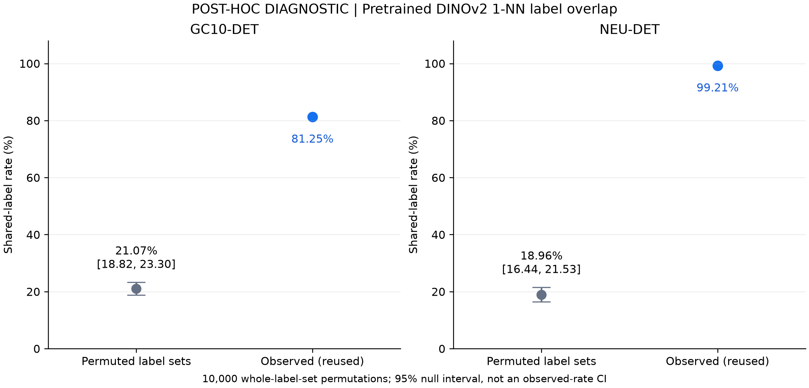
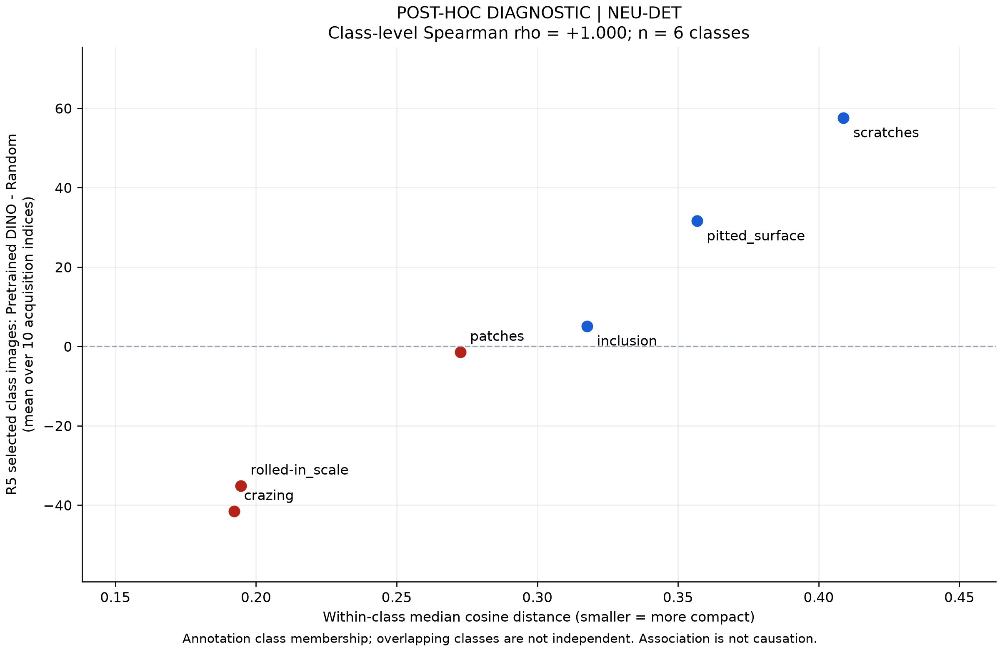
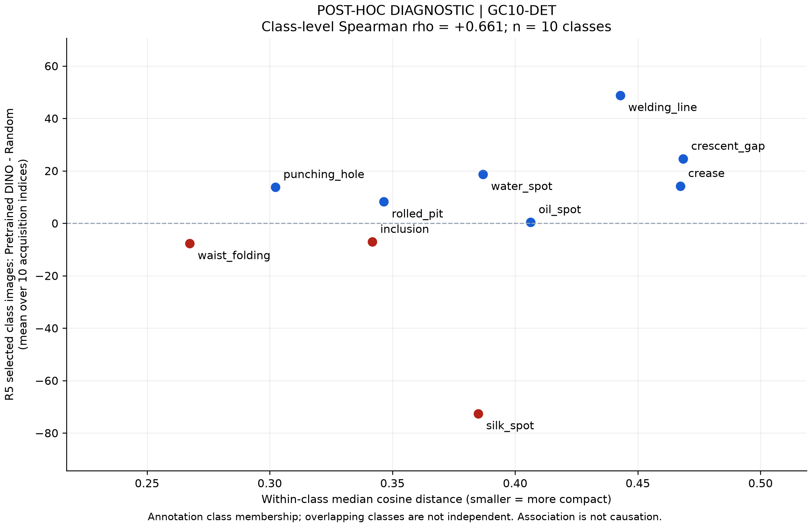

# POST-HOC PRETRAINED DINOv2 CLASS GEOMETRY AUDIT

분석 시각: **2026-09-09 00:09 KST**. 기존 결과를 해석하는 CPU 사후 진단이다. 사전학습 DINOv2의 저장된 특징과 과거 선택 목록만 사용했으며, DINOv2의 추가 학습·특징 재추출·탐지기 학습·새 표본 선택은 수행하지 않았다.

**전체 판정: PARTIAL SUPPORT.** NEU에서는 사전 지정 primary compactness 지표와 선택 편차가 매우 일관되게 대응한다. GC10도 양의 연관성이 있지만 중요한 예외가 있고, 보조 지표들 사이에도 차이가 있다. 클래스 내 geometry는 선택 구성 차이에 대한 설명 후보를 강화한다. 원인 전체가 증명됐다는 뜻은 아니다.

## 1. Chance baseline

기존 1-NN graph와 관측 일치율을 재사용했다. 각 이미지의 **전체 annotation label set을 통째로** 이미지 ID 사이에 섞어 클래스 빈도, 이미지당 클래스 수, 클래스 동시 출현을 보존했다. match는 기존과 동일하게 두 label set의 교집합이 비어 있지 않은 경우다. self-neighbor는 없다. 데이터셋별 10,000회, PCG64, GC10 seed `2026090801`, NEU seed `2026090802`를 결과 전에 기록했다.

| Dataset | 기존 observed 1-NN | Permutation mean | 2.5–97.5 percentile | Observed − chance |
|---|---:|---:|---:|---:|
| GC10-DET | 81.2461% | 21.0717% | [18.8162%, 23.3022%] | +60.1744 pp |
| NEU-DET | 99.2057% | 18.9585% | [16.4416%, 21.5250%] | +80.2472 pp |

구간은 **라벨 permutation null distribution의 중앙 95% 범위**이며 관측 일치율의 신뢰구간이 아니다. 관측값과 null의 차이를 기술했으며 p-value는 계산하지 않았다. 단순 균등 single-label 기준 10%/16.67%와 비교해 우연 수준을 과소평가하지 않았다. 현재 데이터는 GC10 1,605장 중 331장, NEU 1,259장 중 83장이 multi-label이다.

독립 산술 검증으로 서로 다른 두 이미지의 label-set overlap 비율을 계산하면 이 고정 graph에서 permutation 평균의 정확한 기대값은 GC10 21.0917%, NEU 18.9270%다. Monte Carlo 평균은 그 기대값과 일치하는 범위에 있었다. **관측된 높은 라벨 국소 구조를 클래스 빈도와 co-occurrence만으로 설명하기 어렵다.** 이 결과를 fine-tuning 효과, 결함 위치 보존, 모든 클래스의 탐지 적합성으로 확대하지 않는다.

## 2. Class-wise compactness

결과 계산 전에 고정한 순서대로 네 지표를 모두 보고한다. 모두 cosine distance이며 작을수록 compact하다. 클래스 c가 annotation된 모든 acquisition 이미지를 사용하므로 한 이미지가 여러 클래스 집계에 포함될 수 있다.

- **A (primary):** 클래스 내 서로 다른 unordered image pair의 거리 중앙값. 대각선 제외.
- **B:** 각 이미지에서 같은 클래스의 다른 이미지 5개까지의 최근접 거리 평균을 구한 뒤, 그 평균들의 중앙값.
- **C:** 클래스 평균 embedding 방향까지의 거리 중앙값.
- **D:** 같은 centroid distance의 90th percentile(radius).

원본 FP32 cache는 수정하지 않았다. 실제 cosine 계산을 위해 CPU의 임시 float64 배열만 정규화했다. 기존 label agreement와 graph를 새로 추론하거나 변경하지 않았다.

### GC10-DET

| Class | Pool support | A: pair median | B: 5-NN | C: centroid median | D: radius p90 |
|---|---:|---:|---:|---:|---:|
| punching_hole | 230 | 0.302328 | 0.133380 | 0.157625 | 0.258516 |
| welding_line | 358 | 0.442856 | 0.150397 | 0.216847 | 0.412498 |
| crescent_gap | 185 | 0.468505 | 0.159656 | 0.248291 | 0.381532 |
| water_spot | 217 | 0.386944 | 0.146275 | 0.201365 | 0.303685 |
| oil_spot | 175 | 0.406333 | 0.118040 | 0.201871 | 0.379896 |
| silk_spot | 508 | 0.384966 | 0.072465 | 0.200694 | 0.317712 |
| inclusion | 141 | 0.341809 | 0.106154 | 0.162164 | 0.333349 |
| rolled_pit | 32 | 0.346491 | 0.225300 | 0.162924 | 0.331006 |
| crease | 37 | 0.467281 | 0.269701 | 0.242649 | 0.397992 |
| waist_folding | 98 | 0.267396 | 0.101547 | 0.129181 | 0.245301 |

### NEU-DET

| Class | Pool support | A: pair median | B: 5-NN | C: centroid median | D: radius p90 |
|---|---:|---:|---:|---:|---:|
| crazing | 210 | 0.192279 | 0.084106 | 0.100317 | 0.149685 |
| rolled-in_scale | 210 | 0.194577 | 0.080479 | 0.100082 | 0.161674 |
| patches | 238 | 0.272618 | 0.114189 | 0.136670 | 0.342574 |
| inclusion | 264 | 0.317690 | 0.114142 | 0.155138 | 0.371291 |
| pitted_surface | 211 | 0.356728 | 0.135775 | 0.190662 | 0.280033 |
| scratches | 210 | 0.408829 | 0.159917 | 0.219139 | 0.342197 |

## 3. Selection deviation vs geometry

각 round의 누적 선택 이미지 수를 사용했다. 각 데이터셋에서 과거 acquisition index 10개의 Random 평균과 사전학습 DINOv2 + farthest-first 평균을 대조했다. A/B learner가 공유하는 선택 목록은 한 번만 센다. 아래 ratio는 **DINO 평균 / historical Random 평균**이다. 실제 Random 기대값 `labeled_count × pool_class_count / pool_size`도 [전체 결합 표](results/selection_vs_geometry.csv)에 별도로 보존했다.

### R5 선택 구성

| Dataset / class | Pool support | Historical Random mean | DINO mean | DINO − Random | Ratio |
|---|---:|---:|---:|---:|---:|
| GC10 punching_hole | 230 | 82.3 | 96.1 | +13.8 | 1.168 |
| GC10 welding_line | 358 | 130.4 | 179.2 | +48.8 | 1.374 |
| GC10 crescent_gap | 185 | 66.9 | 91.5 | +24.6 | 1.368 |
| GC10 water_spot | 217 | 74.7 | 93.4 | +18.7 | 1.250 |
| GC10 oil_spot | 175 | 62.4 | 62.8 | +0.4 | 1.006 |
| GC10 silk_spot | 508 | 176.8 | 104.2 | −72.6 | 0.589 |
| GC10 inclusion | 141 | 48.3 | 41.2 | −7.1 | 0.853 |
| GC10 rolled_pit | 32 | 11.7 | 19.9 | +8.2 | 1.701 |
| GC10 crease | 37 | 12.8 | 27.0 | +14.2 | 2.109 |
| GC10 waist_folding | 98 | 31.9 | 24.2 | −7.7 | 0.759 |
| NEU crazing | 210 | 73.8 | 32.3 | −41.5 | 0.438 |
| NEU rolled-in_scale | 210 | 68.8 | 33.7 | −35.1 | 0.490 |
| NEU patches | 238 | 83.3 | 81.9 | −1.4 | 0.983 |
| NEU inclusion | 264 | 93.3 | 98.4 | +5.1 | 1.055 |
| NEU pitted_surface | 211 | 79.0 | 110.6 | +31.6 | 1.400 |
| NEU scratches | 210 | 75.1 | 132.7 | +57.6 | 1.767 |

GC10 클래스별 count도 기존 raw table에 있었으므로 새 annotation 해석 없이 재사용했다. NEU의 R1–R5 차이는 기존 summary의 모든 class row와 일치했다. 240개 conceptual 상태(R0는 두 arm에 표시), 220개 고유 누적 manifest와 200개 query manifest를 원본 SHA-256 및 membership과 대조했다. 기존 class count와 재사용 label set으로 확인한 count는 전부 같았다.

### 전체 round의 Spearman 상관

양수는 거리가 큰, 더 퍼진 클래스일수록 상대적으로 많이 선택되는 방향이다. 클래스 수는 GC10 n=10, NEU n=6이며, p-value/CI는 계산하지 않았다. 동일 geometry와 누적 trajectory를 여러 round에서 보기 때문에 이 다섯 열을 독립 반복 증거로 세지 않는다.

| Dataset / metric | R1 | R2 | R3 | R4 | R5 |
|---|---:|---:|---:|---:|---:|
| GC10 A: pair median | 0.830 | 0.782 | 0.721 | 0.661 | 0.661 |
| GC10 B: 5-NN | 0.806 | 0.842 | 0.855 | 0.758 | 0.758 |
| GC10 C: centroid median | 0.830 | 0.782 | 0.721 | 0.661 | 0.661 |
| GC10 D: radius p90 | 0.830 | 0.782 | 0.661 | 0.552 | 0.552 |
| NEU A: pair median | 0.986 | 1.000 | 1.000 | 1.000 | 1.000 |
| NEU B: 5-NN | 0.928 | 0.886 | 0.886 | 0.886 | 0.886 |
| NEU C: centroid median | 0.986 | 0.943 | 0.943 | 0.943 | 0.943 |
| NEU D: radius p90 | 0.522 | 0.543 | 0.543 | 0.543 | 0.543 |

## 4. NEU six-class diagnosis

Primary 거리 순서는 `crazing < rolled-in_scale < patches < inclusion < pitted_surface < scratches`이다. R5 선택 편차 −41.5, −35.1, −1.4, +5.1, +31.6, +57.6의 순서와 정확히 같다.

`crazing`과 `rolled-in_scale`의 클래스 내 중앙 거리는 약 0.19이고, `scratches`는 약 0.41이다. 기존 1-NN 보존율은 전자가 모두 1.0, 후자가 약 0.99여서 거의 구분되지 않았지만, 이번 spread 지표는 분명히 구분한다. 따라서 **NEU에서 상대적으로 compact한 클래스의 과소 선택과 더 퍼진 클래스의 과다 선택이 함께 관찰됐다**고 쓸 수 있다.

다만 radius에서는 `inclusion`이 가장 크고 `pitted_surface`보다 `patches`의 꼬리 반경이 크다. 이 보조 지표의 R5 rho는 0.543이다. 네 지표가 모두 완벽히 같은 설명을 준다고 쓰지 않는다. NEU에는 가설 방향의 강한 기술적 지지가 있으나, class centroid 하나와 class 전체의 대표 거리만으로 farthest-first의 모든 선택 과정을 설명한 것은 아니다.

## 5. GC10 diagnosis

Primary R5 rho=0.661이고 모든 round에서 양수였지만 단순 규칙으로는 닫히지 않는다.

- `waist_folding`: 가장 작은 primary 거리(0.267), −7.7장으로 가설 방향과 맞는다.
- `crescent_gap`, `crease`: 큰 primary 거리(약 0.468)와 각각 +24.6장, +14.2장으로 방향이 맞는다.
- `punching_hole`: 비교적 compact한 0.302인데 +13.8장이다. 클래스 포함 이미지 230장 중 181장이 multi-label이며, 이것이 직접 원인인지는 따로 식별하지 않았다.
- `rolled_pit`: primary 거리는 0.346으로 비교적 작지만 +8.2장이다. 같은 클래스의 local 5-NN 거리는 0.225로 커서 global spread와 local spacing이 서로 다른 정보를 준다. support 32장이라는 점도 5-NN 거리 해석에 영향을 줄 수 있다.
- `silk_spot`: primary 거리 0.385는 중간 정도지만 −72.6장으로 가장 크게 덜 선택됐다. 5-NN 거리는 0.0725로 가장 작다. 이 secondary 지표가 가능한 설명을 보태지만, 그 지표만 선택해 primary의 예외를 지우지 않는다.
- `oil_spot`: primary 거리 0.406인데 선택 차이는 +0.4장으로 거의 없다. `inclusion`은 0.342와 −7.1장이다.

GC10에서는 prevalence, 겹치는 class membership, co-occurrence, 초기 선택 집합 및 클래스 사이의 상대 위치가 함께 작용할 수 있다. 이 분석은 이를 통제한 인과 분석이 아니다. 따라서 **GC10은 부분 지지**로 해석한다.

## 6. What this explains

1. 높은 overall 1-NN overlap이 단순한 class prevalence·multi-label 구성 때문인지에 대한 빈칸을 메웠다. 그 구조를 보존해도 null 수준은 관측보다 훨씬 낮다.
2. NEU의 선택 구성 변화와 직접 연관된 feature-space compactness를 수치로 제시했다. label purity와 spread를 구별했다.
3. GC10에서 같은 설명의 적용 범위와 예외를 드러냈다. 이미지 전체 특징의 공간 배치가 클래스별로 선택에 다르게 연결될 수 있다는 제한된 해석을 지지한다.

## 7. What this does NOT prove

- compactness가 선택 편차의 유일한 원인이라는 주장, 혹은 선택 수 변화가 AP 변화를 일으켰다는 인과 경로를 증명하지 않는다.
- 클래스 사이 거리나 각 round의 현재 reference set까지의 남은 거리를 직접 모델링하지 않았다. 기존 selector를 다시 실행하거나 counterfactual selection을 만들지 않았다.
- global pair distance, local 5-NN spacing, centroid radius는 같은 개념이 아니다. 지표 간 차이를 보존했다.
- class sample은 특히 GC10에서 독립적이지 않으며, class support도 다르다. 작은 n=6/10의 상관을 전체 산업 데이터로 일반화하지 않는다.
- 이번 분석에는 AP/test metric을 입력하지 않았다. 기존 NEU 선택 수↔AP 상관 0.943과 이번 geometry↔선택 수 상관 1.000은 서로 다른 관계다.
- Entropy a00의 우위·열위, 최약 클래스 변화, label 비용 절감, class protection 방법의 효능을 말하지 않는다.

## 8. Thesis implication

논문에 사용할 수 있는 해석 후보는 다음과 같다.

> 고정된 선택 결과에 대한 사후 진단에서, NEU-DET의 클래스 내 사전학습 DINOv2 특징 거리 중앙값과 R5의 Random 대비 선택 이미지 수 차이는 같은 순위를 보였다. 이는 compact한 클래스가 상대적으로 덜 선택되고 분산된 클래스가 더 선택되는 설명을 지지한다. GC10-DET에서도 같은 방향의 연관성을 관찰했으나, 다중 클래스 구성과 지표별 예외 때문에 compactness만으로 선택 편차를 설명할 수는 없다.

이는 원고에 자동 반영하지 않은 **보고용 해석 후보**다. 사후 분석 위치와 경계를 함께 적는다. 설명과 새 figure에는 **사전학습 DINOv2 / Pretrained DINOv2**를 사용한다. 기존 registry 식별자와 파일명은 추적 및 hash 보존을 위해 유지하며, 모델 가중치를 본 실험에서 추가 업데이트하지 않았다는 사실도 명시한다.

## 9. Tomorrow handoff / provenance

[다음 세션 handoff](../END_OF_DAY_HANDOFF_20260909.md)에 thesis 방향, 역사적 440 상태, Entropy 20/200 상태, reference 4-run 계획과 다음 순서를 기록했다.

| Artifact | 내용 |
|---|---|
| [analysis_config.json](analysis_config.json) | 결과 전 정의, 10,000 permutations, seed, 경계 |
| [analyze.py](analyze.py) | exact CPU 분석 코드; 기존 output이 있으면 중단 |
| [test_analysis.py](test_analysis.py) | 계산 정의와 정보 경계 단위 검증 7개 |
| [verify.py](verify.py) | 공개 패키지 hash 및 표 일관성 확인; 원본 재확인은 별도 옵션 |
| [input_files_and_hashes.json](results/input_files_and_hashes.json) | 실제 읽은 파일 목록, 역할, 원본 SHA-256 |
| [chance_baseline.csv](results/chance_baseline.csv) | 관측값, null mean/percentile, 차이, exact expected null |
| [permutation_null_samples.csv](results/permutation_null_samples.csv) | 데이터셋별 10,000개 raw null sample |
| [class_compactness.csv](results/class_compactness.csv) | 16개 클래스의 네 geometry 지표, support, 기존 kNN |
| [selection_vs_geometry.csv](results/selection_vs_geometry.csv) | R0–R5 × 16 classes, 실제 Random/기대 Random/DINO count, ratio, geometry |
| [spearman_by_round.csv](results/spearman_by_round.csv) | 데이터셋 2 × round 5 × 지표 4 = 40개 descriptive correlation |
| [analysis_integrity.json](results/analysis_integrity.json) | 입력 검증, 실행 환경·시간, official registry/hash, 작업 경계 |
| [OUTPUT_SHA256.json](OUTPUT_SHA256.json) | 새 분석 패키지 출력 hash, report·figure 포함 |

새 계산과 최초 figure 생성은 CPU 5.20초였다. 재현 시에는 config를 별도 파일로 복사해 source path를 지정하고, `output_subdirectory`를 아직 없는 이름으로 정해야 한다. 이는 새 결과 폴더를 만들며 기존 결과를 덮지 않는다. 실행 command는 `python analyze.py --config <config copy>`다. GPU 라이브러리를 import하지 않으며 `CUDA_VISIBLE_DEVICES`는 비워 둔다. 공개 브랜치에는 원본 feature cache, acquisition label-set 원본 CSV, 이미지/라벨 파일, checkpoint, SQLite를 추가 배포하지 않는다.

공개 clone에서는 이 폴더에서 `python verify.py`로 원본 데이터 접근 없이 출력 hash와 CSV 일관성을 확인할 수 있다. 원래 로컬 source가 있는 환경에서는 `python verify.py --check-sources`로 실제 입력 SHA-256과 보호 파일 metadata까지 다시 확인한다. 결과를 새로 생성한 경우 기존 seal을 덮어쓰지 않고 별도 패키지에서 새 seal을 만든다.

보호 검증은 모든 실제 분석 입력의 SHA-256 재확인과 historical guard 1,348개 및 기존 보호 metadata 2,574개, 합계 3,922개 경로의 size/mtime 확인이다. 새로운 440-checkpoint 전수 hash 감사를 수행했다고 주장하지 않는다. official registry byte hash와 세 freeze/authorization hash도 그대로다. locked-test 접근 0은 허용된 입력 목록과 코드 실행 경로에 근거하며 OS 전체 syscall 추적을 뜻하지 않는다.

**PARTIAL SUPPORT**

추가 GPU 학습 실행 없음 / historical artifacts 수정 없음 / locked-test 접근 없음
