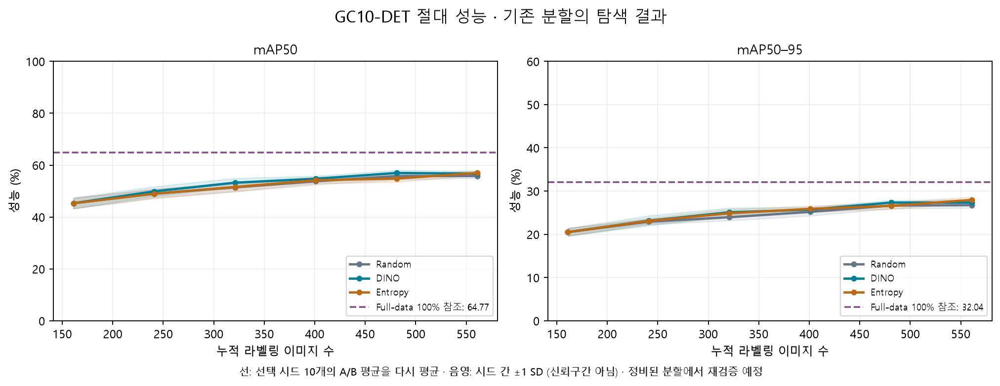
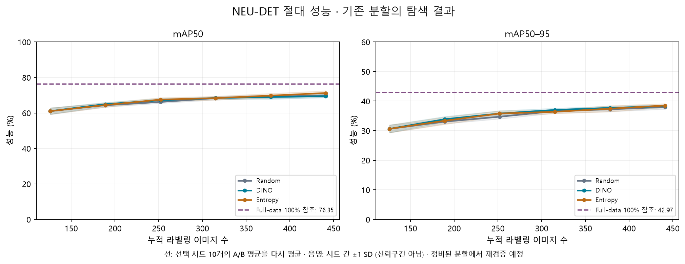
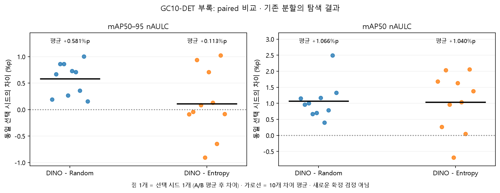
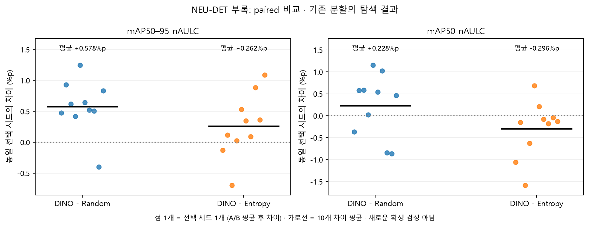

# 기존 성능의 재집계와 발표 배치

**이 문서의 모든 성능 수치는 기존 분할의 탐색 결과입니다. 새 평가·새 학습 결과가 아닙니다.**

## 1. 확인한 수치

Historical 440개, Entropy 200개, Full-data 4개에 해당하는 고유 cell ID 644개를 확인했습니다. Historical raw JSON 440개의 해시를 대조했습니다. 공유 R0를 세 방법에 붙이고 A/B를 평균한 360행은 기존 original-final 표와 오차 1e−12 미만으로 일치합니다.

R5는 각 선택 시드의 A/B 평균을 선택 시드 10개에서 평균했습니다. Full-data는 학습 A/B 두 번의 평균입니다.

| 데이터셋 | 방법 | mAP50 (%) | mAP50–95 (%) |
|---|---|---|---|
| GC10-DET | DINO R5 | 56.73 | 27.33 |
| GC10-DET | Entropy R5 | 57.00 | 27.96 |
| GC10-DET | Random R5 | 55.82 | 26.74 |
| NEU-DET | DINO R5 | 69.47 | 38.30 |
| NEU-DET | Entropy R5 | 71.23 | 38.50 |
| NEU-DET | Random R5 | 69.93 | 38.02 |
| GC10-DET | Full-data | 64.77 | 32.04 |
| NEU-DET | Full-data | 76.35 | 42.97 |

GC10 DINO R5 mAP50–95의 원자료 평균은 27.3346267959%입니다. 두 자리 반올림은 **27.33%**이며 이전 그림의 27.34와 마지막 자리 차이가 있습니다.

## 2. 본문: 절대 곡선부터 설명

각 곡선의 가로축은 누적 라벨링 이미지 수입니다. 선은 선택 시드 10개의 평균, 음영은 시드 간 ±1 표준편차입니다. 음영을 신뢰구간이라고 부르지 않습니다. Full-data 점선은 train 100%를 사용한 별도 참조이며 35% 예산 결과가 아닙니다.

**반례:** NEU R5에서 DINO−Random은 mAP50–95로 +0.274%p지만 mAP50으로 −0.455%p입니다. 지표를 바꾸면 항상 유리해지는 것이 아닙니다. 절대 성능·예산·지표를 함께 설명해야 합니다.

## 3. 부록: paired 차이

| 데이터셋 | 비교 | 평균 nAULC 차이 (%p) | 양의 차이 시드 / 10 |
|---|---|---|---|
| GC10-DET | DINO - Entropy | +0.113 | 5 |
| GC10-DET | DINO - Random | +0.581 | 10 |
| NEU-DET | DINO - Entropy | +0.262 | 8 |
| NEU-DET | DINO - Random | +0.578 | 9 |

한 점은 같은 선택 시드에서 A/B 평균 후 계산한 두 방법의 차이입니다. DINO−Random이 주 비교이고 DINO−Entropy는 보조 비교입니다. 양의 차이 시드 수만으로 우월성을 확정하지 않습니다. 이번에는 새로운 유의성 검정이나 p값을 추가하지 않았습니다.

## 4. 평균과 취약 클래스는 함께 보고

기존 NEU 결과에서 DINO−Random의 전체 mAP50–95 nAULC 차이는 **+0.578%p**, 최저 클래스 nAULC 차이는 **−1.488%p**, R5 최저 클래스 AP 차이는 **−3.118%p**입니다. 최저 클래스 두 지표는 선택 시드 10개 모두 음수입니다.

최저 클래스는 매 학습 실행·라운드에서 클래스별 AP50–95의 최솟값입니다. 고정된 클래스 하나의 AP로 바꾸지 않습니다. 각 학습 반복에서 최저 클래스 곡선을 만든 뒤 nAULC를 계산하고 A/B 평균 및 동일 선택 시드 차이를 구합니다. 이 하위 지표는 기존 표에서 보존한 값이며 이번 입력 진단의 학습 결과가 아닙니다.

출처: [secondary_subgroup.csv](../../../results/thesis_final/tables/secondary_subgroup.csv), [secondary_acquisition_effects.csv](../../../results/thesis_final/tables/secondary_acquisition_effects.csv).

## 5. 현재 설명 가능한 범위

- NEU의 분할 간 내용 중복으로 기존 성능을 독립 확정 결과로 쓰지 않습니다. GC10의 관련 플래그 범위도 별도 확인 대상입니다.
- 낮아 보이는 mAP의 원인을 지표 차이 하나로 단정하지 않습니다. 데이터 배포본·분할·입력 크기·모델·학습 조건이 같은 문헌인지 확인해야 합니다.
- Random+동일 YOLO는 내부 표본선택 기준선, Full-data+동일 YOLO는 전체 학습 참조, 문헌의 탐지 수치는 외부 참고입니다. 이번 실행에서 새 문헌 기준선을 재현하지 않았습니다.
- R0~R5 중 누락된 점을 보간하지 않았고 Full-data 2회를 선택 시드 10개로 복제하지 않았습니다.

원자료: [original_split_exploratory_completion_20260913](../../../results/original_split_exploratory_completion_20260913).
