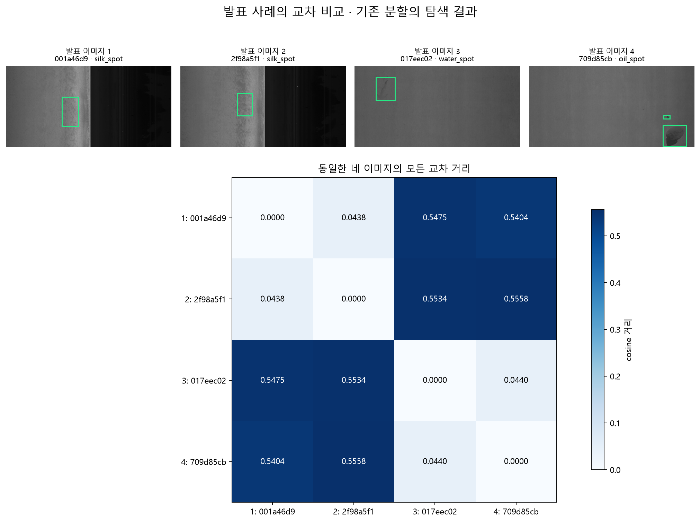
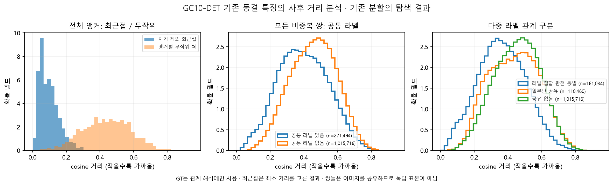
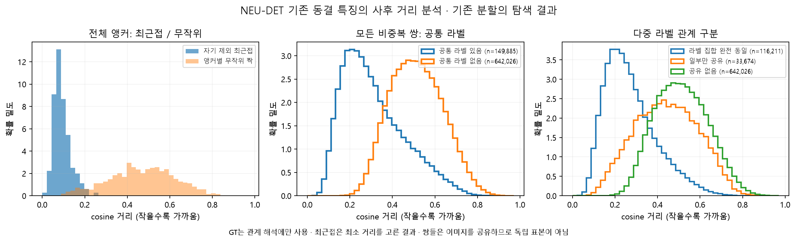
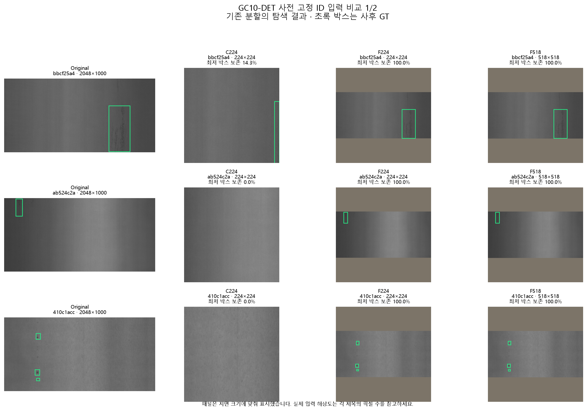
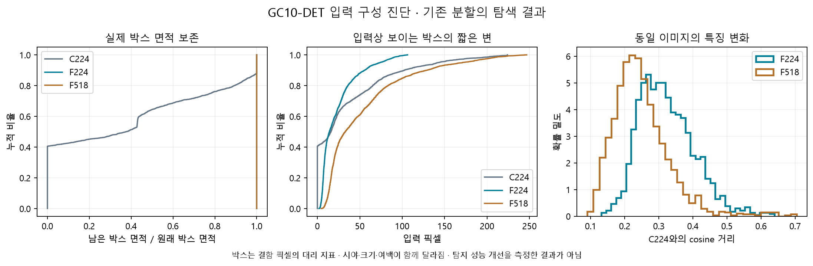
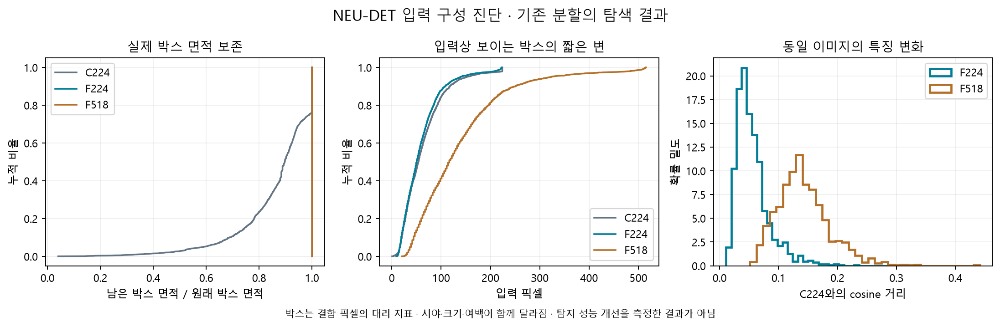
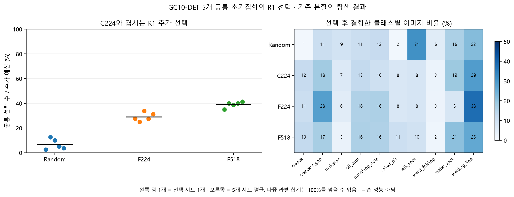
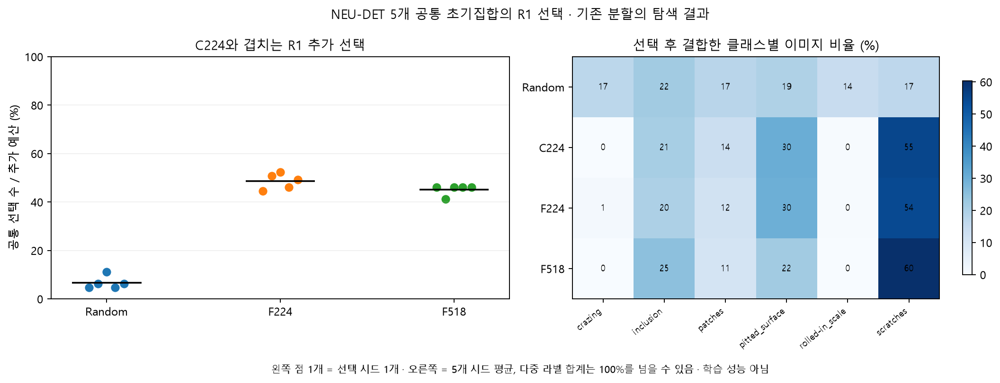

# 거리와 입력 구성 진단 결과

## 핵심 판단

**GC10에서 중앙 자르기로 결함 박스가 상당수 빠지고, 전체 영상을 입력하면 특징과 선택 결과가 달라짐을 확인했습니다. 다음 예비 학습 후보는 GC10의 F518 하나로 좁힙니다. 탐지 성능 향상은 아직 확인하지 않았습니다.**

아래는 기존 분할의 탐색 결과입니다. 오늘 랩미팅의 방법 설명·교차 거리·절대 성능 요구를 먼저 반영하고, 이후 입력 진단을 수행했습니다. 첨부 문서의 과거 학습 명령은 실행하지 않았습니다.

## 1. 실행과 재현 확인

- 원본 풀: GC10 1,605장(모두 2048×1000), NEU 1,259장(모두 200×200).
- 2,864장의 원본 파일·RGB 픽셀 ID·주석 해시, XML 이미지 크기, 박스 범위를 전수 확인했습니다.
- 중복 박스 2개는 사후 박스 통계에서 한 번씩만 세어 GC10 2,462개, NEU 2,952개를 분석했습니다. 원본 주석은 수정하지 않았습니다.
- GC10의 비표준 클래스명 `d` 1건은 기존 adapter와 같은 폴더 번호 규칙으로 welding_line에 연결했습니다.
- 원본 XML은 xmax−xmin의 연속좌표로 분석했습니다. 기존 YOLO 변환은 경계를 width−1/height−1로 제한하여 박스 787개의 좌표가 최대 1픽셀 줄어듭니다. 현재 존재하는 YOLO 라벨 파일 1,002개는 기존 변환 결과와 완전히 일치했습니다. 나머지 1,862개는 해당 캐시 경로에 materialize되어 있지 않으며 원본 XML은 모두 검증했습니다.
- 가중치·config·processor 파일 SHA-256을 고정 버전과 대조했습니다. 모델은 DINOv2-small의 동일 pooler 384차원, FP32, 정규화, batch 32입니다.
- C224는 데이터셋당 사전 고정 64장, 총 128장을 재추출했습니다. **최대 특징 성분 오차 0, processor 입력 픽셀 오차 0**입니다. 허용 기준은 분석 전에 고정했습니다.
- 진단 그림을 처음 PIL bicubic으로 재구성했을 때 미세한 차이가 났습니다. 설치된 processor의 실제 구현인 torchvision uint8 bicubic+antialias에 맞춘 뒤 오차가 0이 됐습니다. 대안 입력은 수정된 구현으로만 추출했습니다. 실패 로그도 보존했습니다.
- F224/F518은 두 풀 전체에서 새로 추출했습니다. C224 전체 캐시는 위 재현 통과 후 재사용했습니다. C224 전체 2,864장을 다시 추출한 것은 아닙니다.

## 2. 교수님이 요청한 교차 거리

발표의 네 이미지 ID를 유지했습니다. 기존 두 쌍의 거리 **0.0438 / 0.0440**이 재현됐고, 두 쌍을 가로지르는 거리는 **0.5404~0.5558**입니다. 첫 쌍은 공통 라벨이 있고, 두 번째 쌍은 없으므로 작은 거리만으로 라벨 일치를 보장할 수 없습니다.

| 데이터셋 | 최근접 공통 라벨 (%) | 무작위 짝 공통 라벨 (%) | 전체 쌍 공통 라벨 (%) | 최근접 거리 중앙값 | 무작위 거리 중앙값 |
|---|---|---|---|---|---|
| GC10-DET | 81.25 | 21.06 | 21.09 | 0.0870 | 0.4432 |
| NEU-DET | 99.21 | 20.10 | 18.93 | 0.0850 | 0.4722 |

최근접 분석은 각 이미지에서 자기 자신을 제외했습니다. 무작위 짝은 사전 고정 PCG64 seed 20260915로 각 앵커에 상대를 한 번 추출했습니다. **이 무작위 짝 수치는 이전 발표의 라벨 섞기 기준 21.07% / 18.96%와 다른 분석**입니다. 숫자를 서로 바꿔 쓰지 않습니다. 전체 비중복 쌍의 라벨 공유율은 무작위 상대의 정확한 기대값을 제공합니다.

GC10의 모든 비중복 쌍 1,287,210개, NEU 791,911개를 분석했습니다. 공통 라벨 있음/없음과 라벨 집합 완전 동일/일부 공유를 구분했습니다. 원본 배열은 압축 NPZ, 최근접·무작위 짝은 CSV로 저장했습니다.

**해석:** 결함 라벨과 관련된 이웃 구조는 보입니다. 그러나 두 관계의 거리 분포가 겹치고, 이미지들이 여러 쌍에 반복 등장하므로 쌍 수를 독립 표본 수로 쓸 수 없습니다. 내용 중복·배경·다중 라벨 빈도도 영향을 줄 수 있습니다. 높은 최근접 공유율은 모든 결함이 입력에 보존됐거나 탐지 학습에 유리하다는 증거가 아닙니다.

추가 실제 사례는 데이터셋별 `SHA256(representative-v1|ID)` 순서의 첫 6개를 분석 전에 고정했습니다. 최근접 짝을 붙인 뒤 사례를 교체하지 않았습니다. 별도로 ‘가장 가까운 비공유 쌍’과 ‘가장 먼 공유 쌍’을 극단값 진단 사례로 표시했습니다. 이 두 반례는 대표 표본이라고 부르지 않습니다.

실제 사례: [GC10-DET_사전고정_실제사례.png](../figures/GC10-DET_사전고정_실제사례.png), [NEU-DET_사전고정_실제사례.png](../figures/NEU-DET_사전고정_실제사례.png).
반례: [GC10-DET_진단반례.png](../figures/GC10-DET_진단반례.png), [NEU-DET_진단반례.png](../figures/NEU-DET_진단반례.png).

## 3. 실제 입력과 박스 보존

| 방식 | 실제 구성 |
|---|---|
| C224 | 짧은 변 256, 중앙 224×224. GC10은 524×256으로 변환 후 자름 |
| F224 | 긴 변 224, half-up 정수 크기, 종횡비 보존, 중앙 배치. GC10 영상 부분 224×109 |
| F518 | 긴 변 518, 같은 규칙. GC10 영상 부분 518×253 |

F 입력의 여백 색은 RGB (124,116,104)입니다. 홀수 여백은 오른쪽/아래에 1픽셀 더 둡니다. resize/crop을 두 번 적용하지 않았고 정규화와 모델 가중치는 동일합니다. F518의 추가 토큰/위치 임베딩 처리는 설치된 동일 모델의 기본 구현을 사용했습니다.

| 데이터셋 | 입력 | 완전히 빠진 박스 (%) | 절반 미만 남은 박스 (%) | 손실 박스가 있는 이미지 (%) | 잘림 전 박스 √면적 중앙값 (px) |
|---|---|---|---|---|---|
| GC10-DET | C224 | 40.54 | 64.42 | 64.74 | 69.64 |
| GC10-DET | F224 | 0.00 | 0.00 | 0.00 | 29.71 |
| GC10-DET | F518 | 0.00 | 0.00 | 0.00 | 68.83 |
| NEU-DET | C224 | 0.00 | 2.78 | 5.48 | 87.31 |
| NEU-DET | F224 | 0.00 | 0.00 | 0.00 | 76.40 |
| NEU-DET | F518 | 0.00 | 0.00 | 0.00 | 176.67 |

‘손실 박스가 있는 이미지’는 박스 하나 이상이 절반 미만 남는 이미지입니다. ‘잘림 전 √면적’은 resize 후 crop 직전의 박스 면적에 제곱근을 취한 크기 대리값으로, 실제 결함 픽셀이나 보이는 부분의 크기와 다릅니다.

GC10에서는 C224의 박스 998/2,462개가 완전히 입력 밖으로 빠졌습니다. 특히 punching_hole 박스 230개는 모두 입력 밖에 있었습니다. 이 때문에 **이웃 라벨은 잘 맞는데 특정 결함 박스는 보지 못하는 상황이 함께 가능**합니다. 이것만으로 해당 클래스의 탐지 성능 하락 원인을 확정하지는 않습니다.

F224와 F518은 모든 박스를 기하학적으로 보존합니다. 그러나 F224의 GC10 박스 √면적은 잘림 전 C224의 약 42.7%, F518은 약 98.8%입니다. F224는 더 작은 결함 표현이라는 반대 효과를 갖습니다. NEU에서 F518은 약 202.3%로 확대하므로 ‘기존과 비슷한 크기’ 설명은 GC10에만 적용됩니다.

기하학적 박스 100% 보존은 resize 후 작은 결함의 세부 질감까지 보존됐다는 뜻이 아닙니다. 시야·크기·여백을 함께 바꾸었기 때문에 순수한 crop 효과만 분리한 인과실험도 아닙니다.

## 4. 특징과 R1 선택 변화

모든 방법은 선택 시드 **2026091501~2026091505**에서 동일 R0를 공유합니다. GC10은 초기 161장+추가 80장, NEU는 초기 126장+추가 63장입니다. 원래 풀의 10%·5%를 half-up 반올림했습니다. 기존 protocol_core의 RNG namespace·목적별 스트림을 그대로 사용했습니다.

선택 프로세스는 불투명 ID·특징·현재 집합만 읽습니다. **40개 R1 선택(2 데이터셋×5 시드×4 방법)의 ID·순서를 저장하고 해시를 봉인한 뒤** 클래스·박스를 결합했습니다. DINO 계열 30개 경로는 별도 FP64 행렬 계산으로 전체 순서를 다시 검증해 모두 일치했습니다.

| 데이터셋 | 비교 | C224와 공통 선택 평균 (%) | 시드 최솟값 (%) | 시드 최댓값 (%) |
|---|---|---|---|---|
| GC10-DET | F224 vs C224 | 29.00 | 25.00 | 33.75 |
| GC10-DET | F518 vs C224 | 39.00 | 35.00 | 41.25 |
| NEU-DET | F224 vs C224 | 48.57 | 44.44 | 52.38 |
| NEU-DET | F518 vs C224 | 45.08 | 41.27 | 46.03 |

GC10에서 F518은 C224와 추가 선택의 평균 39%를 공유하여 61%가 달라졌습니다. 이는 추가 query만 비교한 수치이며 공통 R0까지 넣은 누적 집합의 비율과 다릅니다. Jaccard는 별도 CSV에 있습니다.

GC10의 C224→F224 / F518 평균 cosine 이동은 0.322 / 0.248, 최근접 ID 변경 비율은 85.48% / 80.62%입니다. NEU 평균 이동은 0.056 / 0.142입니다. GC10의 crop 손실과 특징 이동 간 Spearman 상관은 F224 0.110, F518 0.233으로 약합니다. **crop 손실 하나가 특징 변화를 전부 설명한다고 말할 수 없습니다.**

클래스별 신규/누적 선택 구성과 새로 들어온/제외된 모든 ID를 저장했습니다. 입력을 바꿔도 클래스별 선택량이 모두 같은 방향으로 개선되는 것은 아닙니다. 선택량 변화는 클래스별 AP 개선과 다릅니다. 각 특징 공간의 farthest-first 점수 절댓값도 서로 다른 입력 방식 간 성능 점수처럼 비교하지 않습니다.

## 5. 실제 비용과 제한

| 데이터셋 | 입력 | 추출 시간 (초) | 최대 allocated GPU (GiB) |
|---|---|---|---|
| GC10-DET | F224 | 25.56 | 0.30 |
| GC10-DET | F518 | 45.93 | 1.09 |
| NEU-DET | F224 | 3.53 | 0.30 |
| NEU-DET | F518 | 21.61 | 1.09 |

같은 RTX 3070, FP32, batch 32에서 측정한 관측 실행 시간입니다. 일부 CPU 그림 생성과 동시에 진행했으므로 통제된 속도 벤치마크로 쓰지 않습니다. 최대 reserved 메모리에는 이전 arm의 allocator 캐시가 남을 수 있습니다. 선택 시간도 arm·seed별 CSV로 보존했습니다.

원본 캐시 A/B의 파일 해시는 작업 후에도 유지됐습니다. 새로운 파일은 이번 output 폴더에만 기록했습니다. 저장소 checkout이나 기존 미커밋 변경을 수정하지 않았습니다.

**요청 범위에서 실패하여 남은 단계는 없습니다.** 제한은 C224 재추출이 표본 128장이라는 점, 기존 분할을 사용한 탐색 진단이라는 점, YOLO 성능을 측정하지 않았다는 점입니다. 원본 전체 학습·YOLO 재학습·Runpod·유료 GPU·AnomalyDINO 실행·분할 변경은 수행하지 않았습니다.

## 6. 다음 후보 하나와 예비 학습 조건

**GC10의 F518을 다음 후보로 제안합니다.** F224도 전체 박스를 보존하지만, GC10에서는 결함 크기를 크게 줄입니다. F518은 기존과 가까운 박스 크기에서 주변부를 포함하고, 로컬 자원 안에서 추출이 완료됐습니다. 이 판단은 진단 뒤 내린 후보 선택이며 사전에 정한 성공 결과 또는 새 알고리즘의 기여가 아닙니다.

| 항목 | 다음에 고정할 비교 조건 |
|---|---|
| 데이터 | 원본·파생본을 그룹으로 묶어 분할을 먼저 정비한 GC10 학습/개발 집합. 새 분할의 실제 N으로 예산 재계산 |
| 방법 | Random / 기존 C224 / 후보 F518 |
| 선택 | 시드 2026091501, 공통 무작위 R0 10%, R1 추가 5%, half-up. 정비된 풀에서 다시 선택하고 봉인 |
| 학습 | 모든 arm 같은 YOLOv8n checkpoint, 학습 시드 2026091503, 100 epochs, 640, batch 8, SGD, 같은 lr·증강·AMP·workers. R0/R1 모두 같은 가중치에서 cold start |
| 학습 수 | 공통 R0 1회 + 각 방법 R1 3회 = 4회. 이번에는 실행하지 않음 |
| 주 비교 | 개발 집합 R1 mAP50–95의 F518−C224. 다음으로 F518−Random |
| 함께 볼 것 | mAP50, 전체 클래스 AP, 매 실행 최저 클래스 AP, 고정 conf=0.25의 전체 일대일 매칭 후 손실/보존 박스별 recall, 전체 FP/이미지 |
| 평가 규칙 | AP용 conf=0.001, IoU=0.70, max_det=300 등 공통 설정 고정. 검증 best 선택 규칙도 동일 |
| 반복 판단 | 단일 반복은 작동·방향 확인용. 시드 교체 금지. 효과와 부작용을 함께 보고 더 많은 반복 여부 결정 |

현재 생성한 선택 ID는 기존 풀의 진단 결과입니다. 분할을 정비한 뒤의 학습 목록에 그대로 재사용하지 않습니다. 이미 열람한 데이터를 다시 나눴다고 미열람 최종 평가집합이라고 부르지도 않습니다. 입력 변경 또는 AnomalyDINO 자체를 논문 기여로 확정하지 않습니다.
